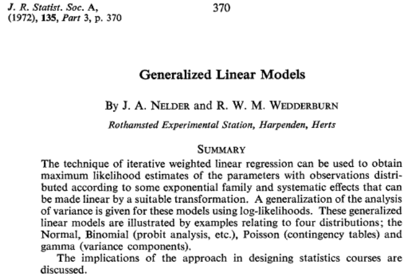
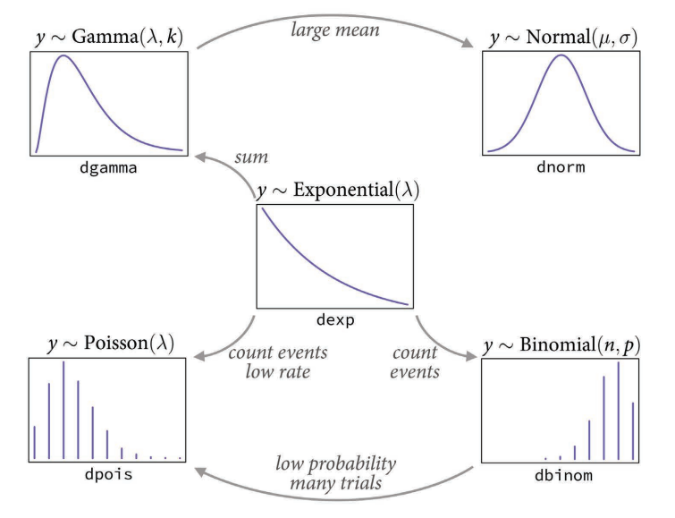

```{r setup, include=FALSE, warning=FALSE}
options(htmltools.dir.version = FALSE)
options(servr.daemon = TRUE)#para que não bloqueie a sessão
knitr::opts_chunk$set(prompt = TRUE, comment = "", eval = TRUE, echo = FALSE, warning = FALSE, message = FALSE,
                      out.width="85%",
                      ## Figuras: mesma largura em todos os chunks (texto com tamanho consistente),
                      ## alta resolução, e fundo transparente para herdar a cor dos slides
                      fig.width = 8, fig.asp = 0.618,
                      dpi = 300, fig.retina = 1,
                      dev.args = list(bg = "transparent"),
                      ## parâmetros gráficos dos gráficos base (hook abaixo)
                      par = TRUE)
## Parâmetros gráficos aplicados antes de cada chunk (gráficos base do R),
## com as cores do tema solarized
knitr::knit_hooks$set(par = function(before, options, envir) {
    if (before && isTRUE(options$par))
        par(lwd = 2, cex.lab = 1.5, cex.axis = 1.5, las = 1,
            mar = c(5, 5.5, 2, 2), mgp = c(4, 1, 0), bty = "l",
            fg = "#586e75", col.axis = "#657b83", col.lab = "#586e75")
})
library(xaringanthemer)
library(dplyr)
library(ggplot2)
library(ggthemes)
library(knitr)
library(kableExtra)
library(MASS)
library(rethinking)
```

```{r xaringan-themer, include=FALSE}
style_solarized_light(
  title_slide_background_color = "#586e75",# base 3
  header_color = "#586e75",
  text_bold_color = "#cb4b16",
  background_color = "#fdf6e3", # base 3
  header_font_google = google_font("DM Sans"),
  text_font_google = google_font("Roboto Condensed", "300", "300i"),
  code_font_google = google_font("Fira Mono"), text_font_size = "24px",
  code_font_size="1rem",
  extra_css = list(
      ".pull-left > :first-child, .pull-right > :first-child" = list("margin-top" = "0")
  )
)
xaringanExtra::use_share_again()
xaringanExtra::use_fit_screen()
xaringanExtra::use_tachyons()
xaringanExtra::use_tile_view()

## clipboard
htmltools::tagList(
  xaringanExtra::use_clipboard(
    button_text = "Copiar código <i class=\"fa fa-clipboard\"></i>",
    success_text = "Copiado! <i class=\"fa fa-check\" style=\"color: #90BE6D\"></i>",
    error_text = "Não copiado 😕 <i class=\"fa fa-times-circle\" style=\"color: #F94144\"></i>"
  ),
  rmarkdown::html_dependency_font_awesome()
)
## ggplot theme
theme_Publication <- function(base_size=14, base_family="helvetica") {
    (theme_foundation(base_size=base_size, base_family=base_family)
        + theme(plot.title = element_text(face = "bold",
                                          size = rel(1.2), hjust = 0.5),
                text = element_text(colour="#586e75"), # solarized base01
                panel.background = element_rect(fill = "transparent", colour = NA),
                plot.background = element_rect(fill = "transparent", colour = NA),
                legend.background = element_rect(fill = "transparent", colour = NA),
                panel.border = element_rect(colour = NA),
                axis.title = element_text(face = "bold",size = rel(1)),
                axis.title.y = element_text(angle=90,vjust =2),
                axis.title.x = element_text(vjust = -0.2),
                axis.text = element_text(colour="#657b83"), # solarized base00
                axis.line = element_line(colour="#586e75"), # solarized base01
                axis.ticks = element_line(colour="#586e75"),
                panel.grid.major = element_line(colour="#eee8d5"), # solarized base2
                panel.grid.minor = element_blank(),
                legend.key = element_rect(fill = "transparent", colour = NA),
                legend.position = "bottom",
                legend.direction = "horizontal",
                legend.key.size= unit(0.2, "cm"),
                legend.spacing = unit(0.2, "cm"),
                legend.title = element_text(face="italic"),
                plot.margin=unit(c(10,5,5,5),"mm"),
                strip.background=element_rect(colour="#eee8d5",fill="#eee8d5"), # solarized base2
                strip.text = element_text(face="bold", colour="#586e75")
                ))
}
```

```{r funcoes-acessorias-discretas}
## Gráfico de barras das probabilidades de uma distribuição discreta
plot_prob <- function(x, p, titulo, xlab = "x", cor = "#268bd2") {
    ggplot(data.frame(x = x, p = p), aes(x, p)) +
        geom_col(fill = cor, width = 0.7) +
        labs(title = titulo, x = xlab, y = "Probabilidade") +
        theme_Publication(18)
}
## Gráfico de barras lado a lado: proporções observadas x previstas por um modelo
plot_obs_prev <- function(x, obs, prev, nome.modelo, titulo, xlab, ylab) {
    df <- data.frame(x = factor(rep(x, 2), levels = x),
                     p = c(obs, prev),
                     fonte = factor(rep(c("Observado", nome.modelo), each = length(x)),
                                    levels = c("Observado", nome.modelo)))
    ggplot(df, aes(x, p, fill = fonte)) +
        geom_col(position = position_dodge(width = 0.8), width = 0.75) +
        scale_fill_manual(values = c("#268bd2", "#93a1a1"), name = NULL) +
        labs(title = titulo, x = xlab, y = ylab) +
        theme_Publication(18) +
        theme(legend.key.size = unit(0.5, "cm"))
}
```

```{r dados-seeds}
## Dados simulados: sobrevivência de sementes
set.seed(42)
dist <- rep(c(0,0.5,1,2,4,10,20,50),each=3)
p.esp <- exp(-3+0.05*dist)/(1+exp(-3+0.05*dist))
nobs <- rbinom(24,size=100,prob=p.esp)
pred.seed <-
    data.frame(distancia=dist, nsobrev=nobs) |>
    mutate(distc = distancia - mean(distancia))
```

```{r aves-data}
## Dados simulados: capturas de aves
set.seed(42)
area <- round(runif(20,50,800))
ncap <- rpois(20,lambda=exp(-5+1*log(area)))
aves <- data.frame(area=area,larea=log(area),ncap=ncap)
aves$lareac <- aves$larea-mean(aves$larea)
```

## Objetivos da aula

.f3[
* Generalizar o conceito de modelos lineares para outras distribuições de probabilidades;
]

--

.f3[
* Exemplificar essa generalização com modelos Poisson e binomial;
]

--

.f3[
* Mostrar os comandos básicos no R para ajustar e avaliar esses modelos;
]

--

.f3[
* Mostrar que alguns deles pertencem à classe dos modelos lineares generalizados (GLMs);
]


---

## Onde estamos

Até agora vimos modelos Gaussianos lineares. Ou seja que têm em sua função de verossimilhança:

$$\begin{align}
Y & \sim \text{Normal}(\mu=a_0+a_1X_1, \, \sigma=b_0)  \\[0.5em] 
Y & \sim \text{Normal} \left( \mu=a_0+a_1X_1+a_2X_2, \, \sigma=e^{b_0+b_1X_1} \right)  \\ 
& \cdots
\end{align}$$

---

## Para onde vamos

Hoje veremos modelos com verossimilhanças não Gaussianas com preditoras, como:

--

* Modelos binomiais:

$$Y \, \sim \, \text{Bin}(N=n, \, p= g(X_i))$$

--

* Modelos Poisson:

$$Y \, \sim \, \text{Pois}(\lambda= g(X_i))$$

---

## Ou seja

.bg-washed-blue.b--navy.ba.bw2.br3.shadow-5.ph4.mt1[
**Uma expressão geral modelos estatísticos**

$$
\begin{aligned}
Y\, &\sim \, f(Y \mid \Theta=g(X_i))\\[0.5em]
\theta_j &\sim h_j(\theta_j)
\end{aligned}
$$
]

--

.bg-washed-blue.b--navy.ba.bw2.br3.shadow-5.ph4.mt1[
**Em palavras**

* $Y$ é uma variável aleatória, cujos valores têm probabilidades
definidas pela função de densidade $f(Y)$, cujos parâmetros
$\Theta$ são uma função qualquer $g$ de outras medidas
(preditoras) $X_i$. 

* Cada um dos parâmetros do conjunto $\Theta$ tem uma distribuição a priori $h_j(\theta_j)$
]

---
class: inverse, middle, center

# Distribuições de probabilidade discretas

---

## Distribuição Bernoulli

.bg-washed-blue.b--navy.ba.bw2.br3.shadow-5.ph4.mt1[

* *Bernoulli* é a distribuição de probabilidades mais simples dentre as
  variáveis discretas.

* Mais que uma distribuição, é interessante vê-la como um ensaio com
  resultado estocástico.

* A partir desse ensaio aleatório, podem-se conceituar diversas
  distribuições de probabilidades de variáveis discretas.
]

--

.bg-washed-blue.b--navy.ba.bw2.br3.shadow-5.ph4.mt1[
**Variável binária**

* Dois resultados possíveis:
  * *fracasso* ( $X=0$ ): o evento não ocorre;
  * *sucesso* ( $X=1$ ): o evento ocorre.

* Parâmetro: a probabilidade de sucesso ( $p$ ).
]

---

## Distribuição Bernoulli: apresentação formal

### Função de densidade

$$f(x) = p^x (1 - p)^{1 - x}, \qquad x=0, 1$$

--

### Resultados

* Fracasso: $f(0) = P(X=0) = 1-p$
* Sucesso: $f(1) = P(X=1) = p$

--

### Momentos

* Esperança: $E[X] = p$
* Variância: $\text{Var}[X] = p\,(1-p)$


---

## Distribuição binomial

.bg-washed-blue.b--navy.ba.bw2.br3.shadow-5.ph4.mt1[
**Situação**

* Uma série de $n$ *ensaios Bernoulli independentes*
* Parâmetro tamanho da série: $n$
* Parâmetro probabilidade de sucesso *constante*: $p$
* Distribuição de máxima entropia para variáveis que são contagens até um valor máximo possível.
]

--

.bg-washed-blue.b--navy.ba.bw2.br3.shadow-5.ph4.mt1[
**Variável**

* $X =$ o número de sucessos nos $n$ ensaios
* Espaço amostral: $x = 0, 1, 2, \ldots, n$
]

--

**Exemplos:** nº de caras em 10 lançamentos de moeda; nº de fêmeas
em ninhadas  de 5 filhotes; nº de cobaias mortas em bioensaio
(dose-resposta).

---

## Gráfico: distribuição binomial

.center[
```{r binom1, out.width = "80%"}
plot_prob(0:20, dbinom(0:20, size = 20, prob = 0.1),
          titulo = "N = 20, p = 0,1", xlab = "Número de sucessos")
```
]

---

## Gráfico: distribuição binomial

.center[
```{r binom2, out.width = "80%"}
plot_prob(0:20, dbinom(0:20, size = 20, prob = 0.5),
          titulo = "N = 20, p = 0,5", xlab = "Número de sucessos")
```
]

---

## Gráfico: distribuição binomial

.center[
```{r binom3, out.width = "80%"}
plot_prob(0:20, dbinom(0:20, size = 20, prob = 0.9),
          titulo = "N = 20, p = 0,9", xlab = "Número de sucessos")
```
]

---

## Distribuição binomial: apresentação formal
### Função de densidade

$$f(x) = \frac{n!}{x!(n-x)!} p^x (1 - p)^{n - x}, \qquad x=0, 1,2,\ldots,n$$

### Parâmetros

* $n$: Tamanho da amostra (número de ensaios);
* $p$: Probabilidade de sucesso em cada ensaio.


--

### Momentos

* Esperança: $E[X] = n\,p$
* Variância: $\text{Var}[X] = n\,p\,(1-p)$
]

---

## Exemplo de distribuição binomial

6.115 famílias de 12 filhos na Saxônia: nº de filhos atribuídos ao
gênero masculino ao nascer (Geissler 1889, *apud* Lindsey (2004)):

.center[
```{r saxonia, out.width = "75%"}
## Exemplo Lindsey p. 171: filhos de gênero masculino em 6115 famílias de 12 filhos
x <- 0:12
y <- c(3, 24, 104, 286, 670, 1033, 1343, 1112, 829, 478, 181, 45, 7)
plot_obs_prev(x, obs = y/sum(y), prev = dbinom(x, size = 12, prob = 0.5),
              nome.modelo = "Binomial", titulo = "N = 12, p = 0,5",
              xlab = "Nº de filhos atribuídos ao gênero masculino",
              ylab = "Proporção das famílias")
```
]

---

## Distribuição Poisson

.bg-washed-blue.b--navy.ba.bw2.br3.shadow-5.ph4.mt1[
**Situação**

* Contagem de eventos independentes.
* A contagem é *por unidade* de tempo e/ou espaço.
* Os eventos ocorrem a uma taxa constante por unidade ($\lambda$).
* Distribuição de máxima entropia para contagens sem limite máximo pré-definido
]

--

.bg-washed-blue.b--navy.ba.bw2.br3.shadow-5.ph4.mt1[
**Variável**

* $X =$ o número de eventos em cada unidade.
* Espaço amostral: $x = 0, 1, 2, \ldots$
]

--

**Exemplos:** nº de árvores por parcela; nº de capturas por unidade de
tempo; número de casos por 100 mil habitantes.

---

## Gráfico: distribuição Poisson

.center[
```{r pois1, out.width = "80%"}
plot_prob(0:15, dpois(0:15, lambda = 1),
          titulo = expression(lambda == 1), xlab = "Número de eventos")
```
]

---

## Gráfico: distribuição Poisson

.center[
```{r pois2, out.width = "80%"}
plot_prob(0:15, dpois(0:15, lambda = 3),
          titulo = expression(lambda == 3), xlab = "Número de eventos")
```
]

---

## Gráfico: distribuição Poisson

.center[
```{r pois3, out.width = "80%"}
plot_prob(0:15, dpois(0:15, lambda = 6),
          titulo = expression(lambda == 6), xlab = "Número de eventos")
```
]

---

## Distribuição Poisson: apresentação formal

### Função de densidade

$$f(x) = \frac{\lambda^x\, e^{-\lambda}}{x!}, \qquad x=0, 1, 2, \ldots$$

### Parâmetro

$\lambda$: taxa de ocorrência por unidade de observação

--

### Momentos

* Esperança: $E[X] = \lambda$
* Variância: $\text{Var}[X] = \lambda$
* Parâmetro $\lambda$ = esperança = variância

---

## Exemplo de distribuição Poisson

Distribuição de bombas V1 lançadas em Londres na II Guerra:

$$\lambda~=~\frac{535 ~\text{bombas}}{576 ~\text{quadriculas}} ~  \simeq ~ 0{,}929/ \text{quadricula}$$

.center[
```{r V1bombs, out.width = "25%"}

```
]

---

## Exemplo de distribuição Poisson

Distribuição dos locais de impacto de bombas V1 lançadas em 1944 no sul de Londres:

.center[
```{r london, out.width = "65%"}
## Bombas V1 no sul de Londres (Clarke 1946)
y <- c(229, 211, 93, 35, 7, 1, 0)
plot_obs_prev(0:6, obs = y/sum(y), prev = dpois(0:6, lambda = 535/576),
              nome.modelo = "Poisson", titulo = expression(lambda == 535/576),
              xlab = "Nº de bombas", ylab = "Proporção das quadrículas")
```
]
.right[[Clarke 1946](https://www.cambridge.org/core/journals/journal-of-the-institute-of-actuaries/article/abs/an-application-of-the-poisson-distribution/F75111847FDA534103BD4941BD96A78E)]

---

## Caso limite

A Poisson é um caso limite da distribuição binomial.

.center[
```{r poisbin1, out.width = "65%"}
## Só a Poisson, lambda = 1
plot_prob(0:7, dpois(0:7, lambda = 1),
          titulo = expression(paste("Poisson, ", lambda == 1)),
          cor = "#cb4b16") +
    scale_x_continuous(breaks = 0:7)
```
]

---

## Caso limite

.pull-left[
A Poisson é um caso limite da distribuição binomial:

* quando o tamanho da amostra tende a infinito ( $n\rightarrow\infty$ ),
* a probabilidade de sucesso tende a zero ( $p\rightarrow 0$ ),
* mas o valor esperado permanece constante: $n\,p = \lambda$.
]

.pull-right[
```{r poisbin2, fig.width = 5, fig.asp = 1, out.width = "75%"}
## Binomial com N grande e p pequeno x Poisson de mesma média (lambda = N p = 1)
plot_obs_prev(0:7, obs = dbinom(0:7, size = 1000, prob = 0.001),
              prev = dpois(0:7, lambda = 1), nome.modelo = "Poisson",
              titulo = "Binomial x Poisson",
              xlab = "x", ylab = "Probabilidade") +
    scale_fill_manual(values = c("#268bd2", "#cb4b16"), name = NULL,
                      labels = c("Binomial, N = 1000, p = 0,001",
                                 expression(paste("Pois, ", lambda == 1))))
```
]

---

## Distribuições de probabilidade no R

.pull-left[
### Binomial

* `dbinom(x, size, prob, log = FALSE)`
* `pbinom(q, size, prob, lower.tail = TRUE, log.p = FALSE)`
* `qbinom(p, size, prob, lower.tail = TRUE, log.p = FALSE)`
* `rbinom(n, size, prob)`
]

.pull-right[
### Poisson

* `dpois(x, lambda, log = FALSE)`
* `ppois(q, lambda, lower.tail = TRUE, log.p = FALSE)`
* `qpois(p, lambda, lower.tail = TRUE, log.p = FALSE)`
* `rpois(n, lambda)`
]

<br>
.center[... e funções equivalentes para outras distribuições (`?Distributions`).]

---
class: inverse, middle, center

# Modelos com distribuição binomial

---

## Modelos binomiais

* Descrevem o número de ocorrências de uma variável binária em um certo número de tentativas,
  em função de variáveis preditoras contínuas ou discretas.

--

### Úteis principalmente quando temos:
  
  * Respostas binárias (regressão logística!)
  
  * Proporções

--

### Exemplos de respostas binomiais:
  
  * Presença de alguma espécie em manchas, fragmentos, sítios;
  
  * Ocorrência de morte, doença ou qualquer outro evento por indivíduo;
  
  * Proporção de frutos parasitados.

---

## Modelos binomiais: um exemplo

.pull-left[
### Sobrevivência de sementes colocadas a diferentes distâncias da árvore-mãe

* 8 distâncias, 3 réplicas de 100 sementes

* Resposta: número de sobreviventes após 60 dias ]

.pull-right[
```{r dados-gendata-seed, echo=FALSE}
rbind(head(pred.seed[,1:2]), tail(pred.seed[,1:2])) |> kable()
```
]
---

## Modelos binomiais: um exemplo

.center[
```{r grafico-seeds, fig.asp = 0.8, out.width = "50%"}

plot(I(nsobrev/100) ~ distancia, data=pred.seed, 
     xlab="Distância da árvore-mãe", ylab="Proporção sobrevivente")
```
]

---

## Modelo binomial: função logística

* A verossimilhança de nosso modelo é:

$$Y \, \sim \, \text{Bin}(N=100, \, p=g(\text{distancia}))$$

--

* Que função usar para o efeito da distância sobre $p$?

--

* Uma função sigmoide limitada entre zero e um, como:

$$p = \frac{e^{a_0+a_1\text{dist}}}{1 + e^{a_0+a_1\text{dist}}}$$

--

* O que implica que:

$$\ln\left(\frac{p}{1-p}\right)\, = \, a_0+a_1\text{dist}$$

---

## Modelo binomial: funções logística e *logito*

.pull-left[
.center[
$$p = \frac{e^{a+bX}}{1 + e^{a+bX}}$$

```{r logistica, fig.width = 5, fig.asp = 1, out.width = "75%"}
curve(exp(x)/(1+exp(x)), from = -6, to = 6,
      xlab = "X", ylab = "p")
```
]
]

.pull-right[
.center[
$$Y=\ln\left(\frac{p}{1-p}\right)$$

```{r logit-p, fig.width = 5, fig.asp = 1, out.width = "75%"}
curve(log((exp(x)/(1+exp(x))) / (1 - exp(x)/(1+exp(x)))),
      from = -6, to = 6,
      xlab = "X", ylab = "ln(p/(1-p))")
```
]
]

---

## Modelo binomial: ajuste Bayesiano no R

### Distribuições *a priori*

.pull-left[

 * Para modelos lineares, já vimos que distribuições *a priori*
achatadas podem expressar expectativas irrealistas ou mesmo
impossíveis de aocntecer. 

* Para preditores não lineares, distribuições *a priori* muito
  achatadas de parâmetros não resultam tipos de curva de resposta bem
  distribuídas. Ao contrário, podem expressar uma premissa de maior
  probabilidade de uma forma específica de resposta.

* Ao lado: 30 curvas logísticas geradas com 30 valores dos dois
parâmetros sorteados de uma normal com $\mu=0$ e $\sigma=10$ ]

.pull-right[ 
.center[
```{r logist-prior-prep,echo=FALSE}
logistica <- function(x,b0,b1)
    exp(b0+b1*x)/(1+exp(b0+b1*x))
n1 <- 30
b0 <- rnorm(n1, 0,10)
b1 <- rnorm(n1,0,10)
plot(0,0, xlim=c(-15,45), ylim=c(0,1), type = "n",
     xlab="Distância centrada da árvore-mãe", ylab="Proporção sobrevivente")
for(i in 1:length(b0)) curve(logistica(x, b0[i],b1[i]), add=TRUE, col="grey") 
```
]]


---

## Modelo binomial: ajuste Bayesiano no R

### Distribuições *a priori*

.pull-left[

```{r logist-prior, echo=FALSE}
set.seed(42)
n1 <- 30
b0 <- rnorm(n1, -1, 2)
b1 <- rnorm(n1, 0, 8/40)
plot(0, 0, xlim = c(-15, 45), ylim = c(-5, 5), type = "n",
     xlab = "Distância centrada da árvore-mãe",
     ylab = "Logito prop. sobrevivente",
     main = expression(list(beta[0] %~% Normal(mu == -1, sigma == 2),
                            beta[1] %~% Normal(mu == 0, sigma == 0.2))),
     cex.main = 1.3)
for(i in 1:n1)
    abline(b0[i],b1[i], col="grey")
abline(h=c(-5,5), lty=2)
axis(side=4, at=c(-5,5), labels = c("0.01", "0.99"))
```

]

.pull-right[]

---

## Modelo binomial: ajuste Bayesiano no R

### Distribuições *a priori*
.pull-left[
```{r logist-prior2, echo=FALSE}
plot(0, 0, xlim = c(-15, 45), ylim = c(-5, 5), type = "n",
     xlab = "Distância centrada da árvore-mãe",
     ylab = "Logito prop. sobrevivente",
     main = expression(list(beta[0] %~% Normal(mu == -1, sigma == 2),
                            beta[1] %~% Normal(mu == 0, sigma == 0.2))),
     cex.main = 1.3)
abline(h = c(-5, 5), lty = 2)
axis(side = 4, at = c(-5, 5), labels = c("0.01", "0.99"))
for(i in 1:n1)
    abline(b0[i], b1[i], col = "grey")
```
]

.pull-right[
```{r logist-prior3, echo=FALSE}
plot(0, 0, xlim = c(-15, 45), ylim = c(0, 1), type = "n",
     xlab = "Distância centrada da árvore-mãe",
     ylab = "Proporção sobrevivente",
     main = expression(list(beta[0] %~% Normal(mu == -1, sigma == 2),
                            beta[1] %~% Normal(mu == 0, sigma == 0.2))),
     cex.main = 1.3)
for(i in 1:length(b0))
    curve(logistica(x, b0[i], b1[i]), add = TRUE, col = "grey")
```
]
---

## Modelo binomial: ajuste Bayesiano no R

### Especificação do modelo

.pull-left[

$$\begin{aligned}
Y_i &\sim \textrm{Binomial}(N, p_i) \\[0.5em]
\ln \left(\frac{p_i}{1-p_i}\right) &= \beta_0 + \beta_1 \textrm{Dist}_i \\[0.5em]
N &= 100 \\[0.5em]
\beta_0 &\sim \textrm{Normal}(\mu = -1, \sigma = 2) \\[0.5em]
\beta_1 &\sim \textrm{Normal}(\mu = 0, \sigma = 0{,}2)
\end{aligned}$$
]

.pull-right[

```{r fit-binom, echo=TRUE, results='hide', message=FALSE, warning=FALSE}
mbin1.f <- alist(
    nsobrev ~ dbinom(100 , p),
    logit(p) <- b0 + b1*distc,
    b0 ~ dnorm(-1, 2),
    b1 ~ dnorm(0, 0.2)
    )
    
mbin1 <- ulam(mbin1.f,
               data = pred.seed,
               chains = 4,
               cores = 4)
```
]

---

## Modelo binomial: ajuste Bayesiano no R

### Coeficientes e seus intervalos

```{r seeds-coefs, echo=TRUE}
precis(mbin1)
```

---

## Modelo binomial: ajuste Bayesiano no R

### Posterior do preditor

.pull-left[
```{r seeds-predicted-plot-code, echo=TRUE, eval=FALSE}
mbin1.post <- extract.samples(mbin1)
plot(I(nsobrev/100) ~ distc, data=pred.seed, 
     xlab="Distância centrada da árvore-mãe", 
     ylab="Proporção sobrevivente", type="n")
for(i in 1:length(mbin1.post$b0))
    with(mbin1.post,
         curve(exp(b0[i] + b1[i]*x) /
               (1 + exp(b0[i] + b1[i]*x)),
                   add=TRUE, col="grey"))
```
]

.pull-right[
```{r , ref.label="seeds-predicted-plot-code", echo=FALSE, eval=TRUE}
```
]

---

## Modelo binomial: ajuste Bayesiano no R

### Posterior dos previstos

Crie uma tabela com os valores dos preditores para fazer previsões e passe à função `sim()`:

```{r seeds-predicted-values, echo=TRUE, eval=TRUE}
grade <- data.frame(distc=unique(pred.seed$distc))
mbin1.sim <- sim(mbin1, data = grade, n = 1000)
```

Objeto resultante: matriz de amostras de valores
previstos (linhas) para cada valor do preditor (colunas):

```{r , echo=TRUE}
head(mbin1.sim, 3)
dim(mbin1.sim)
```

---

## Modelo binomial: ajuste Bayesiano no R

### Posterior dos previstos

Com estas amostras, você pode calcular médias e intervalos de incerteza para cada valor previsto:

```{r }
## quantis de 95% de cada coluna
IC <- apply(mbin1.sim, 2, PI, prob = 0.95)
## Data frame com os quantis (IC a 95%) e média dos previstos
mbin1.pred <- data.frame(
    distc=grade$distc,
    media = colMeans(mbin1.sim)/100,
    inf   = IC[1, ]/100,
    sup   = IC[2, ]/100)
## Exibe o objeto
mbin1.pred
```

---

## Modelo binomial: ajuste Bayesiano no R

### Posterior dos previstos

.pull-left[
```{r plot-modelo-bin, echo=TRUE, eval =FALSE}
plot(I(nsobrev/100) ~ distc, data=pred.seed, 
     xlab="Distância centrada da árvore-mãe", 
     ylab="Proporção sobrevivente",
     ylim = c(min(mbin1.pred$inf),
              max(mbin1.pred$sup)))
points(media ~ distc, data = mbin1.pred,
       col="darkblue", pch = 19)
with(mbin1.pred,
     segments(x0 = distc, x1 = distc,
         y0 = inf, y1 = sup, lwd=1.5,
         col = "darkblue"))
```
]

.pull-right[

```{r , ref.label="plot-modelo-bin", echo=FALSE, eval=TRUE, fig.width=5, fig.asp=1, out.width="80%"}
```

]


---
class: inverse, middle, center

# Modelos Poisson

---

## Modelos Poisson

* Descrevem contagens de eventos independentes em função de variáveis preditoras contínuas ou discretas.

--

* Úteis principalmente quando temos:
  
  * contagens com médias baixas;
  
  * contagens com variância igual à média.

--

* Exemplos de respostas Poisson:
  
  * Número de capturas, avistamentos, registros por unidade de tempo ou espaço;
  
  * Taxas de ocorrência de eventos (*e.g.* fotos/hora, células/área, casos/pacientes).

---

## Modelos Poisson: um exemplo

.pull-left[
### Amostragem de aves em fragmentos de floresta

* Capturas de *Pyriglena leucoptera* em redes de neblina

* 20 fragmentos de diferentes tamanhos, 500 horas/rede

* Resposta: número de capturas

* Preditora: ln da área do fragmento em ha (a partir de agora, simplesmente "área"):
]

.pull-right[
```{r aves-data-summary, echo=FALSE}
rbind(head(aves)[,-4],tail(aves)[,-4]) |> kable() 
```
]
---

## Modelo Poisson: gráfico

.center[
```{r scatterplot-poisson, fig.asp = 0.8, out.width = "50%"}
plot(ncap~larea, data=aves,
     xlab="Ln área do fragmento (ha)",
     ylab="N de capturas")
```
]

---

## Modelos Poisson

* A verossimilhança de nosso modelo é:

$$Y_i \, \sim \, \text{Poisson} ( \lambda_i = g(\ln \text{area}_i) )$$

--

* Que função usar para o efeito do logaritmo da área sobre $\lambda$?

--

* Uma função monotônica positiva, como a exponencial:

$$\lambda_i\, = \, e^{\beta_0 ~+~ \beta_1 \ln \text{area}_i}$$

--

* O que implica que:

$$\ln(\lambda_i) \, = \, \beta_0 ~+~ \beta_1 \ln \text{area}_i$$

---

## Modelo Poisson: ajuste Bayesiano no R

### Distribuições *a priori*
.pull-left[
.center[
```{r poisson-prior1, echo=FALSE}
set.seed(42)
n1 <- 50
b0 <- rnorm(n1, 0, 3)
b1 <- rnorm(n1, 0, 3)
plot(1, 1,
     xlim = range(aves$lareac),
     ylim = c(0, max(exp(b0 + b1*max(aves$lareac)))),
     type = "n",
     xlab = "Ln área do fragmento centrado (ha)",
     ylab = "N de capturas",
     main = expression(list(beta[0] %~% Normal(mu == 0, sigma == 3),
                            beta[1] %~% Normal(mu == 0, sigma == 3))),
     cex.main = 1.3)
abline(h = max(aves$ncap), lty = 2)
for(i in 1:length(b0))
    curve(exp(b0[i] + b1[i]*x), add = TRUE,
          col = ifelse(b1[i] > 0, "blue", "red"))
```
]
]

.pull-right[
.center[
```{r poisson-prior2, echo=FALSE}
set.seed(42)
n1 <- 50
b0 <- rnorm(n1, 0, 1)
b1 <- rlnorm(n1, 0, 1)
plot(1, 1,
     xlim = range(aves$lareac),
     ylim = c(0, max(exp(b0 + b1*max(aves$lareac)))),
     type = "n",
     xlab = "Ln área do fragmento centrado (ha)",
     ylab = "N de capturas",
     main = expression(list(beta[0] %~% Normal(mu == 0, sigma == 1),
                            beta[1] %~% LogNormal(mu == 0, sigma == 1))),
     cex.main = 1.3)
abline(h = max(aves$ncap), lty = 2)
for(i in 1:length(b0))
    curve(exp(b0[i] + b1[i]*x), add = TRUE,
          col = ifelse(b1[i] > 0, "blue", "red"))
```
]
]
---

## Modelo Poisson: ajuste Bayesiano no R

### Especificação do modelo

.pull-left[

$$
\begin{aligned}
Y_i &\sim \textrm{Poisson}(\lambda) \\[0.5em]
\ln \lambda &= \beta_0 + \beta_1 \ln \textrm{area}_i \\[0.5em]
\beta_0 &\sim \textrm{Normal}(\mu = 0, \sigma = 1 ) \\[0.5em]
\beta_1 &\sim \textrm{LogNormal}(\mu = 0, \sigma = 1 ) 
\end{aligned}
$$

]

.pull-right[
```{r fit-pois, echo=TRUE, results='hide', message=FALSE, warning=FALSE}
mpois1.f <- alist(
    ncap ~ dpois(lambda),
    log(lambda) <- b0 + b1*lareac,
    b0 ~ dnorm(0, 1),
    b1 ~ dlnorm(0, 1)
    )
    
mpois1 <- ulam(mpois1.f,
               data = aves,
               chains = 4,
               cores = 4)
```
]

---
## Modelo Poisson: ajuste Bayesiano no R

### Coeficientes e seus intervalos

```{r aves-coefs, echo=TRUE}
precis(mpois1)
```

---

## Modelo Poisson: ajuste Bayesiano no R

### Posterior do preditor

.pull-left[

```{r aves-predicted-plot-code, echo=TRUE, eval=FALSE}
grade <- data.frame(
    lareac = seq(min(aves$lareac),
                max(aves$lareac),
                length=100))
mpois1.lp <- link(mpois1, data = grade)
plot(ncap~lareac, data=aves,
     xlab="Ln área do fragmento (ha)",
     ylab="N de capturas", type="n")
for(i in 1:nrow(mpois1.lp))
    lines(grade$lareac, mpois1.lp[i,],
          col="grey")
```
]

.pull-right[
```{r , ref.label="aves-predicted-plot-code", echo=FALSE, eval=TRUE, fig.width=5, fig.asp=1, out.width="80%"}
```
]

---

## Modelo Poisson: ajuste Bayesiano no R

### Posterior dos previstos

.pull-left[

```{r aves-prev-plot-code, echo=TRUE, eval=TRUE}
## Posterior dos previstos
mpois1.lpm <- apply(mpois1.lp,2,mean)
## quantis de cada Poisson
inf <- qpois(0.025, lambda= mpois1.lpm)
sup <- qpois(0.975, lambda= mpois1.lpm)
## IC e média
mpois1.pred <- data.frame(
    lareac=grade$lareac,
    media = mpois1.lpm,
    inf   = inf,
    sup   = sup)
```
]

.pull-right[

```{r , fig.width=5, fig.asp=1, out.width="80%", echo=FALSE, eval=TRUE}
plot(ncap ~ lareac, data=aves,
     xlab="Ln área do fragmento (ha)",
     ylab="N de capturas",
     ylim =c(0,max(mpois1.pred$sup)))
lines(media ~ lareac, col="darkblue", data = mpois1.pred)
lines(inf ~ lareac, lty=2, col="darkblue", data = mpois1.pred)
lines(sup ~ lareac, lty=2, col="darkblue", data = mpois1.pred)
```
]

---

## GLMs: exemplo Poisson

### Função `glm` no R

```{r glm-aves, echo=TRUE}
aves.glm1 <- glm(ncap ~ lareac, data = aves,
                 family=poisson)
coef(aves.glm1)
coef(mpois1)
```

---

## Modelos lineares generalizados (GLMs)

* Generalizam a lógica da regressão linear Gaussiana para algumas outras distribuições;

* Preservam várias propriedades dos modelos lineares Gaussianos;

* Abrangem vários modelos sob um conjunto único de soluções analíticas e de propriedades matemáticas;

* Ou seja, uma teoria unificada;

* Definiram a sintaxe de modelos do R e de várias outras linguagens computacionais.

---

## Modelos lineares generalizados (GLMs)

.center[
```{r nelder1972, out.width = "50%"}

```
]

---

## A família exponencial de distribuições

.center[
```{r familia-exp, out.width = "50%"}

```
]
.right[Figura 10.6 de McElreath (2016)]


---

## A função de ligação

* Os GLMs têm esse nome porque generalizam a ideia de estabelecer uma relação do valor esperado com
  uma combinação linear de covariáveis:

$$\eta(E[Y]) \, = \, \beta_0 + \beta_1X_1 + \ldots + \beta_iX_i \, = \,\sum_0^i \beta_iX_i$$


* A função $\eta$ estabelece essa relação. Ela é chamada de **função de ligação**.


* Na teoria de GLMs, há uma generalização dos métodos de mínimos
  quadrados para ajuste de modelos não-gaussianos e com funções de
  ligação.

---

## Consequências da função de ligação: coeficientes difíceis de interpretar

```{r derivadas-pois, include=FALSE}
post.p <- extract.samples(mpois1)

## Curva prevista (média da posterior)
x.grid <- seq(min(aves$lareac), 0.8, length.out = 100)
lam.grid <- sapply(x.grid, function(x) mean(exp(post.p$b0 + post.p$b1 * x)))

## Dois pontos da curva e a derivada d(lambda)/dx = b1 * lambda(x) em cada um
##x0 <- round(quantile(aves$lareac, c(0.2, 0.85)), 1)
x0 <- c(-0.7, 0.2)
deriv.p <- t(sapply(x0, function(x) {
    lam <- exp(post.p$b0 + post.p$b1 * x)
    d <- post.p$b1 * lam                 # posterior da derivada
    c(lam = mean(lam), d = mean(d), PI(d, prob = 0.95))
}))
h <- diff(range(aves$lareac)) / 8        # meia largura das tangentes
cores.tg <- c("#cb4b16", "#268bd2")
```

.pull-left[

```{r coef-pois, echo=FALSE}
tab.cf <- as.data.frame(precis(mpois1, prob = 0.95))[, c("mean", "2.5%", "97.5%")]
rownames(tab.cf) <- c("β₀", "β₁")
kable(tab.cf, digits = 3,
      col.names = c("Média", "2,5%", "97,5%"),
      format.args = list(decimal.mark = ","))
```

<br>

O efeito da área sobre o número esperado de capturas é a derivada:

$$\frac{d\lambda}{dx} = \beta_1 \, e^{\beta_0 + \beta_1 x} = \beta_1 \, \lambda(x)$$

O efeito de $x$ depende do próprio valor de $x$: é como se $x$
**interagisse consigo mesmo**.
]

.pull-right[

```{r tangentes-pois, echo=FALSE, fig.width=5, fig.asp=1, out.width="100%"}
plot(ncap ~ lareac, data = aves, col = "grey50",
     xlab = "Ln área do fragmento centrado (ha)",
     ylab = "N de capturas") 
lines(x.grid, lam.grid, lwd = 2)
for (k in 1:2) {
    xs <- x0[k] + c(-h, h)
    ys <- deriv.p[k, "lam"] + deriv.p[k, "d"] * (xs - x0[k])
    segments(xs[1], ys[1], xs[2], ys[2], col = cores.tg[k], lwd = 3)
    points(x0[k], deriv.p[k, "lam"], pch = 19, cex = 1.5, col = cores.tg[k])
}
legend("topleft", bty = "n", col = cores.tg, lwd = 3, pch = 19, cex = 1.1,
       title = "dλ/dx (capturas por unidade de ln área)",
       legend = sprintf("x = %.1f:  %.2f", x0, deriv.p[, "d"]))
```
]

---

## Na escala da função de ligação, o efeito é constante

.pull-left[

$$\ln \lambda = \beta_0 + \beta_1 x$$

$$\frac{d \ln \lambda}{dx} = \beta_1$$

* Na escala do preditor linear, o efeito de $x$ é o mesmo em qualquer
  ponto: $\beta_1 \approx$ `r sprintf("%.2f", mean(post.p$b1))`.

* As tangentes nos dois pontos coincidem com a própria reta.

* Na escala da resposta (número de capturas), o efeito depende de onde
  estamos na curva.
]

.pull-right[

```{r ligacao-pois, echo=FALSE, fig.width=5, fig.asp=1, out.width="100%"}
eta.grid <- mean(post.p$b0) + mean(post.p$b1) * x.grid
eta.x0   <- mean(post.p$b0) + mean(post.p$b1) * x0
plot(log(ncap) ~ lareac, data = subset(aves, ncap > 0), col = "grey50",
     xlim = range(aves$lareac), ylim = range(c(eta.grid, log(aves$ncap[aves$ncap > 0]))),
     xlab = "Ln área do fragmento centrado (ha)",
     ylab = expression(ln ~ lambda ~ "(ln do n de capturas)"))
lines(x.grid, eta.grid, lwd = 2)
for (k in 1:2) {
    xs <- x0[k] + c(-h, h)
    ys <- eta.x0[k] + mean(post.p$b1) * (xs - x0[k])
    segments(xs[1], ys[1], xs[2], ys[2], col = cores.tg[k], lwd = 5)
    points(x0[k], eta.x0[k], pch = 19, cex = 1.5, col = cores.tg[k])
}
legend("topleft", bty = "n", col = cores.tg, lwd = 3, pch = 19, cex = 1.1,
       title = expression(d ~ ln ~ lambda / dx),
       legend = sprintf("x = %.1f:  %.2f", x0, rep(mean(post.p$b1), 2)))
```

.right[Fragmentos sem capturas não aparecem: ln(0) não existe.]
]

---

## Função de ligação log: efeito relativo é constante

```{r efeito-rel-pois, include=FALSE}
## Previstos em x e em x + 1, para os dois pontos, em cada amostra da posterior
efeitos <- t(sapply(x0, function(x) {
    lam.x  <- exp(post.p$b0 + post.p$b1 * x)
    lam.x1 <- exp(post.p$b0 + post.p$b1 * (x + 1))
    c(x = x, lam.x = mean(lam.x), lam.x1 = mean(lam.x1),
      dif = mean(lam.x1 - lam.x), razao = mean(lam.x1 / lam.x))
}))
```

.pull-left[

Dividindo a derivada pelo valor esperado:

$$\frac{1}{\lambda}\frac{d\lambda}{dx} = \frac{d \ln \lambda}{dx} = \beta_1$$

* O efeito **absoluto** de $x$ (em número de capturas) depende de $x$.

* O efeito **relativo** é constante: cada unidade a mais de $x$
  multiplica o número esperado de capturas por $e^{\beta_1}$, em
  qualquer ponto da curva.

* Por isso, nos modelos Poisson com ligação log, interpretamos
  $e^{\beta_1}$ como um efeito multiplicativo.
]

.pull-right[

```{r tabela-efeitos-pois, echo=FALSE}
kable(efeitos, digits = 2,
      col.names = c("x", "λ(x)", "λ(x+1)", "Diferença", "Razão"),
      format.args = list(decimal.mark = ","))
```

<br>

A diferença muda entre os dois pontos, mas a razão é a mesma, e igual a
$e^{\beta_1} \approx$ `r sprintf("%.2f", mean(exp(post.p$b1)))`.
]

---

## O que é constante depende da função de ligação

Para qualquer função de ligação $g$, o efeito é constante na escala da ligação:

$$g(\mu(x+1)) - g(\mu(x)) = \beta_1$$


O que esse efeito constante representa na escala da resposta depende de $g$:

| Ligação | Constante a cada unidade de $x$ | Interpretação de $\beta_1$ |
|:--|:--|:--|
| Identidade: $\mu$ | diferença: $\mu(x+1) - \mu(x)$ | efeito aditivo |
| Log: $\ln \mu$ | razão: $\mu(x+1)/\mu(x)$ | $e^{\beta_1}$: efeito multiplicativo |
| Logito: $\ln \frac{p}{1-p}$ | razão das chances: $\frac{p(x+1)/[1-p(x+1)]}{p(x)/[1-p(x)]}$ | $e^{\beta_1}$: razão de chances |

--

.bg-washed-blue.b--navy.ba.bw2.br3.shadow-5.ph4.mt1[
Com funções de ligação não lineares, a forma mais segura de interpretar
os efeitos é calcular os previstos na escala da resposta e compará-los.
]

---

## Com duas preditoras: interação embutida

```{r duas-preditoras, include=FALSE}
## Ilustração: segunda preditora binária hipotética, com efeito beta2 = 0,8
b0m <- mean(post.p$b0); b1m <- mean(post.p$b1); b2 <- 0.8
x.ref <- mean(range(aves$lareac))
lam2 <- function(x, x2) exp(b0m + b1m * x + b2 * x2)
d2 <- b1m * lam2(x.ref, c(0, 1))         # derivada em x.ref, para x2 = 0 e x2 = 1
```

.pull-left[

$$\ln \lambda = \beta_0 + \beta_1 x_1 + \beta_2 x_2$$

Não há nenhum termo de interação no preditor linear. Mas:

$$\frac{\partial \lambda}{\partial x_1} = \beta_1 \, e^{\beta_0 + \beta_1 x_1 + \beta_2 x_2} = \beta_1 \, \lambda(x_1, x_2)$$

* O efeito absoluto de $x_1$ depende também do valor de $x_2$.

* Com função de ligação não linear, as preditoras **interagem** na
  escala da resposta, mesmo sem termos de interação no modelo
  (McElreath 2016).
]

.pull-right[

```{r grafico-duas-preditoras, echo=FALSE, fig.width=5, fig.asp=1, out.width="100%"}
curve(lam2(x, 1), from = min(aves$lareac), to = max(aves$lareac),
      lwd = 2, col = cores.tg[2], ylim=c(0,12),
      xlab = expression(x[1]), ylab = expression(lambda))
curve(lam2(x, 0), add = TRUE, lwd = 2, col = cores.tg[1])
for (k in 1:2) {
    xs <- x.ref + c(-h, h)
    ys <- lam2(x.ref, k - 1) + d2[k] * (xs - x.ref)
    segments(xs[1], ys[1], xs[2], ys[2], col = cores.tg[k], lwd = 3, lty = 2)
    points(x.ref, lam2(x.ref, k - 1), pch = 19, cex = 1.5, col = cores.tg[k])
}
legend("topleft", bty = "n", col = cores.tg, lwd = 2, cex = 1.1,
       title = expression(partialdiff * lambda / partialdiff * x[1] ~ "no mesmo" ~ x[1]),
       legend = sprintf("x2 = %d:  %.2f", 0:1, d2))
```

.right[Ilustração com uma preditora binária hipotética, $\beta_2 = 0{,}8$]
]

---

## Mensagens para levar para casa

 * Modelos generalizados lineares estendem a lógica de modelos
   lineares Gaussianos para outras distribuições de resposta.
 
--

 * Para respostas que são contagens até um máximo, a distribuição de
   máxima entropia é a binomial.

--

 * A Poisson é um caso particular da binomial, usado para contagens
   sem um máximo conhecido.

--

 * Os glms clássicos inluem outras distribuição da chamada família
   exponencial. Mas na abordagem Bayesiana vocẽ pode criar modelos com
   qualquer distribuição.

--

* A necessidade de escolher uma função de ligação para o preditor
   linear em glms requer cuidados adicionais na especificação, estimativa e
   interpretação desses modelos.
 
 
---

## Para saber mais

* McElreath, R. (2016). Statistical rethinking: A Bayesian course with
  examples in R and Stan (Vol. 122). Boca Raton, FL: CRC press. caps
  10 a 12.

* Bolker, B.M. 2008. Ecological Models and Data in R. Princeton:
  Princeton University Press, caps. 6 e 9.

* Dobson, A.J. 1990. An Introduction to Generalized Linear
  Models. London: Chapman and Hall.
