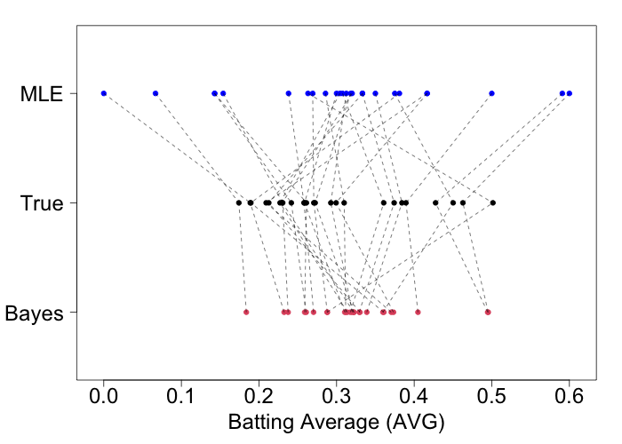

```{r setup, include=FALSE, warning=FALSE}
options(htmltools.dir.version = FALSE)
options(servr.daemon = TRUE)
knitr::opts_chunk$set(
  prompt = FALSE, comment = "", eval = FALSE, echo = TRUE,
  warning = FALSE, message = FALSE, out.width = "85%"
)
library(xaringanthemer)
library(rethinking)
```

```{r xaringan-themer, include=FALSE, eval=TRUE}
style_solarized_light(
  title_slide_background_color = "#586e75",
  header_color = "#586e75",
  text_bold_color = "#cb4b16",
  background_color = "#fdf6e3",
  header_font_google = google_font("DM Sans"),
  text_font_google = google_font("Roboto Condensed", "300", "300i"),
  code_font_google = google_font("Fira Mono"),
  text_font_size = "24px",
  code_font_size = "1rem"
)
xaringanExtra::use_share_again()
xaringanExtra::use_fit_screen()
xaringanExtra::use_tachyons()
xaringanExtra::use_tile_view()
```
## Modelos multiníveis

- Modelos multiníveis introduzem estrutura na distribuição dos parâmetros.
- Eles representam processos como:
  - Medidas repetidas do mesmo indivíduo
  - Delineamentos em blocos, nos quais algumas observações são mais semelhantes
  - Pseudorreplicação
  - Observações correlacionadas
- Mesmo quando essa estrutura não é necessária, a regularização hierárquica pode melhorar as estimativas e as previsões.

---

## Exemplo: médias de rebatidas

- Considere a proporção de rebatidas bem-sucedidas de cada jogador.
- $p$ é a probabilidade de uma tentativa resultar em rebatida.
- No início da temporada, precisamos estimar essa probabilidade com poucas tentativas por jogador.

Estimativa de máxima verossimilhança:

$$\hat{p} = \frac{N_{\mathrm{hits}}}{N_{\mathrm{attempts}}}$$

---

## Hiperparâmetros

- Assim, a informação conjunta sobre a população ajuda a estimar a média de cada jogador.
- $y_i$: número de rebatidas do jogador $i$
- $n_i$: número de tentativas do jogador $i$

<div>
$$\begin{aligned}
y_i &\sim \mathrm{Binomial}(n_i, p_i) \\
p_i &\sim \mathrm{Beta}(\nu_1, \nu_2) \\
\nu_1, \nu_2 &\sim \mathrm{Lognormal}(0, 1)
\end{aligned}$$
</div>

---

## Modelo de rebatidas em `ulam`

```{r baseball-ulam, eval=FALSE}
m1 <- ulam(
  alist(
    hits ~ binomial(at_bats, avgs),
    avgs <- p[player],
    p[player] ~ beta(nu0, nu1),
    nu0 ~ lognormal(0, 1),
    nu1 ~ lognormal(0, 1)
  ),
  data = list(
    hits = d[, 2],
    at_bats = d[, 1],
    player = seq_len(N_players)
  ),
  chains = 4, cores = 4, iter = 2000
)
```

---

## Médias de rebatidas

.center[]

- Estimativas extremas são deslocadas em direção à média da população.

---

## Shrinkage e tipos de pooling

1. **Pooling completo:** todos os jogadores compartilham uma única estimativa, o que pode ignorar diferenças reais entre eles.
2. **Sem pooling:** cada jogador é estimado separadamente, sem compartilhar informação; com poucas tentativas, as estimativas podem ser instáveis.
3. **Pooling parcial:** as estimativas individuais são regularizadas por uma distribuição comum que aprende quanto os jogadores variam.

---
## Variáveis categóricas e pooling

.pull-left[
**Pooling completo**

Todos os grupos (níveis do preditor categórico) compartilham o mesmo intercepto:

$$y_i \sim \mathrm{Normal}(\mu_i, \sigma)$$
$$\mu_i = \textcolor{#cb4b16}{\alpha_0} + \beta x_i$$
$$\textcolor{#cb4b16}{\alpha_0} \sim \mathrm{Normal}(0, 1)$$
$$\beta \sim \mathrm{Normal}(0, 1)$$
$$\sigma \sim \mathrm{Exponential}(1)$$
]

.pull-right[
**Sem pooling**

Cada grupo tem seu próprio intercepto:

$$y_i \sim \mathrm{Normal}(\mu_i, \sigma)$$
$$\mu_i = \textcolor{#cb4b16}{\alpha_{\mathrm{g}[i]}} + \beta x_i$$
$$\textcolor{#cb4b16}{\alpha_k} \sim \mathrm{Normal}(0, 1) \quad k=1,\ldots,N_g$$
$$\beta \sim \mathrm{Normal}(0, 1)$$
$$\sigma \sim \mathrm{Exponential}(1)$$
]

No primeiro modelo, os dados de todos os grupos informam um único intercepto. No segundo, cada intercepto é estimado a partir do próprio grupo.

---
 
## Interceptos aleatórios (Partial pooling)

Muitos modelos hierárquicos envolvem grupos de observações, onde cada grupo (ou bloco) reúne unidades experimentais semelhantes, por exemplo por local, tratamento, parentesco, ou período temporal. Podemos modelar a heterogeneidade entre grupos com interceptos aleatórios:

<div>
$$\begin{aligned}
y_i &\sim \mathrm{Normal}(\mu_i, \sigma) \\
 \mu_i &= \textcolor{#cb4b16}{\alpha_{\mathrm{group}[i]}} \\
 \textcolor{#cb4b16}{\alpha_{k}} &\sim \mathrm{Normal}(\alpha_0, \sigma_{\mathrm{group}}), \quad k=1,\ldots,N_g \\
 \alpha_0 &\sim \mathrm{Normal}(0, 1) \\
 \sigma, \sigma_{\mathrm{group}} &\sim \mathrm{Exponential}(1)
\end{aligned}$$
</div>

O desvio-padrão $\sigma_{\mathrm{group}}$ controla a heterogeneidade entre grupos. Nessa notação, o vetor $\mathrm{group}[i]$ assume valores entre 1 e $N_g$, indicando a qual grupo cada observação pertence. O prior compartilhado introduz dependência entre os interceptos, permitindo que a informação de um grupo informe a estimativa de outro.

---

## `milk`: kcal e lactose em primatas

- O exemplo que usamos no tutorial, com dados de leite em primatas, tem uma variável de agrupamento que indica o grande grupo de cada observação. Vamos usar esses dados como um intercepto aleatório para o grande grupo, e um preditor contínuo para a lactose.

- `K` e `L` são energia e lactose padronizadas como no Tutorial 2. Cada grupo tem seu próprio intercepto $\alpha_k$, parcialmente agrupado em torno do intercepto populacional $\alpha_0$. A inclinação da lactose é compartilhada, e $\sigma_g$ controla a variação entre os interceptos dos clades.

<div>
$$\begin{aligned}
K_i &\sim \mathrm{Normal}(\mu_i, \sigma) \\
\mu_i &= \alpha_{\mathrm{clade}[i]} + \beta_L L_i \\
\alpha_k &\sim \mathrm{Normal}(\alpha_0, \sigma_g), \quad k=1,\ldots,4 \\
\alpha_0 &\sim \mathrm{Normal}(0, 0.2) \\
\beta_L &\sim \mathrm{Normal}(0, 0.5) \\
\sigma, \sigma_g &\sim \mathrm{Exponential}(1)
\end{aligned}$$
</div>

---

## Preparando os dados

```{r milk-random-intercept-data, eval=TRUE, results='hide'}
data(milk, package = "rethinking")
milk_data <- milk[complete.cases(
  milk[c("kcal.per.g", "perc.fat", "perc.lactose", "clade")]
), ]
milk_data$K <- as.numeric(scale(milk_data$kcal.per.g))
milk_data$L <- as.numeric(scale(milk_data$perc.lactose))
milk_data$clade_id <- as.integer(factor(milk_data$clade))
```

---

## Ajuste do modelo com clado

```{r milk-random-intercept-model, eval=FALSE, results='hide'}
milk_random_intercept <- ulam(
  alist(
    # Likelihood
    K ~ normal(mu, sigma),
    mu <- a[clade_id] + bL * L,
    # Priors
    a[clade_id] ~ normal(a_0, sigma_g),
    bL ~ normal(0, 0.5),
    sigma ~ exponential(1),
    # Hyperprior
    a_0 ~ normal(0, 0.2),
    sigma_g ~ exponential(1)),
  data = milk_data[, c("K", "L", "clade_id")],
  chains = 4, cores = 4, iter = 2000
)
```

Esse modelo apresenta problemas de ajuste! 

```r
Warning: 139 of 4000 (3.0%) transitions ended with a divergence.
See https://mc-stan.org/misc/warnings for details.
```


---

## Comparando versões centradas e não-centradas

.pull-left[
**Centrada**

$$K_i \sim \mathrm{Normal}(\mu_i, \sigma)$$
$$\mu_i = \textcolor{#cb4b16}{\alpha_{\mathrm{clade}[i]}} + \beta_L L_i$$
$$\textcolor{#cb4b16}{\alpha_k} \sim \mathrm{Normal}(\textcolor{#859900}{\alpha_0}, \textcolor{#2aa198}{\sigma_g}),\quad k=1,\ldots,4$$
$$\textcolor{#859900}{\alpha_0} \sim \mathrm{Normal}(0, 0.1)$$
$$\beta_L \sim \mathrm{Normal}(0, 0.5)$$
$$\sigma,\textcolor{#2aa198}{\sigma_g} \sim \mathrm{Exponential}(1)$$
]

.pull-right[
**Não centrada**

$$K_i \sim \mathrm{Normal}(\mu_i, \sigma)$$
$$\mu_i = \textcolor{#859900}{\alpha_0} + \textcolor{#268bd2}{z_{\mathrm{clade}[i]}}\textcolor{#2aa198}{\sigma_g} + \beta_L L_i$$
$$\textcolor{#268bd2}{z_k} \sim \mathrm{Normal}(0, 1),\quad k=1,\ldots,4$$
$$\textcolor{#859900}{\alpha_0} \sim \mathrm{Normal}(0, 0.1)$$
$$\beta_L \sim \mathrm{Normal}(0, 0.5)$$
$$\sigma,\textcolor{#2aa198}{\sigma_g} \sim \mathrm{Exponential}(1)$$
]

Ambos os modelos são equivalentes, mas a versão não centrada costuma ter melhor desempenho computacional, especialmente quando $\sigma_g$ é pequeno. 

---

## Ajuste do modelo com clado (versão não-centrada)

```{r milk-random-intercept-model-matt, eval=TRUE, results='hide'}
milk_random_intercept_nc <- ulam(
  alist(
    # Likelihood
    K ~ normal(mu, sigma),
    mu <- a_0 + a_z[clade_id] * sigma_g + bL * L,

    # Priors
    a_z[clade_id] ~ normal(0, 1),
    bL ~ normal(0, 0.5),
    sigma ~ exponential(1),

    # Hyperprior
    a_0 ~ normal(0, 0.2),
    sigma_g ~ exponential(1),

    # Transformação para interceptos específicos do grupo
    gq> vector[clade_id]:a <<- a_0 + a_z * sigma_g),
  data = milk_data[, c("K", "L", "clade_id")],
  chains = 4, cores = 4, iter = 2000, 
)
```

---

## Estimativas do modelo

```{r milk-random-intercept-summary, eval=TRUE, echo=TRUE}
rethinking::precis(milk_random_intercept_nc, depth = 2) |> round(3)
levels(factor(milk_data$clade))
```

---

## Previsões incluindo clado

```{r milk-random-intercept-predictions, eval=TRUE, echo=FALSE, fig.width=8, fig.height=4.2, out.width="85%"}
clade_levels <- levels(factor(milk_data$clade))
milk_grid <- expand.grid(
  L = seq(min(milk_data$L), max(milk_data$L), length.out = 100),
  clade_id = seq_along(clade_levels)
)
milk_grid$clade <- factor(clade_levels[milk_grid$clade_id], levels = clade_levels)

milk_mu <- rethinking::link(milk_random_intercept_nc, data = milk_grid)
milk_grid$mean <- colMeans(milk_mu)

ggplot2::ggplot(milk_grid, ggplot2::aes(x = L, y = mean, color = clade)) +
  ggplot2::geom_line(linewidth = 0.5) +
  ggplot2::geom_point(
    data = milk_data,
    ggplot2::aes(x = L, y = K, color = clade),
    inherit.aes = FALSE, alpha = 0.65, size = 2
  ) +
  ggplot2::scale_color_brewer(
    palette = "Dark2", name = "Clade",
    guide = ggplot2::guide_legend(nrow = 1, byrow = TRUE)
  ) +
  ggplot2::labs(
    x = "Lactose (z-score)",
    y = "Energia do leite (z-score)") +
  ggplot2::theme_minimal(base_size = 14) +
  ggplot2::theme(legend.position = "bottom")
```

---

## Comparando as previsões com as médias de cada grupo

```{r milk-partial-pooling-comparison, eval=TRUE, echo=FALSE, fig.width=9, fig.height=4.2, dpi=300, out.width="95%", fig.bg="transparent"}
milk_posterior <- rethinking::extract.samples(milk_random_intercept_nc)
clade_levels <- levels(factor(milk_data$clade))
milk_lm_no_pooling <- stats::lm(K ~ 0 + clade + L, data = milk_data)
lm_coefficients <- stats::coef(milk_lm_no_pooling)
raw_intercepts <- unname(lm_coefficients[paste0("clade", clade_levels)])

group_estimates <- data.frame(
  clade = factor(clade_levels, levels = clade_levels),
  raw_mean = raw_intercepts,
  mixed_mean = colMeans(milk_posterior$a)
)
estimate_points <- rbind(
  data.frame(clade = group_estimates$clade, estimate = group_estimates$raw_mean,
             y = 2),
  data.frame(clade = group_estimates$clade, estimate = group_estimates$mixed_mean,
             y = 1)
)
global_mean <- mean(milk_posterior$a_0)

ggplot2::ggplot() +
  ggplot2::geom_vline(xintercept = global_mean, color = "#586e75", linetype = "dashed") +
  ggplot2::geom_segment(
    data = group_estimates,
    ggplot2::aes(x = raw_mean, xend = mixed_mean, y = 2, yend = 1,
                 color = clade),
    linetype = "dashed", alpha = 0.65, linewidth = 0.7
  ) +
  ggplot2::geom_point(
    data = estimate_points,
    ggplot2::aes(x = estimate, y = y, color = clade),
    size = 3
  ) +
  ggrepel::geom_text_repel(
    data = subset(estimate_points, y == 2),
    ggplot2::aes(x = estimate, y = y, label = clade, color = clade),
    inherit.aes = FALSE, direction = "y", nudge_y = 0.16, size = 3,
    box.padding = 0.2, point.padding = 0.15, max.overlaps = Inf,
    min.segment.length = 0, show.legend = FALSE
  ) +
  ggplot2::scale_y_continuous(
    breaks = c(2, 1), labels = c("Não pooled", "Modelo misto"),
    limits = c(0.6, 2.4), expand = ggplot2::expansion(mult = 0)
  ) +
  ggplot2::scale_color_brewer(palette = "Dark2", guide = "none") +
  ggplot2::labs(
    x = "Intercepto de energia previsto em lactose média (z-score)",
    y = NULL
  ) +
  ggplot2::theme_minimal(base_size = 12) +
  ggplot2::theme(
    legend.position = "none",
    panel.background = ggplot2::element_rect(fill = "transparent", color = NA),
    plot.background = ggplot2::element_rect(fill = "transparent", color = NA)
  )
```

---

## Como ocorre o pooling parcial

O intercepto de cada grupo não é estimado isoladamente. A distribuição hierárquica combina a informação local do grupo com a distribuição comum, produzindo shrinkage em direção a $\alpha_0$.

No **caso normal simples**, com variância residual conhecida, o estimador posterior do intercepto do grupo tem a forma de uma média ponderada:

$$\hat{\alpha}_j = w_j\bar{y}_j + (1-w_j)\alpha_0$$

$$w_j = \frac{\sigma_g^2}{\sigma_g^2+\sigma^2/n_j}$$

Grupos com mais observações têm maior $w_j$ e dependem mais de seus próprios dados. Grupos pequenos são mais regularizados em direção à média populacional. Se $\sigma_g$ for próximo de zero, os grupos são semelhantes e o pooling é forte; se for grande, há menos pooling.

---

## Inclinações aleatórias

Um intercepto aleatório não basta quando a associação entre $x$ e $y$ também varia entre grupos. Nesse caso, cada grupo tem um intercepto e uma inclinação próprios:

<div>
$$\begin{aligned}
 y_i &\sim \mathrm{Normal}(\mu_i, \sigma) \\
\mu_i &= \alpha_0 + \alpha_{\mathrm{group}[i]} + (\beta_0 + \beta_{\mathrm{group}[i]})x_i \\
\alpha_j &\sim \mathrm{Normal}(0, \sigma_\alpha), \quad j=1,\ldots,N_g \\
\beta_j &\sim \mathrm{Normal}(0, \sigma_\beta), \quad j=1,\ldots,N_g \\
\alpha_0, \beta_0 &\sim \mathrm{Normal}(0, 1) \\
\sigma, \sigma_\alpha, \sigma_\beta &\sim \mathrm{Exponential}(1)
\end{aligned}$$
</div>

O intercepto e a inclinação específicos do grupo $j$ são, respectivamente, $\alpha_0+\alpha_j$ e $\beta_0+\beta_j$. 

---

## Modelo de lactose com inclinações aleatórias

```{r milk-random-slope-model, eval=FALSE, results='hide'}
milk_random_slope <- ulam(
  alist(
    # Likelihood
    K ~ normal(mu, sigma),
    mu <- a[clade_id] + b[clade_id] * L,        

    # Priors
    a[clade_id] ~ normal(a_0, sigma_a),
    b[clade_id] ~ normal(b_0, sigma_b),
    sigma ~ exponential(1),
    # Hyperpriors
    a_0 ~ normal(0, 0.2),
    b_0 ~ normal(0, 0.5),
    sigma_a ~ exponential(1),
    sigma_b ~ exponential(1)
    ),
    data = milk_data[, c("K", "L", "clade_id")],
    chains = 4, cores = 4, iter = 2000
)
```

```r
Warning: 155 of 4000 (4.0%) transitions ended with a divergence.
See https://mc-stan.org/misc/warnings for details.
```

---

## Modelo de lactose com inclinações aleatórias (não-centrado)

```{r milk-random-slope-model-matt, eval=TRUE, results='hide'}
milk_random_slope_nc <- ulam(
  alist(
    # Likelihood
    K ~ normal(mu, sigma),
    mu <- a_0 + a_z[clade_id] * sigma_a + (b_0 + b_z[clade_id] * sigma_b) * L,
    # Priors
    a_z[clade_id] ~ normal(0, 1),
    b_z[clade_id] ~ normal(0, 1),
    sigma ~ exponential(1),
    # Hyperpriors       
    a_0 ~ normal(0, 0.2),
    b_0 ~ normal(0, 0.5),
    sigma_a ~ exponential(1),
    sigma_b ~ exponential(1),
    # Transformação para interceptos e inclinações específicos do grupo
    gq> vector[clade_id]:a <<- a_0 + a_z * sigma_a,
    gq> vector[clade_id]:b <<- b_0 + b_z * sigma_b),
    data = milk_data[, c("K", "L", "clade_id")],
    chains = 4, cores = 4, iter = 2000, refresh = 0
)
```

---

## Retas de regressão por clado

```{r milk-random-slope-predictions, eval=TRUE, echo=FALSE, fig.width=9, fig.height=4.4, dpi=300, out.width="95%"}
milk_slope_posterior <- rethinking::extract.samples(milk_random_slope_nc)
clade_levels <- levels(factor(milk_data$clade))
milk_slope_grid <- expand.grid(
  L = seq(min(milk_data$L), max(milk_data$L), length.out = 100),
  clade_id = seq_along(clade_levels)
)
milk_slope_grid$clade <- factor(
  clade_levels[milk_slope_grid$clade_id], levels = clade_levels
)

milk_mu_draws <- vapply(seq_len(nrow(milk_slope_grid)), function(i) {
  clade_id <- milk_slope_grid$clade_id[i]
  milk_slope_posterior$a[, clade_id] +
    milk_slope_posterior$b[, clade_id] * milk_slope_grid$L[i]
}, numeric(nrow(milk_slope_posterior$a)))
milk_slope_grid$mean <- colMeans(milk_mu_draws)

ggplot2::ggplot(
  milk_slope_grid,
  ggplot2::aes(x = L, y = mean, color = clade)
) +
  ggplot2::geom_line(linewidth = 0.8) +
  ggplot2::geom_point(
    data = milk_data,
    ggplot2::aes(x = L, y = K, color = clade),
    inherit.aes = FALSE, alpha = 0.7, size = 2
  ) +
  ggplot2::scale_color_brewer(palette = "Dark2", name = "Clade") +
  ggplot2::labs(
    x = "Lactose (z-score)",
    y = "Energia do leite (z-score)"
  ) +
  ggplot2::theme_minimal(base_size = 13) +
  ggplot2::theme(legend.position = "bottom")
```

---

## Quando usar modelos hierárquicos?

- Existe uma recomendação genérica na literatura só devam ser usados quando número de grupos é grande (por exemplo, $> 30$). 
- No entanto, o pooling parcial é útil mesmo com poucos grupos, especialmente quando há poucos dados por grupo. O modelo hierárquico permite que a informação de todos os grupos informe a estimativa de cada um deles.
- Sempre que os grupos forem amostras de uma população maior, o pooling parcial é apropriado. 
- Se os grupos forem fixos e não representativos de uma população maior (por exemplo, se forem tratamentos experimentais), o pooling parcial ainda pode ser útil para regularizar as estimativas. Ainda existem fontes de similaridade entre os grupos que podem ser exploradas, mesmo que não sejam amostras de uma população maior.
- Uma preocupação comum é que o uso de modelos hierárquicos aumente de forma relevante a complexidade do modelo, incluindo muitos novos parâmetros. No entanto, a regularização hierárquica reduz a variância das estimativas, e o número de parâmetros não é mais um bom indicador da complexidade do modelo. Vamos explorar isso mais adiante, quando discutirmos a comparação de modelos.

---

## Dados replicados

Simular dados a partir do modelo ajustado permite verificar se ele reproduz características importantes dos dados observados, incluindo a variação dentro e entre grupos. A replicação deve respeitar a estrutura de agrupamento, não apenas a distribuição marginal da resposta.

---

## Efeitos aleatórios correlacionados

A correlação entre intercepto e inclinação descreve como o nível basal dos grupos se relaciona com a resposta ao preditor. Ela não é uma associação causal entre esses parâmetros e pode depender da origem escolhida para $x$; por isso, sua interpretação exige centralização e contexto substantivo.

---

## Modelos filogenéticos e processos Gaussianos

São extensões nas quais a dependência entre observações é definida por uma estrutura de covariância, como parentesco evolutivo ou distância espacial, em vez de apenas pela pertença a grupos discretos.
