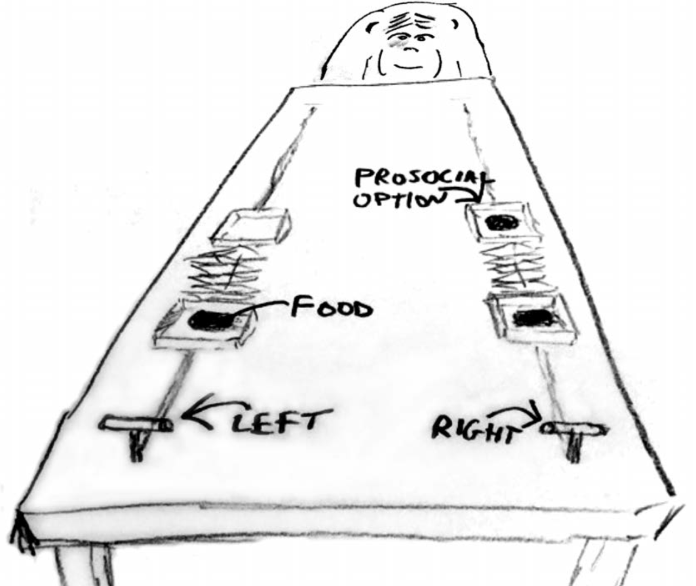
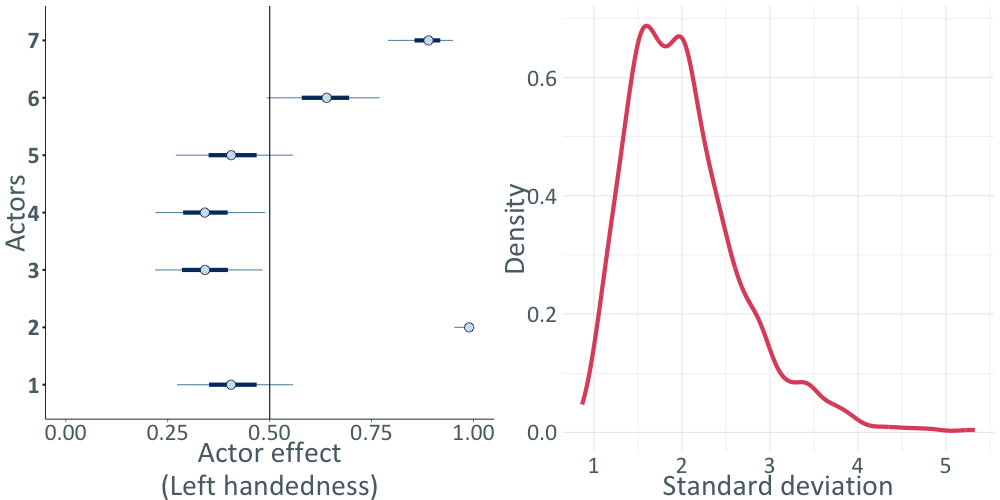
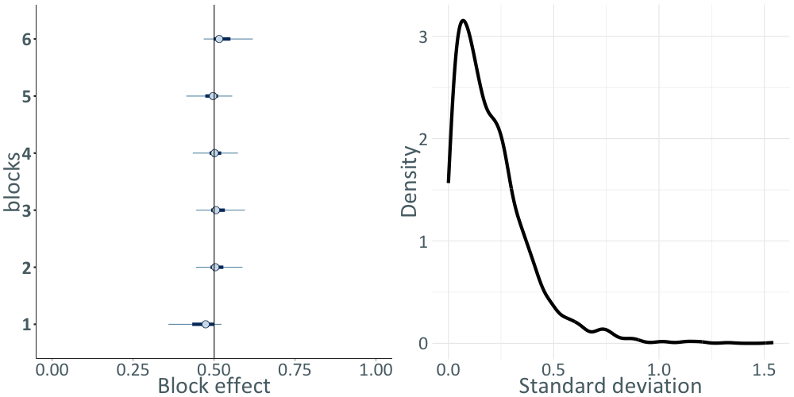
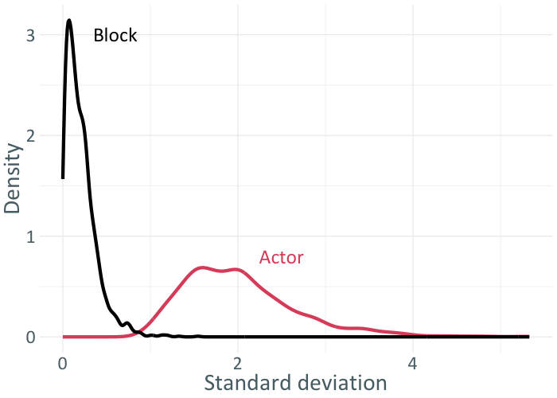
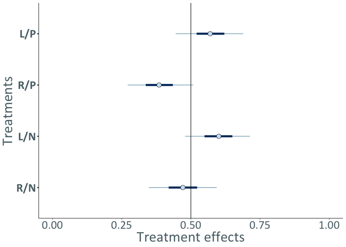
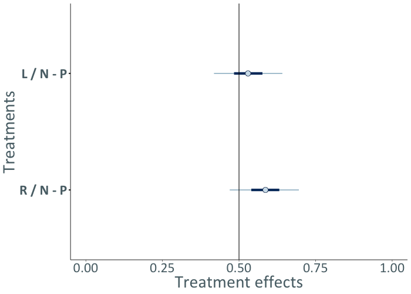

```{r setup, include=FALSE, warning=FALSE}
options(htmltools.dir.version = FALSE)
options(servr.daemon = TRUE)
knitr::opts_chunk$set(
  prompt = FALSE, comment = "", eval = FALSE, echo = TRUE,
  warning = FALSE, message = FALSE, out.width = "85%"
)
library(xaringanthemer)
library(rethinking)
```

```{r xaringan-themer, include=FALSE, eval=TRUE}
style_solarized_light(
  title_slide_background_color = "#586e75",
  header_color = "#586e75",
  text_bold_color = "#cb4b16",
  background_color = "#fdf6e3",
  header_font_google = google_font("DM Sans"),
  text_font_google = google_font("Roboto Condensed", "300", "300i"),
  code_font_google = google_font("Fira Mono"),
  text_font_size = "24px",
  code_font_size = "1rem"
)
xaringanExtra::use_share_again()
xaringanExtra::use_fit_screen()
xaringanExtra::use_tachyons()
xaringanExtra::use_tile_view()
```

## Prosocialidade em chimpanzés

- Prosocialidade refere-se a comportamentos que beneficiam outros indivíduos.
- Podemos estudar esse comportamento experimentalmente.
- Neste experimento, um sujeito pode disponibilizar alimento a um parceiro sem custo para si.

---

## Delineamento experimental

.center[]

---

## Estrutura dos dados

- Várias medidas por chimpanzé (ator)
- Condição social ou não social
- Blocos experimentais
- Opção prosocial à esquerda; os chimpanzés podem ter preferência lateral

**Respostas observadas**

- Escolheu a opção prosocial
- Puxou a alavanca da esquerda

---

## Dados dos chimpanzés

```{r chimp-data}
library(rethinking)
data(chimpanzees)
head(chimpanzees)
```

```text
  actor recipient condition block trial prosoc_left chose_prosoc pulled_left
1     1        NA         0     1     2           0            1           0
2     1        NA         0     1     4           0            0           1
3     1        NA         0     1     6           1            0           0
4     1        NA         0     1     8           0            1           0
5     1        NA         0     1    10           1            1           1
6     1        NA         0     1    12           1            1           1
```

---

## Tratamentos experimentais

.f3[
1. `prosoc_left = 0`, `condition = 0`: dois itens à direita, sem parceiro.
2. `prosoc_left = 1`, `condition = 0`: dois itens à esquerda, sem parceiro.
3. `prosoc_left = 0`, `condition = 1`: dois itens à direita, com parceiro.
4. `prosoc_left = 1`, `condition = 1`: dois itens à esquerda, com parceiro.
]

---

## Modelo inicial da verossimilhança

- $L_i$: indicador de que a alavanca esquerda foi puxada

<div>
$$\begin{aligned}
L_i &\sim \mathrm{Bernoulli}(p_i) \\
 \mathrm{logit}(p_i) &= \alpha_{\mathrm{actor}[i]} + \beta_{\mathrm{treatment}[i]}
\end{aligned}$$
</div>

---

## Incluindo efeitos de bloco

- $L_i$: indicador de que a alavanca esquerda foi puxada

<div>
$$\begin{aligned}
L_i &\sim \mathrm{Bernoulli}(p_i) \\
 \mathrm{logit}(p_i) &= \alpha_{\mathrm{actor}[i]} + \gamma_{\mathrm{block}[i]} + \beta_{\mathrm{treatment}[i]}
\end{aligned}$$
</div>

---

## Priori para o tratamento experimental

<div>
$$\begin{aligned}
L_i &\sim \mathrm{Bernoulli}(p_i) \\
 \mathrm{logit}(p_i) &= \alpha_{\mathrm{actor}[i]} + \gamma_{\mathrm{block}[i]} + \beta_{\mathrm{treatment}[i]} \\
 \beta_j &\sim \mathrm{Normal}(0, 0.5), \quad j=1,\ldots,4
\end{aligned}$$
</div>

---

## Pooling dos interceptos por ator

<div>
$$\begin{aligned}
L_i &\sim \mathrm{Bernoulli}(p_i) \\
 \mathrm{logit}(p_i) &= \alpha_{\mathrm{actor}[i]} + \gamma_{\mathrm{block}[i]} + \beta_{\mathrm{treatment}[i]} \\
 \beta_j &\sim \mathrm{Normal}(0, 0.5), \quad j=1,\ldots,4 \\
 \alpha_j &\sim \mathrm{Normal}(\alpha_0, \sigma_{\alpha}), \quad j=1,\ldots,7
\end{aligned}$$
</div>

---

## Pooling dos interceptos por bloco

<div>
$$\begin{aligned}
L_i &\sim \mathrm{Bernoulli}(p_i) \\
 \mathrm{logit}(p_i) &= \alpha_{\mathrm{actor}[i]} + \gamma_{\mathrm{block}[i]} + \beta_{\mathrm{treatment}[i]} \\
 \beta_j &\sim \mathrm{Normal}(0, 0.5), \quad j=1,\ldots,4 \\
 \alpha_j &\sim \mathrm{Normal}(\alpha_0, \sigma_{\alpha}), \quad j=1,\ldots,7 \\
 \gamma_j &\sim \mathrm{Normal}(0, \sigma_{\gamma}), \quad j=1,\ldots,6
\end{aligned}$$
</div>

---

## Completando as prioris

<div>
$$\begin{aligned}
L_i &\sim \mathrm{Bernoulli}(p_i) \\
 \mathrm{logit}(p_i) &= \alpha_0 + \alpha_{\mathrm{actor}[i]} + \gamma_{\mathrm{block}[i]} + \beta_{\mathrm{treatment}[i]} \\
 \beta_j &\sim \mathrm{Normal}(0, 0.5), \quad j=1,\ldots,4 \\
 \alpha_j &\sim \mathrm{Normal}(\alpha_0, \sigma_{\alpha}), \quad j=1,\ldots,7 \\
 \gamma_j &\sim \mathrm{Normal}(0, \sigma_{\gamma}), \quad j=1,\ldots,6 \\
 \alpha_0 &\sim \mathrm{Normal}(0, 1.5) \\
 \sigma_{\alpha} &\sim \mathrm{Exponential}(1) \\
 \sigma_{\gamma} &\sim \mathrm{Exponential}(1)
\end{aligned}$$
</div>

---

## Código do modelo dos chimpanzés

```{r chimp-model}
data(chimpanzees, package = "rethinking")
d <- chimpanzees
d$treatment <- 1 + d$prosoc_left + 2 * d$condition

dat_list <- list(
  pulled_left = d$pulled_left,
  actor = d$actor,
  block_id = d$block,
  treatment = as.integer(d$treatment)
)

m1 <- ulam(
  alist(
    pulled_left ~ dbinom(1, p),
    logit(p) <- a[actor] + g[block_id] + b[treatment],
    b[treatment] ~ dnorm(0, 0.5),
    a[actor] ~ dnorm(a_0, sigma_a),
    g[block_id] ~ dnorm(0, sigma_g),
    a_0 ~ dnorm(0, 1.5),
    sigma_a ~ dexp(1),
    sigma_g ~ dexp(1)
  ),
  data = dat_list,
  chains = 4, cores = 4, log_lik = TRUE
)
```

---

## Estimativas por ator

.center[]

---

## Estimativas por bloco

.center[]

---

## Desvios-padrão dos efeitos aleatórios

.center[]

---

## Efeitos dos tratamentos

.center[]

---

## Contrastes entre tratamentos

.center[]

---

## Parametrização centrada dos efeitos por ator

<div>
$$\begin{aligned}
\mathrm{logit}(p_i) &= \alpha_{\mathrm{actor}[i]} \\
 \alpha_j &\sim \mathrm{Normal}(\alpha_0, \sigma_{\alpha}), \quad j=1,\ldots,7 \\
 \alpha_0 &\sim \mathrm{Normal}(0, 1.5) \\
 \sigma_{\alpha} &\sim \mathrm{Exponential}(1)
\end{aligned}$$
</div>

Na parametrização centrada, cada intercepto de ator é modelado diretamente pela distribuição hierárquica. A forma torna explícito que os valores observados são realizações de uma população comum.

---

## Parametrização não centrada dos efeitos por ator

<div>
$$\begin{aligned}
\mathrm{logit}(p_i) &= \alpha_0 + \tilde{\alpha}_{\mathrm{actor}[i]}\sigma_{\alpha} \\
 \tilde{\alpha}_j &\sim \mathrm{Normal}(0, 1), \quad j=1,\ldots,7 \\
 \alpha_0 &\sim \mathrm{Normal}(0, 1.5) \\
 \sigma_{\alpha} &\sim \mathrm{Exponential}(1)
\end{aligned}$$
</div>

Na parametrização não centrada, escrevemos cada efeito como um valor padronizado $z_j$ multiplicado pela escala populacional. As duas expressões definem o mesmo modelo probabilístico, mas produzem geometrias diferentes para o amostrador. A forma centrada tende a funcionar bem quando há informação suficiente por grupo; a não centrada costuma ajudar quando os grupos são pouco informativos ou a heterogeneidade está próxima de zero. A escolha deve ser avaliada pelos diagnósticos do ajuste.

---

## Modelo não centrado dos chimpanzés

```{r chimp-noncentered}
m1nc <- ulam(
  alist(
    pulled_left ~ dbinom(1, p),
    logit(p) <- a_0 + z[actor] * sigma_a +
      x[block_id] * sigma_g + b[treatment],
    b[treatment] ~ dnorm(0, 0.5),
    z[actor] ~ dnorm(0, 1),
    x[block_id] ~ dnorm(0, 1),
    a_0 ~ dnorm(0, 1.5),
    sigma_a ~ dexp(1),
    sigma_g ~ dexp(1),
    gq> vector[actor]:a <<- a_0 + z * sigma_a,
    gq> vector[block_id]:g <<- x * sigma_g
  ),
  data = dat_list,
  chains = 4, cores = 4
)
```

---

## Modelo de interceptos e inclinações aleatórios

Para o grupo $j$, seja $u_{0j}$ o desvio do intercepto e $u_{1j}$ o desvio da inclinação. Os dois desvios podem variar juntos:

<div>
$$\begin{aligned}
y_{ij} &\sim \mathrm{Normal}(\mu_{ij}, \sigma) \\
 \mu_{ij} &= (\alpha_0+u_{0j}) + (\beta_0+u_{1j})x_{ij} \\
 \begin{pmatrix}u_{0j}\\
u_{1j}\end{pmatrix} &\sim \mathrm{Normal}_2\left(\begin{pmatrix}0\\
0\end{pmatrix}, \mathbf{\Sigma}\right) \\
 \mathbf{\Sigma} &= \begin{pmatrix} \tau_0^2 & \rho\tau_0\tau_1 \\
 \rho\tau_0\tau_1 & \tau_1^2 \end{pmatrix}
\end{aligned}$$
</div>

Agora cada grupo tem sua própria reta. $\alpha_0+u_{0j}$ é o intercepto do grupo $j$, e $\beta_0+u_{1j}$ é sua inclinação. $\tau_0$ e $\tau_1$ medem a heterogeneidade entre grupos; $\rho$ representa a associação entre os desvios de intercepto e inclinação. Se $\tau_1=0$, as inclinações são comuns e o modelo se reduz ao de interceptos aleatórios.

Antes de ajustar esse modelo, centralize $x$ em um valor de referência relevante. Sem centralização, o intercepto corresponde a $x=0$, que pode estar fora da região observada; isso também pode induzir forte correlação entre os efeitos aleatórios de intercepto e inclinação.

---

## Dados replicados

Simular dados a partir do modelo ajustado permite verificar se ele reproduz características importantes dos dados observados, incluindo a variação dentro e entre grupos. A replicação deve respeitar a estrutura de agrupamento, não apenas a distribuição marginal da resposta.

---

## Efeitos aleatórios correlacionados

A correlação entre intercepto e inclinação descreve como o nível basal dos grupos se relaciona com a resposta ao preditor. Ela não é uma associação causal entre esses parâmetros e pode depender da origem escolhida para $x$; por isso, sua interpretação exige centralização e contexto substantivo.

---

## Modelos filogenéticos e processos Gaussianos

São extensões nas quais a dependência entre observações é definida por uma estrutura de covariância, como parentesco evolutivo ou distância espacial, em vez de apenas pela pertença a grupos discretos.
