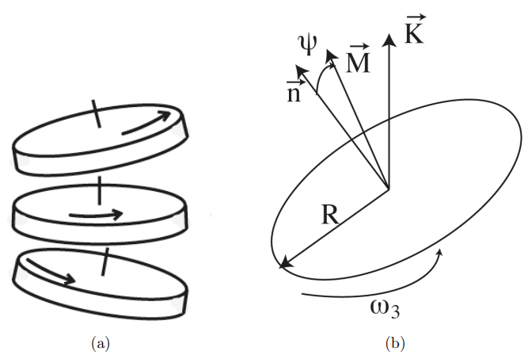
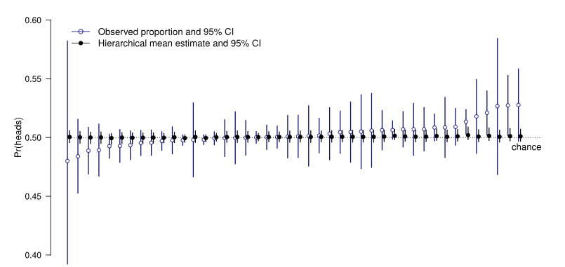
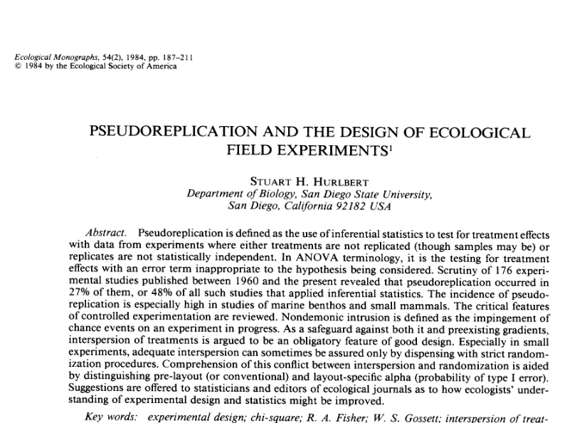

```{r setup, include=FALSE, warning=FALSE}
options(htmltools.dir.version = FALSE)
options(servr.daemon = TRUE)#para que não bloqueie a sessão
knitr::opts_chunk$set(prompt = TRUE, comment = "", eval = TRUE, echo = FALSE, warning = FALSE, message = FALSE,
                      out.width="85%",
                      ## Figuras: mesma largura em todos os chunks (texto com tamanho consistente),
                      ## alta resolução, e fundo transparente para herdar a cor dos slides
                      fig.width = 8, fig.asp = 0.618,
                      dpi = 300, fig.retina = 1,
                      dev.args = list(bg = "transparent"))
library(xaringanthemer)
library(ggplot2)
library(ggthemes)
library(dplyr)
library(tidyr)
library(knitr)
library(rethinking)
```

```{r xaringan-themer, include=FALSE}
style_solarized_light(
  title_slide_background_color = "#586e75",# base 3
  header_color = "#586e75",
  text_bold_color = "#cb4b16",
  background_color = "#fdf6e3", # base 3
  header_font_google = google_font("DM Sans"),
  text_font_google = google_font("Roboto Condensed", "300", "300i"),
  code_font_google = google_font("Fira Mono"), text_font_size = "24px",
  code_font_size="1rem",
  extra_css = list(
      ".pull-left > :first-child, .pull-right > :first-child" = list("margin-top" = "0"),
      ".destaque" = list("color" = "#dc322f", "font-size" = "3em",
                         "font-weight" = "bold", "text-align" = "center")
  )
)
xaringanExtra::use_share_again()
xaringanExtra::use_fit_screen()
xaringanExtra::use_tachyons()
xaringanExtra::use_tile_view()

## clipboard
htmltools::tagList(
  xaringanExtra::use_clipboard(
    button_text = "Copiar código <i class=\"fa fa-clipboard\"></i>",
    success_text = "Copiado! <i class=\"fa fa-check\" style=\"color: #90BE6D\"></i>",
    error_text = "Não copiado 😕 <i class=\"fa fa-times-circle\" style=\"color: #F94144\"></i>"
  ),
  rmarkdown::html_dependency_font_awesome()
)
## ggplot theme
theme_Publication <- function(base_size=14, base_family="helvetica") {
    (theme_foundation(base_size=base_size, base_family=base_family)
        + theme(plot.title = element_text(face = "bold",
                                          size = rel(1.2), hjust = 0.5),
                text = element_text(colour="#586e75"), # solarized base01
                panel.background = element_rect(fill = "transparent", colour = NA),
                plot.background = element_rect(fill = "transparent", colour = NA),
                legend.background = element_rect(fill = "transparent", colour = NA),
                panel.border = element_rect(colour = NA),
                axis.title = element_text(face = "bold",size = rel(1)),
                axis.title.y = element_text(angle=90,vjust =2),
                axis.title.x = element_text(vjust = -0.2),
                axis.text = element_text(colour="#657b83"), # solarized base00
                axis.line = element_line(colour="#586e75"), # solarized base01
                axis.ticks = element_line(colour="#586e75"),
                panel.grid.major = element_line(colour="#eee8d5"), # solarized base2
                panel.grid.minor = element_blank(),
                legend.key = element_rect(fill = "transparent", colour = NA),
                legend.position = "bottom",
                legend.direction = "horizontal",
                legend.key.size= unit(0.2, "cm"),
                legend.spacing = unit(0.2, "cm"),
                legend.title = element_text(face="italic"),
                plot.margin=unit(c(10,5,5,5),"mm"),
                strip.background=element_rect(colour="#eee8d5",fill="#eee8d5"), # solarized base2
                strip.text = element_text(face="bold", colour="#586e75")
                ))
}
```

```{r dados}
## Dados de Bartoš et al. (2025): totais por pessoa (Tabela 1) e por moeda (Tabela 2)
por.pessoa <- read.csv("bartos_por_pessoa.csv")
por.moeda <- read.csv("bartos_por_moeda.csv")
## Lista de dados para o rethinking
dl <- list(S = por.pessoa$mesmo_lado,       # n de lançamentos que caíram do mesmo lado
           N = por.pessoa$lancamentos,      # n total de lançamentos
           pessoa = seq_len(nrow(por.pessoa)))
## Resumos para os slides
n.pessoas <- nrow(por.pessoa)
n.moedas <- nrow(por.moeda)
n.total <- sum(por.pessoa$lancamentos)
fmt <- function(x, d = 0) format(round(x, d), big.mark = ".", decimal.mark = ",", nsmall = d)
## Priori do logito de p: centrada no valor DHM (p = 0,51),
## com 95% da probabilidade entre p = 0,25 e p = 0,75
prior.m <- 0.04   # logit(0,51)
prior.s <- 0.56   # logit(0,75) / 1,96

## Dados por pessoa x moeda (dados brutos do OSF, agregados), para o
## modelo com dois agrupamentos. Colunas: pessoa, moeda, mesmo_lado, lancamentos
arq.pm <- "bartos_pessoa_moeda.csv"
tem.pm <- file.exists(arq.pm)
if (tem.pm) {
    por.pm <- read.csv(arq.pm)
    dl.pm <- list(S = por.pm$mesmo_lado,
                  N = por.pm$lancamentos,
                  pessoa = as.integer(factor(por.pm$pessoa)),
                  moeda = as.integer(factor(por.pm$moeda)))
}
```

```{r ajustes, include = FALSE}
## Ajusta os modelos com o código mostrado nos slides (chunks m-agr, m-sem
## e m-hier) e guarda as amostras das posteriores em um arquivo .rds.
## Nas próximas compilações, as amostras são lidas do arquivo, sem reajustar,
## a menos que os dados ou o código dos modelos tenham mudado.
## (O cache do knitr não serve aqui: objetos do ulam ajustados com cmdstanr
## apontam para arquivos temporários que são apagados ao fim da sessão)
## Uso interativo (rodando os chunks no console): a função usa os modelos
## que já estiverem na sessão (rode antes os chunks dos modelos) ou, se
## não estiverem, lê as amostras salvas na última compilação.
ajusta_ou_le <- function(arquivo, rotulos, objetos, dados.arq) {
    ## Amostras das posteriores e diagnósticos dos modelos que estão na sessão
    extrai <- function() list(
        post = lapply(setNames(objetos, objetos),
                      function(o) extract.samples(get(o, envir = globalenv()))),
        diag = sapply(objetos, function(o) {
            m <- get(o, envir = globalenv())
            c(divergencias = divergent(m),
              rhat.max = max(precis(m, depth = 2)$rhat))
        }))
    if (!isTRUE(getOption("knitr.in.progress"))) {
        if (all(sapply(objetos, exists, envir = globalenv()))) return(extrai())
        if (file.exists(arquivo)) return(readRDS(arquivo))
        stop("Rode antes os chunks ", paste(rotulos, collapse = ", "),
             ", ou compile o documento uma vez.")
    }
    ## Na compilação: reajusta só se os dados ou o código dos modelos mudaram
    md5 <- unname(tools::md5sum(dados.arq))
    codigo <- lapply(rotulos, function(r) as.character(knitr::knit_code$get(r)))
    if (file.exists(arquivo)) {
        res <- readRDS(arquivo)
        if (identical(res$md5, md5) && identical(res$codigo, codigo)) return(res)
    }
    set.seed(42)
    for (r in rotulos) eval(parse(text = knitr::knit_code$get(r)), envir = globalenv())
    res <- c(list(md5 = md5, codigo = codigo), extrai())
    saveRDS(res, arquivo)
    res
}
ajustes <- ajusta_ou_le("posteriores_pessoa.rds", c("m-agr", "m-sem", "m-hier"),
                        c("m.agr", "m.sem", "m.hier"), "bartos_por_pessoa.csv")
```

```{r posteriores}
## Amostras das posteriores
post.agr <- ajustes$post$m.agr
post.sem <- ajustes$post$m.sem
post.hier <- ajustes$post$m.hier
## Probabilidade estimada de mesmo lado para cada pessoa, nos três modelos
resumo <- function(a) c(media = mean(a), inf = unname(PI(a, 0.95)[1]), sup = unname(PI(a, 0.95)[2]))
p.agr <- resumo(inv_logit(post.agr$a))
est <- rbind(
    data.frame(pessoa = por.pessoa$pessoa, modelo = "Sem agregação",
               t(apply(inv_logit(post.sem$a), 2, resumo))),
    data.frame(pessoa = por.pessoa$pessoa, modelo = "Agregação parcial",
               t(apply(inv_logit(post.hier$a), 2, resumo))))
## Pessoas ordenadas pela estimativa do modelo hierárquico
ordem <- est %>% filter(modelo == "Agregação parcial") %>% arrange(media) %>% pull(pessoa)
est$indice <- match(est$pessoa, ordem)
est$modelo <- factor(est$modelo, levels = c("Sem agregação", "Agregação parcial"))
cores.mod <- c("Sem agregação" = "#268bd2", "Agregação parcial" = "#dc322f")
```

## Modelos hierárquicos ou multinível

.pull-left[
### Frequentistas
* Modelos que postulam uma distribuição de
probabilidades para pelo menos um de seus parâmetros (os **efeitos
aleatórios**). 
* Os parâmetros desta distribuição (p.ex., sua variância)
são estimados a partir dos dados.

### Bayesianos
* Modelos em que pelo menos um parâmetro de uma
distribuição *a priori* também tem uma distribuição *a priori*.
* Os parâmetros da priori são os **hiperparâmetros**.
* As prioris dos hiperparâmetros são as **hiperprioris**.
]

.pull-right[

<br>

$$\begin{aligned}
y_i &\sim \text{Binomial}(N_i, \, p_i) \\[0.5em]
\text{logit}(p_i) &= \alpha_{\text{PESSOA}[i]} \\[0.5em]
\alpha_j &\sim \text{Normal}(\bar\alpha, \, \sigma) \leftarrow \text{priori} \\[0.5em]
\bar\alpha &\sim \text{Normal}(0{,}04; \, 0{,}56) \leftarrow \text{hiperpriori} \\[0.5em]
\sigma &\sim \text{Exponencial}(1) & & \leftarrow \text{hiperpriori}
\end{aligned}$$

Hiperparâmetros: $\bar\alpha$ e $\sigma$.
]

---
class: inverse, center, middle

# Um modelo binomial hierárquico

---

## Moedas justas caem do mesmo lado?

.pull-left[

**Motivação**

* O modelo físico padrão do lançamento de moedas prevê que uma moeda
  justa cai em cara ou coroa com probabilidade 0,5.

* Diaconis, Holmes & Montgomery (DHM; 2007) propuseram que, ao lançar a
  moeda, as pessoas introduzem uma pequena **precessão** (oscilação do
  eixo de rotação).

* Com isso a moeda passa mais tempo no ar com a face inicial para cima,
  e tende a cair **do mesmo lado em que começou**.

* DHM previram: P(mesmo lado) $\approx$ **0,51**.
]

.pull-right[
.center[

```{r }

```
]
]

---

## Delineamento experimental

.pull-left[
**Metodologia** (Bartoš et al. 2025)

* `r n.pessoas` pessoas lançaram `r n.moedas` tipos de moedas, num total de `r fmt(n.total)` lançamentos.

* Coleta em trabalhos de conclusão de curso, "maratonas" presenciais e
  voluntários recrutados pela internet.

* **Resposta**: número de lançamentos que caíram do mesmo lado em que
  começaram ( $S$ ), em $N$ lançamentos de cada pessoa.

* Cada pessoa lançou uma ou mais moedas; vamos começar ignorando as
  moedas.


]

.pull-right[
```{r tabela-resumo}
resumo.dados <- data.frame(
    Item = c("Pessoas", "Moedas (moeda x valor)", "Lançamentos (total)",
             "Lançamentos por pessoa: média (mín. - máx.)"),
    Valor = c(fmt(n.pessoas), fmt(n.moedas), fmt(n.total),
              paste0(fmt(mean(por.pessoa$lancamentos)), " (",
                     fmt(min(por.pessoa$lancamentos)), " - ",
                     fmt(max(por.pessoa$lancamentos)), ")")))
kable(resumo.dados, col.names = c("", ""), align = c("l", "r"))
```
```{r tabela-dados, include=FALSE}
por.pessoa %>%
    mutate(proporcao = mesmo_lado / lancamentos) %>%
    select(pessoa, mesmo_lado, lancamentos, proporcao) %>%
    head(8) %>%
    kable(digits = 3, col.names = c("Pessoa", "Mesmo lado (S)", "Lançamentos (N)", "S / N"),
          format.args = list(big.mark = ".", decimal.mark = ","))
```
.right[.f6[Fonte: Tabela 1 de Bartoš et al. (2025).]]
]

---

## Modelo binomial agregado (*pooling*)

.pull-left[

<br>

```{r m-agr, eval = FALSE, echo = TRUE}
m.agr <- ulam(
    alist(
        S ~ dbinom(N, p),
        logit(p) <- a,
        a ~ dnorm(0.04, 0.56)
    ),
    data = dl, chains = 4, cores = 4)
```

<br>

.f6[`dl`: lista com os vetores `S` (n de lançamentos do mesmo lado), `N`
(n de lançamentos) e `pessoa` (índice da pessoa, de 1 a `r n.pessoas`).]
]

.pull-right[

$$\begin{aligned}
S_i &\sim \text{Binomial}(N_i, \, p) \\[0.5em]
\text{logit}(p) &= \alpha \\[0.5em]
\alpha &\sim \text{Normal}(0{,}04; \, 0{,}56)
\end{aligned}$$

* Uma única probabilidade $p$ para todos os lançamentos, que são
  supostos **independentes**.

* Priori centrada no valor previsto por DHM: $\text{logit}(0{,}51) = 0{,}04$.

* 95% da priori entre $p = 0{,}25$ e $p = 0{,}75$: $\text{logit}(0{,}75) / 1{,}96 = 0{,}56$.
]

---

## Modelo binomial sem agregação (*no pooling*)

.pull-left[

<br>

```{r m-sem, eval = FALSE, echo = TRUE}
m.sem <- ulam(
    alist(
        S ~ dbinom(N, p),
        logit(p) <- a[pessoa],
        a[pessoa] ~ dnorm(0.04, 0.56)
    ),
    data = dl, chains = 4, cores = 4)
```
]

.pull-right[

$$\begin{aligned}
S_i &\sim \text{Binomial}(N_i, \, p_i) \\[0.5em]
\text{logit}(p_i) &= \alpha_{\text{PESSOA}[i]} \\[0.5em]
\alpha_j &\sim \text{Normal}(0{,}04; \, 0{,}56) \\[0.5em]
& \quad j = 1, \ldots, `r n.pessoas`
\end{aligned}$$

* Uma probabilidade para cada pessoa (**efeito fixo** de pessoa).

* A mesma priori, **fixa**, para todas as pessoas.
]

---

## Modelo binomial com agregação parcial (hierárquico)

.pull-left[

<br>

```{r m-hier, eval = FALSE, echo = TRUE}
m.hier <- ulam(
    alist(
        S ~ dbinom(N, p),
        logit(p) <- a[pessoa],
        a[pessoa] ~ dnorm(abar, sigma),
        abar ~ dnorm(0.04, 0.56),
        sigma ~ dexp(1)
    ),
    data = dl, chains = 4, cores = 4)
```
]

.pull-right[

$$\begin{aligned}
S_i &\sim \text{Binomial}(N_i, \, p_i) \\[0.5em]
\text{logit}(p_i) &= \alpha_{\text{PESSOA}[i]} \\[0.5em]
\alpha_j &\sim \text{Normal}(\bar\alpha, \, \sigma) \\[0.5em]
\bar\alpha &\sim \text{Normal}(0{,}04; \, 0{,}56) \\[0.5em]
\sigma &\sim \text{Exponencial}(1)
\end{aligned}$$

* Uma probabilidade para cada pessoa (**efeito aleatório** de pessoa).

* A priori dos $\alpha_j$ tem parâmetros estimados a partir dos dados:
  $\bar\alpha$ (média) e $\sigma$ (variação entre pessoas).
]

---

## Estimativas por pessoa

```{r grafico-pessoas, fig.width = 12, fig.asp = 0.42, out.width = "92%"}
ggplot(est, aes(indice, media, colour = modelo)) +
    annotate("rect", xmin = -Inf, xmax = Inf, ymin = p.agr["inf"], ymax = p.agr["sup"],
             fill = "#93a1a1", alpha = 0.5) +
    geom_hline(yintercept = 0.5, linetype = "dotted", colour = "#586e75") +
    geom_pointrange(aes(ymin = inf, ymax = sup),
                    position = position_dodge(width = 0.6), size = 0.25, linewidth = 0.6) +
    scale_colour_manual(values = cores.mod, name = NULL) +
    labs(x = "Pessoa (ordenadas pela estimativa do modelo hierárquico)",
         y = "P(mesmo lado)") +
    theme_Publication(18) +
    theme(legend.key.size = unit(0.6, "cm"))
```

.right[.f6[Pontos e barras: média e intervalo de 95% da posterior de cada pessoa. Faixa cinza: intervalo de 95% do modelo agregado. Linha pontilhada: P = 0,5.]]

---

## Resumo

<br>

* **Agregação total** (*pooling*): **subajuste** $\rightarrow$ não
  considera a estrutura de dependência entre as observações (*clusters*
  ou agregados).

<br>

* **Sem agregação** (*no pooling*): **sobreajuste** $\rightarrow$ obtém
  as estimativas de cada pessoa (*cluster*) independentemente das outras
  pessoas. Os resultados de uma pessoa não informam nada ao modelo sobre
  os resultados que outra pode obter.

<br>

.bg-washed-blue.b--navy.ba.bw2.br3.shadow-5.ph4.mt1[
**Agregação parcial** (*partial pooling*) $\rightarrow$ estimativas
intermediárias entre o sub e o sobreajuste. Equivale a uma distribuição
*a priori* regularizadora, construída com a informação sobre a variação
entre *clusters* (pessoas).
]

---

## Melhores estimativas das médias

.pull-left[

* **Agregados**: a estimativa de cada pessoa usa também a informação das
  outras. Estimativas com menos dados são puxadas para a média
  (*shrinkage*), e erram menos ao prever novos lançamentos.

* **Média geral**: o modelo agregado trata os `r fmt(n.total)`
  lançamentos como independentes, e superestima a precisão. O
  hierárquico incorpora a variação entre agregados (pessoas): seu intervalo de
  credibilidade é cerca de `r fmt(diff(PI(inv_logit(post.hier$abar), 0.95)) / diff(p.agr[c("inf", "sup")]), 0)` vezes mais largo.

* O modelos hierárquico estima a média da **população de pessoas**, e permite
  prever os resultados de uma **nova pessoa**.
]

.pull-right[
```{r grafico-medias, fig.width = 6, fig.asp = 0.9, out.width = "90%"}
grade.p <- seq(0.48, 0.54, length.out = 500)
dens.prior <- data.frame(p = grade.p,
                         dens = dnorm(logit(grade.p), prior.m, prior.s) / (grade.p * (1 - grade.p)))
post.medias <- rbind(
    data.frame(modelo = "Agregado", p = inv_logit(post.agr$a)),
    data.frame(modelo = "Agregação parcial", p = inv_logit(post.hier$abar)))
post.medias$modelo <- factor(post.medias$modelo, levels = c("Agregado", "Agregação parcial"))
ggplot(post.medias, aes(p)) +
    geom_density(aes(colour = modelo, fill = modelo), alpha = 0.25, linewidth = 1) +
    geom_line(data = dens.prior, aes(p, dens), linetype = "dotted",
              colour = "#586e75", linewidth = 1) +
    geom_vline(xintercept = 0.51, linetype = "dashed", colour = "#859900", linewidth = 1) +
    annotate("text", x = 0.5105, y = Inf, label = "DHM", hjust = 0, vjust = 1.5,
             colour = "#859900", size = 6) +
    scale_colour_manual(values = c("Agregado" = "#586e75", "Agregação parcial" = "#dc322f"),
                        name = NULL) +
    scale_fill_manual(values = c("Agregado" = "#586e75", "Agregação parcial" = "#dc322f"),
                      name = NULL) +
    scale_y_sqrt() +
    coord_cartesian(xlim = range(grade.p)) +
    labs(x = "P(mesmo lado)", y = "Densidade") +
    theme_Publication(18) +
    theme(legend.key.size = unit(0.6, "cm"))
```
.right[.f6[Linha pontilhada: priori (a mesma nos dois modelos). Linha tracejada: valor previsto por DHM. Eixo y em escala de raiz quadrada.]]
]

---

## Mais de um tipo de agrupamento

.pull-left[

$$\begin{aligned}
S_i &\sim \text{Binomial}(N_i, \, p_i) \\[0.5em]
\text{logit}(p_i) &= \alpha_{\text{PESSOA}[i]} + \gamma_{\text{MOEDA}[i]} \\[0.5em]
\alpha_j &\sim \text{Normal}(\bar\alpha, \, \sigma_\alpha) \\[0.5em]
\gamma_k &\sim \text{Normal}(0, \, \sigma_\gamma) \\[0.5em]
\bar\alpha &\sim \text{Normal}(0{,}04; \, 0{,}56) \\[0.5em]
\sigma_\alpha, \, \sigma_\gamma &\sim \text{Exponencial}(1)
\end{aligned}$$

* Cada linha dos dados ( $i$ ) é uma combinação de pessoa e moeda.

* $\sigma_\alpha$: variação entre pessoas; $\sigma_\gamma$: variação
  entre moedas.
]

.pull-right[

<br>

```{r m-pm, eval = FALSE, echo = TRUE}
m.pm <- ulam(
    alist(
        S ~ dbinom(N, p),
        logit(p) <- abar +
            z_a[pessoa] * sigma_a +
            z_g[moeda] * sigma_g,
        z_a[pessoa] ~ dnorm(0, 1),
        z_g[moeda] ~ dnorm(0, 1),
        abar ~ dnorm(0.04, 0.56),
        c(sigma_a, sigma_g) ~ dexp(1)
    ),
    data = dl.pm,
    chains = 4, cores = 4)
```

.f6[`dl.pm`: lista com `S`, `N`, e os índices `pessoa` e `moeda` de cada combinação.

Parametrização **não centrada**: $\alpha_j = \bar\alpha + z_{\alpha,j} \, \sigma_\alpha$ e $\gamma_k = z_{\gamma,k} \, \sigma_\gamma$, com $z \sim \text{Normal}(0, 1)$. Mesmo modelo, com amostragem mais eficiente quando um $\sigma$ é próximo de zero.]
]

---

## Variação entre pessoas e entre moedas

```{r ajuste-pm, include = FALSE, eval = tem.pm}
ajustes.pm <- ajusta_ou_le("posteriores_pessoa_moeda.rds", "m-pm", "m.pm", arq.pm)
post.pm <- ajustes.pm$post$m.pm
```

```{r aviso-pm, results = "asis", eval = !tem.pm}
cat("<br><br>.center[Gráfico gerado quando o arquivo `bartos_pessoa_moeda.csv` estiver no diretório.]")
```

```{r grafico-sigmas, fig.width = 10, fig.asp = 0.45, out.width = "85%", eval = tem.pm}
post.sig <- rbind(data.frame(par = "Entre pessoas", sigma = post.pm$sigma_a),
                  data.frame(par = "Entre moedas", sigma = post.pm$sigma_g))
post.sig$par <- factor(post.sig$par, levels = c("Entre pessoas", "Entre moedas"))
grade.s <- seq(0, max(post.sig$sigma) * 1.1, length.out = 500)
ggplot(post.sig, aes(sigma)) +
    geom_density(aes(colour = par, fill = par), alpha = 0.25, linewidth = 1, bounds = c(0, Inf)) +
    geom_line(data = data.frame(sigma = grade.s, dens = dexp(grade.s, 1)),
              aes(sigma, dens), linetype = "dotted", colour = "#586e75", linewidth = 1) +
    scale_colour_manual(values = c("Entre pessoas" = "#dc322f", "Entre moedas" = "#268bd2"),
                        name = NULL) +
    scale_fill_manual(values = c("Entre pessoas" = "#dc322f", "Entre moedas" = "#268bd2"),
                      name = NULL) +
    scale_y_sqrt() +
    labs(x = "Desvio-padrão (escala logito)", y = "Densidade") +
    theme_Publication(18) +
    theme(legend.key.size = unit(0.6, "cm"))
```

.right[.f6[Linha pontilhada: priori Exponencial(1), a mesma para os dois desvios-padrão. Eixo y em escala de raiz quadrada.]]

---

## Quantidades derivadas

.center[
```{r fig-bartos, out.width = "65%"}

```
]
Proporção de caras obtidas por cada pessoa e seus ICs e as estimativas como uma quantidade derivada do modelo hierárquico. 

.absolute.bottom-2.right-2[.f6[[Bartoš et al. (2025)](https://ar5iv.labs.arxiv.org/html/2310.04153)]]


---

class: inverse, center, middle

# Modelos com inclinações variáveis

```{r dados-covid}
## Dados do tutorial: óbitos por COVID-19 por faixa etária em países com
## boa vigilância, e população brasileira (Censo 2022).
## Os arquivos são baixados do repositório da disciplina na primeira
## compilação, e depois lidos do diretório local.
repo <- "https://raw.githubusercontent.com/BIE5781/2026/main/Tutoriais/"
baixa <- function(arq) {
    if (!file.exists(arq)) download.file(paste0(repo, arq), arq, mode = "wb")
    readRDS(arq)
}
obitos <- baixa("obitos_covid_paises_selecionados.rds")
pop.br <- baixa("pop_brasileira_censo_2022.rds")
obitos.br <- 614186   # óbitos no Brasil até a semana epidemiológica 47 de 2021

## Lista de dados para o rethinking, como no tutorial
dados <- list(
    obitos  = obitos$obitos,
    log_pop = log(obitos$pop.e5),
    idade_d = (obitos$idade.meio - 50) / 10,   # décadas a partir dos 50 anos
    pais    = as.integer(factor(obitos$pais))
)
paises <- levels(factor(obitos$pais))
```

```{r m1-covid, eval = FALSE, include = FALSE}
## Modelo Poisson sem efeito de país (tutorial sobre GLMs).
## Valores iniciais passados com init: o argumento start do ulam()
## falha com listas de vários parâmetros nas versões recentes do rethinking
m1 <- ulam(
    alist(
        obitos ~ dpois(lambda),
        log(lambda) <- log_pop + b0 + b1 * idade_d,
        b0 ~ dnorm(4.6, 2),
        b1 ~ dnorm(1, 0.5)
    ),
    data = dados, chains = 4, cores = 4,
    init = function() list(b0 = 4.6, b1 = 1))
```

```{r m3-covid, eval = FALSE, include = FALSE}
## Modelo hierárquico de interceptos (tutorial 09_glmm)
m3 <- ulam(
    alist(
        obitos ~ dpois(lambda),
        log(lambda) <- log_pop + b0[pais] + b1 * idade_d,
        b0[pais] ~ dnorm(b0_media, sigma_pais),
        b0_media ~ dnorm(4.6, 2),
        b1 ~ dnorm(1, 0.5),
        sigma_pais ~ dexp(1)
    ),
    data = dados, chains = 4, cores = 4,
    init = function() list(b0 = rep(4.6, length(paises)), b0_media = 4.6,
                           b1 = 1, sigma_pais = 1))
```

```{r ajustes-covid, include = FALSE}
ajustes.covid <- ajusta_ou_le("posteriores_covid.rds",
                              c("m1-covid", "m3-covid", "m4-covid"),
                              c("m1", "m3", "m4"),
                              "obitos_covid_paises_selecionados.rds")
post1 <- ajustes.covid$post$m1
post3 <- ajustes.covid$post$m3
post4 <- ajustes.covid$post$m4
S <- length(post3$b1)
```

```{r previsoes-covid}
cores.paises <- setNames(hcl.colors(length(paises), "Dark 3"), paises)
idade.grade <- seq(10, 90, length.out = 50)
d.grade <- (idade.grade - 50) / 10

## Modelo Poisson sem país: média da posterior da taxa
previsto1 <- data.frame(idade.meio = idade.grade,
                        media = sapply(d.grade, function(d) mean(exp(post1$b0 + post1$b1 * d))))

## Modelo de interceptos: média da posterior da taxa de cada país
previstos3 <- do.call(rbind, lapply(seq_along(paises), function(j)
    data.frame(pais = paises[j], idade.meio = idade.grade,
               media = sapply(d.grade, function(d)
                   mean(exp(post3$b0[, j] + post3$b1 * d))))))

## Taxa aos 50 anos de cada país: posterior (modelo de interceptos) e observada
taxa50 <- data.frame(pais = paises,
                     media = colMeans(exp(post3$b0)),
                     dp = apply(exp(post3$b0), 2, sd),
                     observada = sapply(paises, function(p)
                         obitos$taxa[obitos$pais == p & obitos$idade.meio == 50]))

taxa50$pais <- factor(taxa50$pais, levels = taxa50$pais[order(taxa50$media)])

## 100 distribuições de interceptos tomadas da posterior
set.seed(42)
amostras <- sample(S, 100)
b0.grade <- seq(min(post3$b0_media) - 3 * max(post3$sigma_pais),
                max(post3$b0_media) + 3 * max(post3$sigma_pais), length.out = 200)
curvas <- do.call(rbind, lapply(amostras, function(s)
    data.frame(amostra = s, b0 = b0.grade,
               dens = dnorm(b0.grade, post3$b0_media[s], post3$sigma_pais[s]))))

## Modelo de interceptos e inclinações: retas com as médias das posteriores
b0.4 <- colMeans(post4$b0)
b1.4 <- colMeans(post4$b1)
previstos4 <- do.call(rbind, lapply(seq_along(paises), function(j)
    data.frame(pais = paises[j], idade.meio = idade.grade,
               media = exp(b0.4[j] + b1.4[j] * d.grade))))

## Normal bivariada com as médias das posteriores de seus parâmetros
mu4 <- c(mean(post4$b0_media), mean(post4$b1_media))
sig4 <- colMeans(post4$sigma_pais)
rho4 <- mean(post4$Rho[, 1, 2])
Sigma4 <- diag(sig4) %*% matrix(c(1, rho4, rho4, 1), 2) %*% diag(sig4)
grade2 <- expand.grid(b0 = seq(mu4[1] - 3 * sig4[1], mu4[1] + 3 * sig4[1], length.out = 150),
                      b1 = seq(mu4[2] - 3 * sig4[2], mu4[2] + 3 * sig4[2], length.out = 150))
dens2 <- function(x, mu, Sig) {
    Si <- solve(Sig); dx <- sweep(as.matrix(x), 2, mu)
    exp(-0.5 * rowSums((dx %*% Si) * dx)) / (2 * pi * sqrt(det(Sig)))
}
grade2$dens <- dens2(grade2[, c("b0", "b1")], mu4, Sigma4)

## População brasileira, com uma única classe para 80 anos ou mais
pop.br80 <- pop.br |>
    mutate(acima80 = idade.meio > 80,
           classe = ifelse(acima80, "80 anos ou mais", as.character(idade)),
           idade.meio = ifelse(acima80, 90, idade.meio)) |>
    group_by(classe, idade.meio) |>
    summarise(pop = sum(pop), .groups = "drop") |>
    arrange(idade.meio)
d.br <- (pop.br80$idade.meio - 50) / 10
P.br <- pop.br80$pop / 1e5

## Total de óbitos do Brasil, dados um intercepto e uma inclinação por amostra
total_br <- function(b0, b1) {
    lambda <- sapply(seq_along(d.br), function(i) P.br[i] * exp(b0 + b1 * d.br[i]))
    rowSums(matrix(rpois(length(lambda), lambda), nrow = length(b0)))
}
set.seed(42)
## Brasil como um país qualquer: intercepto e inclinação sorteados da normal bivariada
z1 <- rnorm(S); z2 <- rnorm(S)
rho.s <- post4$Rho[, 1, 2]
b0.br <- post4$b0_media + post4$sigma_pais[, 1] * z1
b1.br <- post4$b1_media + post4$sigma_pais[, 2] * (rho.s * z1 + sqrt(1 - rho.s^2) * z2)
total.qualquer <- total_br(b0.br, b1.br)
## Brasil como o país típico: intercepto e inclinação nas médias da normal bivariada
total.tipico <- total_br(post4$b0_media, post4$b1_media)

## Mediana e intervalo de 95% de uma posterior, para o texto
med_ic <- function(x, d = 2)
    paste0(fmt(median(x), d), " [", fmt(quantile(x, 0.025), d), "; ",
           fmt(quantile(x, 0.975), d), "]")
```

---

## Taxa de mortalidade por COVID-19

.pull-left[

* Dados da base *The Demography of COVID-19 Deaths* (INED; Caporali et
  al. 2022): óbitos acumulados por COVID-19 por sexo e idade, de fontes
  oficiais documentadas e com controle de qualidade.

* Seleção de `r length(paises)` países com boa vigilância
  epidemiológica, e `r nlevels(obitos$idade)` faixas etárias (de
  `r levels(obitos$idade)[1]` a `r tail(levels(obitos$idade), 1)` anos).

* Total de `r fmt(sum(obitos$obitos))` óbitos.

* Com a população de cada faixa etária, calculamos a **taxa** de óbitos
  por 100 mil habitantes.
]

.pull-right[
```{r grafico-com-pais, fig.width = 6, fig.asp = 0.95, out.width = "100%"}
ggplot(obitos, aes(idade.meio, taxa, color = pais)) +
    geom_point(size = 2) +
    geom_line() +
    scale_y_log10() +
    scale_colour_manual(values = cores.paises) +
    labs(x = "Idade (ponto médio da faixa, anos)",
         y = "Óbitos por 100 mil habitantes (escala log)", color = "País") +
    theme_Publication(16) +
    theme(legend.position = "right", legend.direction = "vertical",
          legend.text = element_text(size = 10),
          legend.key.size = unit(0.4, "cm"))
```
]

---

## O fantasma da pseudorreplicação

.pull-left[
.center[
```{r hurlbert, out.width = "75%"}

```

Google Acadêmico: 11256 citações
]

[Hurlbert (1984)](https://www.jstor.org/stable/1942661)
]

.pull-right[
```{r grafico-sem-pais, fig.width = 6, fig.asp = 0.95, out.width = "100%"}
ggplot(obitos, aes(idade.meio, taxa)) +
    geom_point(size = 2) +
    geom_line(data = previsto1, aes(y = media), colour = "#dc322f", linewidth = 1) +
    scale_y_log10() +
    labs(x = "Idade (ponto médio da faixa, anos)",
         y = "Óbitos por 100 mil habitantes (escala log)") +
    theme_Publication(16)
```
.right[.f6[Linha: regressão Poisson, sem efeito de país.]]
]

---

## Modelo hierárquico de interceptos

.pull-left[

<br>

$$\begin{aligned}
Y_{ij} &\sim \text{Poisson}(\lambda_{ij}) \\[0.5em]
\ln \lambda_{ij} &= \ln P_{ij} + \beta_{0j} + \beta_1 \, d_i \\[0.5em]
\beta_1 &\sim \text{Normal}(1, \, 0{,}5) \\[0.5em]
\beta_{0j} &\sim \text{Normal}(\bar{\beta}_0, \, \sigma_P) \\[0.5em]
\bar{\beta}_0 &\sim \text{Normal}(\ln 100, \, 2) \\[0.5em]
\sigma_P &\sim \text{Exponencial}(1)
\end{aligned}$$

.f6[
$Y_{ij}$: óbitos na faixa etária $i$ do país $j$; $d_i$: idade em décadas a partir dos 50 anos.
]
]

.pull-right[

* $\ln P_{ij}$: *offset* (log da população da faixa, em 100 mil habitantes).

* $\beta_1$: inclinação do aumento no ln da taxa de mortalidade com a
  idade.

* $\beta_{0j}$: intercepto de cada país (ln da taxa de mortalidade aos
  50 anos).

* $\bar{\beta}_0$: ln da taxa esperada de mortalidade aos 50 anos (país
  típico).

* $\sigma_P$: desvio-padrão do ln da taxa esperada de mortalidade aos 50
  anos.
]

---

## Posteriores dos interceptos

.pull-left[
```{r grafico-forest, fig.width = 6, fig.asp = 0.95, out.width = "85%"}
ggplot(taxa50, aes(y = pais)) +
    geom_pointrange(aes(x = media, xmin = media - 2 * dp, xmax = media + 2 * dp,
                        colour = "Estimada"), size = 0.5) +
    geom_point(aes(x = observada, colour = "Observada"), size = 3) +
    scale_x_log10() +
    scale_colour_manual(values = c("Estimada" = "#268bd2", "Observada" = "#dc322f"),
                        name = NULL) +
    labs(x = "ln Óbitos por 100 mil hab. aos 50 anos", y = NULL,
         title = "Taxas de mortalidade 50 anos \ndos países na amostra") +
    theme_Publication(16) +
    theme(legend.key.size = unit(0.6, "cm"))
```
.f6[
Estimada: média ± 2 desvios-padrão da posterior de $e^{\beta_{0j}}$. Observada: taxa da faixa de 40 a 59 anos.
]
]

.pull-right[
```{r grafico-curvas-interceptos, fig.width = 6, fig.asp = 0.95, out.width = "85%"}
ggplot(curvas, aes(b0, dens, group = amostra)) +
    geom_line(colour = "#268bd2", alpha = 0.25) +
    geom_rug(data = data.frame(b0 = colMeans(post3$b0)), aes(b0), inherit.aes = FALSE,
             colour = "#dc322f", linewidth = 1) +
    labs(x = expression(beta[0] ~ "(ln da taxa aos 50 anos)"), y = "Densidade",
         title = "Distribuições dos interceptos") +
    theme_Publication(16)
```
.f6[
Normais com $\bar\beta_0$ e $\sigma_P$ de 100 amostras da posterior. Marcas: médias dos $\beta_{0j}$.
]
]

---

## Preditores lineares

```{r grafico-previstos3, fig.width = 12, fig.asp = 0.45, out.width = "88%"}
ggplot(obitos, aes(idade.meio, taxa, color = pais)) +
    geom_line(data = previstos3, aes(y = media)) +
    geom_point(size = 2) +
    scale_y_log10() +
    scale_colour_manual(values = cores.paises) +
    labs(x = "Idade (ponto médio da faixa, anos)",
         y = "Óbitos por 100 mil habitantes (escala log)", color = "País") +
    theme_Publication(16) +
    theme(legend.position = "right", legend.direction = "vertical",
          legend.text = element_text(size = 12),
          legend.key.size = unit(0.5, "cm"))
```

.right[.f6[Modelo hierárquico de interceptos. Linhas: média da posterior da taxa de cada país.]]

---

## Modelo hierárquico de interceptos e inclinações

.pull-left[
$$\begin{aligned}
Y_{ij} &\sim \text{Poisson}(\lambda_{ij}) \\[0.2em]
\ln \lambda_{ij} &= \ln P_{ij} + \beta_{0j} + \beta_{1j} \, d_i \\[0.2em]
\begin{pmatrix} \beta_{0j} \\ \beta_{1j} \end{pmatrix} &\sim
\text{MVNormal}\left( \begin{pmatrix} \bar\beta_0 \\ \bar\beta_1 \end{pmatrix}, \, \mathbf{S} \right) \\[0.2em]
\bar\beta_0 &\sim \text{Normal}(\ln 100, \, 2) \\[0.2em]
\bar\beta_1 &\sim \text{Normal}(1, \, 0{,}5) \\[0.2em]
\mathbf{S} &= \begin{pmatrix} \sigma_P & 0 \\ 0 & \sigma_I \end{pmatrix}
\mathbf{R} \begin{pmatrix} \sigma_P & 0 \\ 0 & \sigma_I \end{pmatrix} \\[0.2em]
\sigma_P, \, \sigma_I &\sim \text{Exponencial}(1)\\[0.2em]
\mathbf{R} &\sim \text{LKJcorr}(2)
\end{aligned}$$

]

.pull-right[
```{r grafico-bivariada, fig.width = 6, fig.asp = 0.95, out.width = "100%"}
ggplot(grade2, aes(b0, b1)) +
    geom_contour(aes(z = dens), colour = "#268bd2", bins = 8) +
    geom_point(data = data.frame(b0 = b0.4, b1 = b1.4), colour = "#dc322f", size = 3) +
    labs(x = expression("Intercepto (" * beta[0] * ")"),
         y = expression("Inclinação (" * beta[1] * ")")) +
    theme_Publication(16)
```
.f6[Curvas de nível: normal bivariada com as médias das posteriores de seus parâmetros. Pontos: médias das posteriores de interceptos e inclinações de cada país.]
]

---

## Ajuste com o rethinking

.pull-left[
```{r m4-covid, eval = FALSE, echo = TRUE}
m4 <- ulam(
    alist(
        obitos ~ dpois(lambda),
        log(lambda) <- log_pop +
            b0[pais] +
            b1[pais] * idade_d,
        c(b0, b1)[pais] ~ multi_normal(
            c(b0_media, b1_media),
            Rho, sigma_pais),
        b0_media ~ dnorm(4.6, 2),
        b1_media ~ dnorm(1, 0.5),
        sigma_pais ~ dexp(1),
        Rho ~ lkj_corr(2)
    ),
    data = dados,
    chains = 4, cores = 4)
```
]

.pull-right[

* `c(b0, b1)[pais]`: um par (intercepto, inclinação) para cada país.

* `multi_normal(...)`: normal bivariada, com vetor de médias
  `c(b0_media, b1_media)`, matriz de correlação `Rho` e vetor de
  desvios-padrão `sigma_pais` ( $\sigma_P$ e $\sigma_I$ ).

* `lkj_corr(2)`: priori da matriz de correlação, que torna correlações
  extremas pouco plausíveis.

]

---

## Preditores lineares

```{r grafico-previstos4, fig.width = 12, fig.asp = 0.45, out.width = "88%"}
ggplot(obitos, aes(idade.meio, taxa, color = pais)) +
    geom_line(data = previstos4, aes(y = media)) +
    geom_point(size = 2) +
    scale_y_log10() +
    scale_colour_manual(values = cores.paises) +
    labs(x = "Idade (ponto médio da faixa, anos)",
         y = "Óbitos por 100 mil habitantes (escala log)", color = "País") +
    theme_Publication(16) +
    theme(legend.position = "right", legend.direction = "vertical",
          legend.text = element_text(size = 12),
          legend.key.size = unit(0.5, "cm"))
```

.right[.f6[Modelo de interceptos e inclinações. Linhas: retas com as médias das posteriores de cada país.]]

---

## Quantidades derivadas

.pull-left[

* O Brasil não está entre os países usados no ajuste, e por isso não tem
  um intercepto nem uma inclinação estimados.

* O modelo descreve a distribuição conjunta de interceptos e
  inclinações, como uma
  $\text{MVNormal}\left( (\bar\beta_0, \bar\beta_1), \, \mathbf{S} \right)$.

* Supondo que o Brasil também faz parte desta distribuição, o seu
  intercepto e a sua inclinação são um sorteio dessa distribuição.
]

.pull-right[

**Cálculo da posterior**: para cada amostra $s$ da posterior,

1. Sorteamos um intercepto e uma inclinação para o Brasil:
   $(\beta_{0,\text{BR}}, \beta_{1,\text{BR}}) \sim \text{MVNormal}(\boldsymbol\mu_s, \mathbf{S}_s)$,
   com $\boldsymbol\mu_s = (\bar\beta_{0,s}, \bar\beta_{1,s})$.

2. Calculamos o número esperado de óbitos em cada faixa etária $i$:
   $\lambda_{i} = P_{i} \, e^{\beta_{0,\text{BR}} + \beta_{1,\text{BR}} \, d_i}$.

3. Sorteamos o número de óbitos em cada faixa de uma
   $\text{Poisson}(\lambda_i)$ e somamos as faixas.
]

---

## Quantidades derivadas

A posterior descrita no slide anterior responde à pergunta "quantos óbitos teria **um
país qualquer** dessa população de países, com a pirâmide etária do
Brasil?".

Outra posterior derivada possível é a do **país típico** com a pirâmide
etária do Brasil. 

Neste caso,  para cada amostra $s$ da posterior:

1. Usamos o intercepto e a inclinação do país típico, que são as médias
   da normal bivariada: $\beta_{0,\text{BR}} = \bar\beta_{0,s}$ e
   $\beta_{1,\text{BR}} = \bar\beta_{1,s}$.

2. Calculamos o número esperado de óbitos em cada faixa etária $i$:
   $\lambda_{i} = P_{i} \, e^{\bar\beta_{0,s} + \bar\beta_{1,s} \, d_i}$.

3. Sorteamos o número de óbitos em cada faixa de uma
   $\text{Poisson}(\lambda_i)$ e somamos as faixas.

---

## Distribuições posteriores das duas quantidades

```{r grafico-brasil, fig.width = 10, fig.asp = 0.5, out.width = "85%"}
totais.br <- rbind(data.frame(previsao = "Típico", total = total.tipico),
                   data.frame(previsao = "Qualquer", total = total.qualquer))
totais.br$previsao <- factor(totais.br$previsao, levels = c("Típico", "Qualquer"))
ggplot(totais.br, aes(total)) +
    geom_density(aes(colour = previsao, fill = previsao), alpha = 0.25, linewidth = 1) +
    geom_vline(aes(xintercept = obitos.br, linetype = "Observado"),
               colour = "#859900", linewidth = 1) +
    scale_x_log10(labels = function(x) fmt(x)) +
    scale_colour_manual(values = c("Típico" = "#586e75", "Qualquer" = "#dc322f"),
                        name = NULL) +
    scale_fill_manual(values = c("Típico" = "#586e75", "Qualquer" = "#dc322f"),
                      name = NULL) +
    scale_linetype_manual(values = c("Observado" = "dashed"), name = NULL) +
    labs(x = "Total de óbitos no Brasil", y = "Densidade posterior") +
    theme_Publication(18) +
    theme(legend.key.size = unit(0.6, "cm"))
```

.right[.f6[Óbitos registrados no Brasil: `r fmt(obitos.br)`. Eixo x em escala logarítmica.]]

---

## Referências

* Bartoš, F. et al. (2025). Fair coins tend to land on the same side
  they started: Evidence from 350,757 flips. *Journal of the American
  Statistical Association*, 120(552), 2118–2127.
  [doi:10.1080/01621459.2025.2516210](https://doi.org/10.1080/01621459.2025.2516210)

* Diaconis, P., Holmes, S. & Montgomery, R. (2007). Dynamical bias in
  the coin toss. *SIAM Review*, 49(2), 211–235.

* McElreath, R. (2020). *Statistical Rethinking: A Bayesian Course with
  Examples in R and Stan*. 2ª ed. CRC Press.

* Dados: [osf.io/pxu6r](https://osf.io/pxu6r/)
