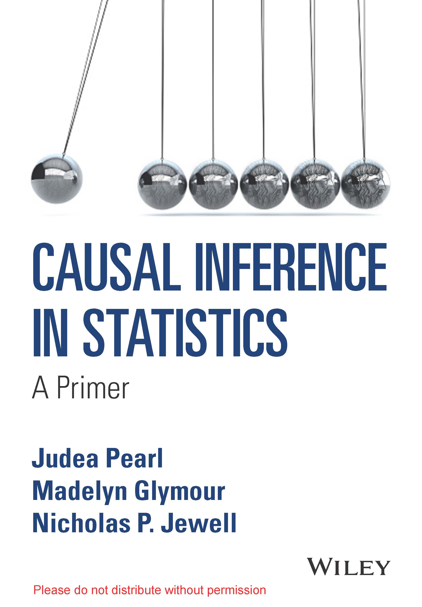
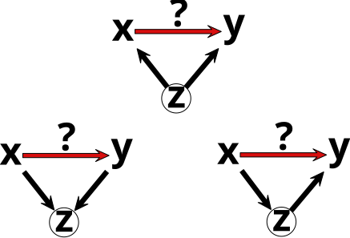
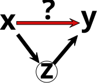

```{r setup, include=FALSE, warning=FALSE}
options(htmltools.dir.version = FALSE)
options(servr.daemon = TRUE)
knitr::opts_chunk$set(
  prompt = FALSE, comment = "", eval = FALSE, echo = TRUE,
  warning = FALSE, message = FALSE, out.width = "85%"
)
library(xaringanthemer)
library(rethinking)
```

```{r xaringan-themer, include=FALSE, eval=TRUE}
style_solarized_light(
  title_slide_background_color = "#586e75",
  header_color = "#586e75",
  text_bold_color = "#cb4b16",
  background_color = "#fdf6e3",
  header_font_google = google_font("DM Sans"),
  text_font_google = google_font("Roboto Condensed", "300", "300i"),
  code_font_google = google_font("Fira Mono"),
  text_font_size = "24px",
  code_font_size = "1rem"
)
xaringanExtra::use_share_again()
xaringanExtra::use_fit_screen()
xaringanExtra::use_tachyons()
xaringanExtra::use_tile_view()
```

```{css, echo=FALSE, eval=TRUE}
.pull-left-70  { float: left;  width: 64%; }
.pull-right-30 { float: right; width: 32%; }
.pull-left-70 > :first-child, .pull-right-30 > :first-child { margin-top: 0; }
```

```{r funcao-plot-dag, include=FALSE, eval=TRUE}
## Desenha um DAG do dagitty com ggplot2, usando as coordenadas definidas em
## `pos` (se ausentes, usa dagitty::graphLayout). Fundo transparente.
## `labels`: vetor nomeado opcional para trocar os rótulos dos nós; rótulos entre
## $...$ são interpretados como LaTeX, ex.: labels = c(x = "$\\beta_x$").
## `side_labels`: vetor nomeado com textos longos escritos ao lado do nó (fora do
## círculo), no lado oposto ao centro do grafo; `side_size` define a fonte e
## `side_padding` o espaço extra reservado nas laterais. O nó mantém o seu rótulo.
## `latent`: nós não observados, desenhados com círculo pontilhado e sem preenchimento.
## Por padrão usa os nós marcados com [latent] no dagitty, ex.: `u [latent]`;
## também pode ser um vetor de nomes, ex.: latent = c("u", "z").
## Os nomes dos nós no DAG devem ser simples (ex.: ux), sem `$` nem `\`.
## `node_radius` (unidades de coordenadas) é calculado automaticamente a partir de
## `node_size` e de fig.width/fig.height do chunk, para as setas começarem e
## terminarem na borda dos nós; pode ser fornecido manualmente.
library(ggplot2)
library(rethinking)
library(bayesplot)
plot_dag <- function(dag, labels = NULL, node_size = 26, label_size = 11,
                     node_radius = NULL, padding = 0.7, arrow_mm = 4,
                     latent = NULL, side_labels = NULL, side_size = 9, side_padding = 1.6,
                     fig_width = knitr::opts_current$get("fig.width"),
                     fig_height = knitr::opts_current$get("fig.height"),
                     node_fill = "#eee8d5", node_color = "#586e75",
                     edge_color = "#657b83", text_color = "#073642") {
  if (is.character(dag)) dag <- dagitty::dagitty(dag)
  coords <- dagitty::coordinates(dag)
  if (anyNA(coords$x) || anyNA(coords$y)) {
    coords <- dagitty::coordinates(dagitty::graphLayout(dag))
    # Reescala para que a maior dimensão ocupe 2 unidades (mesma escala do uso manual)
    escala <- 2 / max(diff(range(coords$x)), diff(range(coords$y)))
    coords$x <- (coords$x - min(coords$x)) * escala
    coords$y <- (coords$y - min(coords$y)) * escala
    dagitty::coordinates(dag) <- coords
  }
  nodes <- data.frame(node = names(coords$x), x = unname(coords$x),
                      y = unname(coords$y))
  if (is.null(latent)) latent <- dagitty::latents(dag)
  nodes$latent <- nodes$node %in% latent
  nodes$label <- nodes$node
  if (!is.null(labels)) {
    i <- match(names(labels), nodes$node)
    nodes$label[i] <- labels
  }
  # Rótulos entre $...$ são interpretados como LaTeX (latex2exp); os demais, como texto
  nodes$label_expr <- vapply(nodes$label, function(l) {
    expr <- if (grepl("\\$", l)) latex2exp::TeX(l, output = "character") else deparse(l)
    paste0("bold(", expr, ")")
  }, character(1))

  # raio do círculo (shape 21) em polegadas
  raio_pol <- 0.375 * (node_size * ggplot2::.pt + 1.2 * ggplot2::.stroke / 2) / 72
  circle_radius <- NULL
  pad_x <- if (is.null(side_labels)) padding else padding + side_padding
  if (is.null(node_radius)) {
    if (is.null(fig_width)) fig_width <- 7
    if (is.null(fig_height)) fig_height <- 5
    # polegadas por unidade de coordenada (coord_equal usa a menor escala)
    pol_por_unid <- min(
      fig_width / (diff(range(nodes$x)) + 2 * pad_x),
      fig_height / (diff(range(nodes$y)) + 2 * padding)
    )
    # raio do círculo mais uma pequena folga para as setas
    node_radius <- (raio_pol + 0.08) / pol_por_unid
    circle_radius <- raio_pol / pol_por_unid
  }
  if (is.null(circle_radius)) circle_radius <- node_radius * 0.85

  edges <- dagitty::edges(dag)
  edges <- edges[edges$e %in% c("->", "<->"), ]
  from <- match(edges$v, nodes$node)
  to <- match(edges$w, nodes$node)
  dx <- nodes$x[to] - nodes$x[from]
  dy <- nodes$y[to] - nodes$y[from]
  len <- sqrt(dx^2 + dy^2)
  edges <- data.frame(
    x = nodes$x[from] + node_radius * dx / len,
    y = nodes$y[from] + node_radius * dy / len,
    xend = nodes$x[to] - node_radius * dx / len,
    yend = nodes$y[to] - node_radius * dy / len,
    bidirected = edges$e == "<->"
  )

  seta <- function(ends) {
    grid::arrow(type = "closed", ends = ends, length = grid::unit(arrow_mm, "mm"))
  }
  p <- ggplot2::ggplot()
  for (bi in c(FALSE, TRUE)) {
    e <- edges[edges$bidirected == bi, ]
    if (nrow(e) == 0) next
    p <- p + ggplot2::geom_segment(
      data = e, ggplot2::aes(x = x, y = y, xend = xend, yend = yend),
      linewidth = 1.1, color = edge_color,
      arrow = seta(if (bi) "both" else "last")
    )
  }
  if (!is.null(side_labels)) {
    i <- match(names(side_labels), nodes$node)
    lateral <- nodes[i, ]
    lateral$texto <- unname(side_labels)
    direita <- lateral$x >= mean(nodes$x)
    deslocamento <- node_radius * 1.15
    lateral$x <- lateral$x + ifelse(direita, deslocamento, -deslocamento)
    lateral$hjust <- ifelse(direita, 0, 1)
    p <- p + ggplot2::geom_text(
      data = lateral, ggplot2::aes(x = x, y = y, label = texto, hjust = hjust),
      color = text_color, size = side_size
    )
  }
  obs <- nodes[!nodes$latent, ]
  lat <- nodes[nodes$latent, ]
  p <- p + ggplot2::geom_point(
    data = obs, ggplot2::aes(x = x, y = y), shape = 21, size = node_size,
    stroke = 1.2, fill = node_fill, color = node_color
  )
  if (nrow(lat) > 0) {
    lat$r <- circle_radius
    p <- p + ggforce::geom_circle(
      data = lat, ggplot2::aes(x0 = x, y0 = y, r = r), fill = NA,
      color = node_color, linetype = "dotted", linewidth = 1.1
    )
  }
  p +
    ggplot2::geom_text(
      data = nodes, ggplot2::aes(x = x, y = y, label = label_expr), parse = TRUE,
      color = text_color, fontface = "bold", size = label_size
    ) +
    ggplot2::coord_equal(
      xlim = range(nodes$x) + c(-pad_x, pad_x),
      ylim = range(nodes$y) + c(-padding, padding), expand = FALSE
    ) +
    ggplot2::theme_void() +
    ggplot2::theme(
      plot.background = ggplot2::element_rect(fill = "transparent", color = NA),
      panel.background = ggplot2::element_rect(fill = "transparent", color = NA),
      plot.margin = ggplot2::margin(8, 12, 8, 12)
    )
}
```

# Para que servem os modelos?

- Previsões: 
  
  - O que vai acontecer?
  - Qual a probabilidade de um evento dado um conjunto de condições? 

--

- Inferência causal:
  - O que causou o evento?
  - Qual o efeito de uma intervenção?

--

- Inferência Contrafactual: 
  - O que teria acontecido se a intervenção tivesse sido diferente?

---

## Causas e correlações

.center[
**Por que correlação não implica causalidade?**
]

---

## Representação gráfica de modelos

- Podemos representar nosso modelo causal proposto por  meio de grafos. Uma seta entre variáveis representa um possível efeito causal.

- Directed acyclic graphs (DAGs) são grafos direcionados e acíclicos, ou seja, não possuem ciclos (uma cadeia de setas que retorna ao mesmo nó).

- Um grafo causal deve ser acíclico pois causas precedem e influenciam efeitos, mas não o contrário.

```{r figura-dag-xy, echo=FALSE, eval=TRUE, out.width="55%", fig.width=8, fig.height=3, fig.align="center", dpi=300, dev="png", dev.args=list(bg="transparent")}
plot_dag("dag {
  x [pos=\"0,0\"]
  y [pos=\"2,0\"]
  ux [latent,pos=\"-1,1\"]
  uy [latent,pos=\"3,1\"]
  ux -> x
  uy -> y
  x -> y
}", labels = c(ux = "$u_x$", uy = "$u_y$"))
```

As variáveis $u_x$ e $u_y$ representam fatores não observados que afetam $x$ e $y$, respectivamente. 
Todas essas variáveis que afetam apenas um nó são independentes entre si por hipótese. 


---

## Introdução à inferência causal

```{r figura-introducao-causal, echo=FALSE, eval=TRUE, out.width="30%", fig.align="center"}

```

---

## Grafos e relações funcionais

.pull-left[
- Um grafo causal representa relações funcionais entre variáveis. Por exemplo, o DAG ao lado representa a seguinte relação funcional:

$$
\begin{aligned}
x_1 &= \mathcal{f}(u_1) \\
x_2 &= \mathcal{f}(x_1, u_2) \\
x_3 &= \mathcal{f}(x_1, u_3) \\
x_4 &= \mathcal{f}(x_2, x_3, u_4) \\
x_5 &= \mathcal{f}(x_4, u_5)
\end{aligned}
$$

- Essas relações são conhecidas como equações estruturais.
- De forma geral, todas as setas que entram em um nó são os **pais** desse nó, e podemos escrever esse modelos como $x_i = \mathcal{f}({pa}_i, u_i)$, onde ${pa}_i$ são os pais de $x_i$.

]
.pull-right[
```{r figura-dag-xy-condicionado_1, echo=FALSE, eval=TRUE, out.width="100%", fig.align="center", dpi=300, dev="png", dev.args=list(bg="transparent")}
plot_dag("dag {
  x5 [pos=\"0,0\"]
  x4 [pos=\"0,1\"]
  x3 [pos=\"-1,2\"]
  x2 [pos=\"1,2\"]
  x1 [pos=\"0,3\"]
  u1 [pos=\"-0.6,4\"]
  u2 [pos=\"1.6,3\"]
  u3 [pos=\"-1.6,3\"]
  u4 [pos=\"-1.5,1\"]
  u5 [pos=\"-1.5,0\"]
  u1 -> x1
  u2 -> x2
  u3 -> x3
  u4 -> x4
  u5 -> x5
  x1 -> x2
  x1 -> x3
  x3 -> x4
  x2 -> x4
  x4 -> x5
}", labels = c(u1 = "$u_1$", u2 = "$u_2$", u3 = "$u_3$", u4 = "$u_4$", u5 = "$u_5$",
    x1 = "$x_1$", x2 = "$x_2$", x3 = "$x_3$", x4 = "$x_4$", x5 = "$x_5$" ))
```
]

---

## Consequências das relações causais

.pull-left[
- Relações causais representadas num DAG implicam relações de independência condicional entre as variáveis.

- Hipótese de independência:

  - Todas as variáveis que afetam apenas uma variável são independentes entre si.

  - Se condicionarmos em todos os pais de uma variável, então essa variável é independente de todas as outras variáveis que não são descendentes dela.
]
.pull-right[
```{r figura-dag-xy-condicionado, echo=FALSE, eval=TRUE, out.width="100%", fig.align="center", dpi=300, dev="png", dev.args=list(bg="transparent")}
plot_dag("dag {
  x5 [pos=\"0,0\"]
  x4 [pos=\"0,1\"]
  x3 [pos=\"-1,2\"]
  x2 [pos=\"1,2\"]
  x1 [pos=\"0,3\"]
  u1 [pos=\"-0.6,4\"]
  u2 [pos=\"1.6,3\"]
  u3 [pos=\"-1.6,3\"]
  u4 [pos=\"-1.5,1\"]
  u5 [pos=\"-1.5,0\"]
  u1 -> x1
  u2 -> x2
  u3 -> x3
  u4 -> x4
  u5 -> x5
  x1 -> x2
  x1 -> x3
  x3 -> x4
  x2 -> x4
  x4 -> x5
}", labels = c(u1 = "$u_1$", u2 = "$u_2$", u3 = "$u_3$", u4 = "$u_4$", u5 = "$u_5$",
    x1 = "$x_1$", x2 = "$x_2$", x3 = "$x_3$", x4 = "$x_4$", x5 = "$x_5$" ))
```
]


---

## Consequências das relações causais

.pull-left[
- Relações causais representadas num DAG implicam relações de independência condicional entre as variáveis.

- Hipótese de independência:

  - Todas as variáveis que afetam apenas uma variável são independentes entre si. (normalmente omitidas nos DAGs)

  - Se condicionarmos em todos os pais de uma variável, então essa variável é independente de todas as outras variáveis que não são descendentes dela.
]
.pull-right[
```{r figura-dag-xy-condicionado-nou, echo=FALSE, eval=TRUE, out.width="100%", fig.align="center", dpi=300, dev="png", dev.args=list(bg="transparent")}
plot_dag("dag {
  x5 [pos=\"0,0\"]
  x4 [pos=\"0,1\"]
  x3 [pos=\"-1,2\"]
  x2 [pos=\"1,2\"]
  x1 [pos=\"0,3\"]
  x1 -> x2
  x1 -> x3
  x3 -> x4
  x2 -> x4
  x4 -> x5
}", labels = c(x1 = "$x_1$", x2 = "$x_2$", x3 = "$x_3$", x4 = "$x_4$", x5 = "$x_5$" ))
```
]

---

# Tríades elementares

Todo grafo de relações causais pode ser decomposto em três tipos de relações elementares: pipes, forks e colliders.

.center[
**Pipe**

```{r figura-caminho, echo=FALSE, eval=TRUE, out.width="25%", fig.align="center"}
knitr::include_graphics("figures/DAGS/pipe.svg")
```

**Fork**

```{r figura-bifurcacao, echo=FALSE, eval=TRUE, out.width="25%", fig.align="center"}
knitr::include_graphics("figures/DAGS/fork.svg")
```

**Collider**

```{r figura-colisor, echo=FALSE, eval=TRUE, out.width="25%", fig.align="center"}
knitr::include_graphics("figures/DAGS/colider.svg")
```
]

---

## Simulando fatores de confusão

Como um fator de confusão afeta nossa estimativa do efeito de $x$ sobre $y$?

```{r figura-dag-confundimento, echo=FALSE, eval=TRUE, out.width="55%", fig.align="center"}

```

---

# Fork

Efeito direto de $x$ sobre $y$, mais um fator de confusão $z$

```{r figura-dag-fork-efeito, echo=FALSE, eval=TRUE, out.width="45%", fig.width=8, fig.height=4, fig.align="center", dpi=300, dev="png", dev.args=list(bg="transparent")}
fork = plot_dag("dag {
  x [pos=\"0,0\"]
  y [pos=\"2,0\"]
  z [pos=\"1,1\"]
  x -> y
  z -> x 
  z -> y
}")
print(fork)
```

Modelo gerador implícito neste DAG: 

$$
\begin{aligned}
y &= \mathcal{f}(x, z, u_y) \\
x &= \mathcal{f}(z, u_x) \\
z &= \mathcal{f}(u_z)
\end{aligned}
$$

---

```{r funcoes-graficos-simulacao, include=FALSE, eval=TRUE}
## Funções auxiliares para os gráficos das simulações (fork, pipe e colisor)
plot_coef <- function(pm, xlim = NULL, verdadeiro = NULL, linha = 1) {
  plot(pm, xlim = xlim, cex = 2, cex.lab = 1.5)
  if (!is.null(verdadeiro)) points(verdadeiro, linha, pch = 19, col = 4, cex = 2)
}
plot_xy <- function(x, y, z) {
  plot(x, y, pch = 19, cex.axis = 1.5, cex.lab = 2)
  points(x[z == 1], y[z == 1], pch = 19, col = 2)
  legend("topleft", legend = c("z = 0", "z = 1"), col = c(1, 2), pch = 19,
         bg = "#fdf6e3", box.col = NA, cex = 1.5)
}
```

## Fork: dados simulados

Aqui o fator de confusão $z$ é uma variável **discreta** (binária):

```{r fork-simulacao, eval=TRUE, echo=TRUE}
set.seed(2)
N <- 200
z <- rbinom(N, 1, 0.5)          # z ~ Bernoulli(0.5)
x <- rnorm(N, 1 + z)            # x ~ Normal(1 + z, 1)
y <- rnorm(N, 1 + 0.5*x + 2*z)  # y ~ Normal(1 + 0.5x + 2z, 1)
```

O efeito verdadeiro de $x$ sobre $y$ é $\beta_{yx} = 0{,}5$.

---

## Modelo sem o fator de confusão

.pull-left[
```{r figura-dag-fork-sem-confusao, echo=FALSE, eval=TRUE, fig.width=8, fig.height=4, fig.align="center", dpi=300, dev="png", dev.args=list(bg="transparent")}
print(fork)
```

Modelo estatístico sem o fator de confusão:

$$
\begin{aligned}
y &\sim \mathrm{Normal}(\mu, \sigma) \\
\mu &= \alpha + \beta_{x}x \\
\alpha &\sim \mathrm{Normal}(0, 5) \\
\beta_{x} &\sim \mathrm{Normal}(0, 0.3) \\
\sigma &\sim \mathrm{Exponential}(1)
\end{aligned}
$$
]
.pull-right[
```{r modelo-fork-sem-confusao, eval=TRUE, echo=TRUE}
m1 <- quap(
  alist(
    y ~ dnorm(mu, sigma),
    mu <- a + bx * x,
    a ~ dnorm(0, 5),
    bx ~ dnorm(0, 0.3),
    sigma ~ dexp(1)
  ),
  data = list(y = y, x = x)
)
precis(m1) |> round(2)
```
]

---

## Fork: estimativa de $\beta_{yx}$ sem controlar por $z$

O ponto azul indica o valor verdadeiro ($0.5$).

```{r figura-fork-coef-sem-correcao, echo=FALSE, eval=TRUE, fig.width=6, fig.height=5, out.width="45%", fig.align="center", dpi=200, dev="png", dev.args=list(bg="transparent")}
plot_coef(precis(m1, pars = "bx"), xlim = c(0, 1.5), verdadeiro = 0.5, linha = 1)
```

---

## Fork: dados e reta ajustada sem controlar por $z$

```{r figura-fork-dados-sem-correcao, echo=FALSE, eval=TRUE, fig.width=6, fig.height=5, out.width="45%", fig.align="center", dpi=200, dev="png", dev.args=list(bg="transparent")}
plot_xy(x, y, z)
abline(coef(m1)["a"], coef(m1)["bx"], lwd = 5, col = 1)
```

---

## Incluindo o fator de confusão

.pull-left[
```{r figura-dag-fork-com-confusao, echo=FALSE, eval=TRUE, fig.width=8, fig.height=4, fig.align="center", dpi=300, dev="png", dev.args=list(bg="transparent")}
print(fork)
```

$$
\begin{aligned}
y &\sim \mathrm{Normal}(\mu, \sigma) \\
\mu &= a + \beta_{x}x + \beta_{z}z \\
\alpha &\sim \mathrm{Normal}(0, 5) \\
\beta_{x} &\sim \mathrm{Normal}(0, 0.3) \\
\beta_{z} &\sim \mathrm{Normal}(0, 0.3) \\
\sigma &\sim \mathrm{Exponential}(1)
\end{aligned}
$$
]
.pull-right[
```{r modelo-fork-com-confusao, eval=TRUE, echo=TRUE}
m2 <- quap(
  alist(
    y ~ dnorm(mu, sigma),
    mu <- a + bx * x + bz * z,
    a ~ dnorm(0, 5),
    bx ~ dnorm(0, 0.3),
    bz ~ dnorm(0,0.3),
    sigma ~ dexp(1)
  ),
  data = list(y = y, x = x, z = z)
)
precis(m2) |> round(2)
```
]

---

## Fork: estimativa de $\beta_{yx}$ controlando por $z$

```{r figura-fork-coef-com-correcao, echo=FALSE, eval=TRUE, fig.width=6, fig.height=5, out.width="45%", fig.align="center", dpi=200, dev="png", dev.args=list(bg="transparent")}
plot_coef(precis(m2, pars = c("bx", "bz")), xlim = c(0, 2.5), verdadeiro = 0.5, linha = 2)
```

---

## Fork: dados e retas ajustadas controlando por $z$

Cinza: reta sem $z$. Preta e vermelha: retas para $z = 0$ e $z = 1$.

```{r figura-fork-dados-com-correcao, echo=FALSE, eval=TRUE, fig.width=6, fig.height=5, out.width="45%", fig.align="center", dpi=200, dev="png", dev.args=list(bg="transparent")}
plot_xy(x, y, z)
abline(coef(m1)["a"], coef(m1)["bx"], lwd = 5, col = "gray")
abline(coef(m2)["a"], coef(m2)["bx"], lwd = 5, col = 1)
abline(coef(m2)["a"] + coef(m2)["bz"], coef(m2)["bx"], lwd = 5, col = 2)
```

---

## Fork: ausência de efeito de $x$ sobre $y$

Agora $x$ **não** afeta $y$: ambos dependem apenas de $z$.

.pull-left[
```{r fork-sem-efeito, eval=TRUE, echo=TRUE}
set.seed(8)
z <- rbinom(N, 1, 0.5)  
x <- rnorm(N, 1 + 2*z)
y <- rnorm(N, 2*z)      
m1 <- quap(
  alist(
    y ~ dnorm(a + bx * x, sigma), 
    a ~ dnorm(0, 5), 
    bx ~ dnorm(0, 1), 
    sigma ~ dexp(1)),
  data = list(y = y, x = x))
m2 <- quap(
  alist(
    y ~ dnorm(a + bx * x + bz * z, sigma),
    a ~ dnorm(0, 5), 
    bx ~ dnorm(0, 1),
    bz ~ dnorm(0, 1), 
    sigma ~ dexp(1)),
  data = list(y = y, x = x, z = z))
```
]
.pull-right[
```{r figura-fork-sem-efeito, echo=FALSE, eval=TRUE, fig.width=6, fig.height=5, fig.align="center", dpi=200, dev="png", dev.args=list(bg="transparent")}
plot_xy(x, y, z)
abline(coef(m1)["a"], coef(m1)["bx"], lwd = 5, col = "gray")
abline(coef(m2)["a"], coef(m2)["bx"], lwd = 5, col = 1)
abline(coef(m2)["a"] + coef(m2)["bz"], coef(m2)["bx"], lwd = 5, col = 2)
```
]

Sem controlar por $z$ (cinza) aparece uma associação espúria; controlando por $z$ a inclinação é ~0.

---

## Fork: efeito de $x$ com sinal oposto ao da correlação

Sem $z$ (cinza) a inclinação tem o sinal errado (paradoxo de Simpson); com $z$, as retas recuperam o efeito negativo.

.pull-left[
```{r fork-efeito-oposto, eval=TRUE, echo=TRUE}
set.seed(1)
z <- rbinom(N, 1, 0.5) 
x <- rnorm(N, -1 - 2*z)  
y <- rnorm(N, -1*x - 5*z) 
m1 <- quap(
  alist(
    y ~ dnorm(a + bx * x, sigma), 
    a ~ dnorm(0, 5), 
    bx ~ dnorm(0, 1), 
    sigma ~ dexp(1)),
  data = list(y = y, x = x))
m2 <- quap(
  alist(
    y ~ dnorm(a + bx * x + bz * z, sigma), 
    a ~ dnorm(0, 5), 
    bx ~ dnorm(0, 1),
    bz ~ dnorm(0, 1), 
    sigma ~ dexp(1)),
  data = list(y = y, x = x, z = z))
```
]

.pull-right[
```{r figura-fork-efeito-oposto, echo=FALSE, eval=TRUE, fig.width=7, fig.height=7, fig.align="center", dpi=200, dev="png", dev.args=list(bg="transparent")}
plot_xy(x, y, z)
abline(coef(m1)["a"], coef(m1)["bx"], lwd = 5, col = "gray")
abline(coef(m2)["a"], coef(m2)["bx"], lwd = 5, col = 1)
abline(coef(m2)["a"] + coef(m2)["bz"], coef(m2)["bx"], lwd = 5, col = 2)
```
]


---

## Exemplos de forks ou fatores de confusão

- Esta é a variável de controle por excelência.
- É o que todo mundo gostaria de estar fazendo ao incluir preditores.
- Muitas variáveis são incluídas no modelo sob a suposição de que são fatores de confusão cujos efeitos precisam ser considerados.

```{r figura-dag-fork-exemplos, echo=FALSE, eval=TRUE, fig.height=4, out.width="50%", fig.align="center", dpi=300, dev="png", dev.args=list(bg="transparent")}
plot_dag("dag {
  x [pos=\"0,0\"]
  y [pos=\"2,0\"]
  z [pos=\"1,1\"]
  x -> y
  z -> x 
  z -> y
}")
```

---

## Tabagismo e câncer

R. A. Fisher, o cara do ML e da teoria evolutiva, não estava convencido de que fumar causava câncer e propôs que uma predisposição não observada causava tanto o câncer quanto o tabagismo.

```{r figura-dag-fork-tabagismo, echo=FALSE, eval=TRUE, fig.width=8, fig.height=4, out.width="70%", fig.align="center", dpi=300, dev="png", dev.args=list(bg="transparent")}
plot_dag("dag {
  x [pos=\"0,0\"]
  y [pos=\"2,0\"]
  z [pos=\"1,1\"]
  x -> y
  z -> x 
  z -> y
}", side_labels = c(x = "Tabaco", y = "Câncer", z = "Genótipo"))
```

---

## Distribuições de espécies

Em Yellowstone, podemos perguntar se o risco de predação por lobos altera onde os alces usam o habitat. Mas relevo e cobertura vegetal também podem afetar a distribuição de ambas as espécies; por isso, a associação espacial entre lobos e alces, sozinha, não identifica o efeito causal (exemplo inspirado em Ripple e Beschta, 2004).

```{r figura-distribuicao-especies, echo=FALSE, eval=TRUE, fig.width=8, fig.height=3.5, out.width="65%", fig.align="center", dpi=300, dev="png", dev.args=list(bg="transparent")}
plot_dag("dag {
  L [pos=\"0,0\"]
  A [pos=\"2,0\"]
  H [pos=\"1,1\"]
  L -> A
  H -> L
  H -> A
}", side_labels = c(L = "Lobos", A = "Alces", H = "Habitat"))
```

---

## Viés por variável omitida

.pull-left[
```{r figura-variavel-omitida, echo=FALSE, eval=TRUE, out.width="100%", fig.align="center"}

```

- Carlos Cinelli e Chad Hazlett (2020).
]
.pull-right[
```{r figura-dag-u, echo=FALSE, eval=TRUE, out.width="100%", fig.align="center", dpi=300, dev="png", dev.args=list(bg="transparent")}
plot_dag("dag {
  x [pos=\"0,0\"]
  y [pos=\"2,0\"]
  u [latent, pos=\"1,1\"]
  z [pos=\"1,-1\"]
  x -> y
  u -> x 
  u -> y
  z -> x
  z -> y
}", side_labels = c(u = "Não observado"))
```
]

---

## Pipe

- Todo o efeito de $x$ sobre $y$ é mediado por $z$

```{r figura-dag-pipe-efeito, echo=FALSE, eval=TRUE, fig.width=8, fig.height=3, out.width="100%", fig.align="center", dpi=300, dev="png", dev.args=list(bg="transparent")}
pipe = plot_dag("dag {
  x [pos=\"0,0\"]
  y [pos=\"2,0\"]
  z [pos=\"1,0\"]
  x -> z 
  z -> y
}")
print(pipe)
```

---

## Modelo gerador implícito neste DAG

$$
\begin{aligned}
y &= \mathcal{f}(z, u_y) \\
z &= \mathcal{f}(x, u_z) \\
x &= \mathcal{f}(u_x)
\end{aligned}
$$

--

### Dados simulados

O mediador $z$ também é binário:

```{r pipe-simulation, eval=TRUE, echo=TRUE}
set.seed(2)
N <- 200
x <- rnorm(N)                    # x ~ Normal(0, 1)
z <- rbinom(N, 1, inv_logit(x))  # z ~ Bernoulli(invlogit(x))
y <- rnorm(N, 1 + 2*z)           # y ~ Normal(1 + 2z, 1)
```

---

## Modelo sem o mediador

.pull-left[
```{r figura-dag-pipe-sem-mediador, echo=FALSE, eval=TRUE, fig.width=9, fig.height=2.5, out.width="60%", fig.align="center", dpi=300, dev="png", dev.args=list(bg="transparent")}
print(pipe)
```

```{r modelo-caminho-sem-mediador, eval=TRUE, echo=TRUE}
m1 <- quap(
  alist(
    y ~ dnorm(mu, sigma),
    mu <- a + bx * x,
    a ~ dnorm(0, 5),
    bx ~ dnorm(0, 2),
    sigma ~ dexp(1)
  ),
  data = list(y = y, x = x)
)
precis(m1) |> round(2)
```
]

--

.pull-right[
### Estimativa do efeito de $x$ sem controlar por $z$

O ponto azul é o efeito total de $x$ sobre $y$ (aprox. $2\,E[p(1-p)]$, com $p = \mathrm{invlogit}(x)$).

```{r figura-pipe-coef-sem-correcao, echo=FALSE, eval=TRUE, fig.width=6, fig.height=5, out.width="60%", fig.align="center", dpi=200, dev="png", dev.args=list(bg="transparent")}
efeito_total <- 2 * mean(inv_logit(x) * (1 - inv_logit(x)))
plot_coef(precis(m1, pars = "bx"), xlim = c(0, 2.5), verdadeiro = efeito_total, linha = 1)
```
]

---

## Pipe: dados e reta ajustada sem controlar por $z$

```{r figura-pipe-sem-correcao, echo=FALSE, eval=TRUE, fig.width=7, fig.height=5, out.width="70%", fig.align="center", dpi=200, dev="png", dev.args=list(bg="transparent")}
plot_xy(x, y, z)
abline(coef(m1)["a"], coef(m1)["bx"], lwd = 5, col = 1)
```

---

## Incluindo o mediador

.pull-left[
```{r modelo-caminho-com-mediador, eval=TRUE, echo=TRUE}
m2 <- quap(
  alist(
    y ~ dnorm(mu, sigma),
    mu <- a + bx * x + bz * z,
    a ~ dnorm(0, 5),
    bx ~ dnorm(0, 2),
    bz ~ dnorm(0, 5),
    sigma ~ dexp(1)
  ),
  data = list(y = y, x = x, z = z)
)
precis(m2) |> round(2)
```
]

--

.pull-right[
### Estimativa do efeito de $x$ controlando por $z$

O ponto azul é o efeito direto de $x$ sobre $y$ ($0$): controlar pelo mediador bloqueia o caminho.

```{r figura-pipe-coef-com-correcao, echo=FALSE, eval=TRUE, fig.width=6, fig.height=5, out.width="60%", fig.align="center", dpi=200, dev="png", dev.args=list(bg="transparent")}
plot_coef(precis(m2, pars = c("bx", "bz")), xlim = c(-0.3, 2.5), verdadeiro = efeito_total, linha = 2)
```
]

---

## Pipe: dados e retas ajustadas controlando por $z$

```{r figura-pipe-com-correcao, echo=FALSE, eval=TRUE, fig.width=7, fig.height=5, out.width="70%", fig.align="center", dpi=200, dev="png", dev.args=list(bg="transparent")}
plot_xy(x, y, z)
abline(coef(m2)["a"], coef(m2)["bx"], lwd = 5, col = 1)
abline(coef(m2)["a"] + coef(m2)["bz"], coef(m2)["bx"], lwd = 5, col = 2)
```

---

## Z é um Pipe vs. Z é um Fork

.pull-left[
```{r figura-dag-pipe-comp, echo=FALSE, eval=TRUE, fig.width=8, fig.height=4, out.width="90%", fig.align="center", dpi=300, dev="png", dev.args=list(bg="transparent")}
plot_dag("dag {
  x [pos=\"0,0\"]
  y [pos=\"2,0\"]
  z [pos=\"1,1\"]
  x -> z 
  z -> y
  x -> y
}")
```

- Incluir o mediador $z$ no modelo bloqueia o **caminho causal** de $x$ para $y$, mascarando o efeito total de $x$ sobre $y$.

]
.pull-right[

```{r figura-dag-fork-comp, echo=FALSE, eval=TRUE, fig.width=8, fig.height=4, out.width="90%", fig.align="center", dpi=300, dev="png", dev.args=list(bg="transparent")}
plot_dag("dag {
  x [pos=\"0,0\"]
  y [pos=\"2,0\"]
  z [pos=\"1,1\"]
  z -> x
  z -> y
  x -> y
}")
```

- Incluir o fator de confusão $z$ no modelo bloqueia o **caminho espúrio** de $x$ para $y$, recuperando o efeito causal de $x$ sobre $y$.

]

---

## Exemplos de caminhos ou mediadores

- Incluir um mediador em nossos modelos pode ter consequências graves. 

- Um erro comum é incluir variáveis medidas após o tratamento.

```{r figura-dag-pipe-exemplos, echo=FALSE, eval=TRUE, out.width="25%", fig.align="center"}

```

---

## Variáveis pós-tratamento

Ao avaliar a eficácia de um tratamento contra fungos, grande parte do efeito do tratamento sobre o peso final pode ser mediada pela presença do fungo. Como o fungo é medido após o tratamento, incluí-lo como controle pode mascarar o efeito total da intervenção.

```{r figura-dag-tratamento-fungico, echo=FALSE, eval=TRUE, fig.width=10, fig.height=5, out.width="80%",fig.align="center", dpi=300, dev="png",  dev.args=list(bg="transparent")}
plot_dag("dag {
  T [pos=\"1,2\"]
  Pi [pos=\"3,3\"]
  Pf [pos=\"3,2\"]
  F [pos=\"2, 1\"]
  Pi -> Pf
  T -> Pf
  T -> F
  F -> Pf
}", side_labels = c(T = "Tratamento", Pi = "Peso inicial", Pf = "Peso final", F = "Fungo"))
```

---

## Exemplo: intervenção, educação e qualidade parental

Intervenção de apoio familiar ($T$), qualidade parental pós-tratamento ($Q$) e nota na prova ($Y$). Educação dos pais ($X$) é pré-tratamento.

```{r figura-dag-intervencao-educacao, echo=FALSE, eval=TRUE, fig.width=10, fig.height=4, out.width="80%",fig.align="center", dpi=300, dev="png",  dev.args=list(bg="transparent")}
plot_dag("dag {
  T [pos=\"1.5,2\"]
  X [pos=\"3,0\"]
  Q [pos=\"2.25,1\"]
  Y [pos=\"4,1\"]
  X -> Q
  X -> Y
  T -> Q
  T -> Y
  Q -> Y
}", side_labels = c(T = "Intervenção", X = "Educação dos pais", Q = "Qualidade\nparental", Y = "Nota"))
```

---

## Calculando o efeito causal médio da intervenção

Intervenção **randomizada**; fixamos uma categoria de educação parental ($X$). A tabela mostra perfis potenciais de $Q$ e notas sem/com intervenção.

| Perfil potencial | Proporção | Qualidade parental sem $T$ $\to$ com $T$ | Nota na prova sem $T$ $\to$ com $T$ |
|:--|--:|:--:|:--:|
| Qualidade baixa de qualquer forma | 10% | Baixa $\to$ Baixa | 60 $\to$ 70 |
| Qualidade melhora com a intervenção | 70% | Baixa $\to$ Alta | 65 $\to$ 80 |
| Qualidade alta de qualquer forma | 20% | Alta $\to$ Alta | 90 $\to$ 100 |

```{r medias-potenciais-educacao, eval=TRUE, echo=TRUE}
media_controle   <- 0.1 * 60 + 0.7 * 65 + 0.2 * 90
media_tratamento <- 0.1 * 70 + 0.7 * 80 + 0.2 * 100
media_tratamento-media_controle
```

---

## Condicionar em $Q$ 

Condicionar em $Q$ mistura perfis potenciais diferentes:

| Qualidade observada | Controle | Tratamento | Efeito (errado) |
|:--|:--|:--|--:|
| Baixa | Baixa de qualquer forma + melhora com tratamento; nota média **64,4** | Só baixa de qualquer forma; nota média **70,0** | **+5,6** |
| Alta | Só alta de qualquer forma; nota média **90,0** | Melhora com tratamento + alta de qualquer forma; nota média **84,4** | **−5,6** |

```{r diferencas-condicionais-educacao, eval=TRUE, echo=TRUE}
c(Q_baixa = 70 - (0.1 * 60 + 0.7 * 65) / 0.8,
  Q_alta = (0.7 * 80 + 0.2 * 100) / 0.9 - 90)
```

Em $Q$ baixa, o controle também inclui quem melhoraria com a intervenção; em $Q$ alta, só o grupo tratado inclui essas pessoas. Portanto, as diferenças entre controle e tratamentocomparam grupos distintos.

---

## Nota na prova: sem e com condicionamento em $Q$

```{r figura-simulacao-pos-tratamento, echo=FALSE, eval=TRUE, fig.width=11, fig.height=5, out.width="95%", fig.align="center", dpi=250, dev="png", dev.args=list(bg="transparent")}
set.seed(5781)
n <- 500
perfil <- sample(1:3, n, replace = TRUE, prob = c(0.1, 0.7, 0.2))
tratamento <- rbinom(n, 1, 0.5)
dados_pos <- data.frame(
  tratamento = factor(tratamento, levels = 0:1,
                      labels = c("Controle", "Intervenção")),
  qualidade = factor(c(0, 0, 1)[perfil] + tratamento * c(0, 1, 0)[perfil],
                     levels = 0:1,
                     labels = c("Baixa", "Alta")),
  nota = c(60, 65, 90)[perfil] + tratamento * c(10, 15, 10)[perfil] +
    rnorm(n, 0, 4)
)
modelo_total <- lm(nota ~ tratamento, data = dados_pos)
modelo_condicional <- lm(nota ~ tratamento * qualidade, data = dados_pos)
dados_plot <- rbind(
  transform(dados_pos, painel = "Sem condicionar em Q"),
  transform(dados_pos, painel = "Condicionando em Q")
)
pred_total <- data.frame(
  tratamento = factor(c("Controle", "Intervenção"),
                      levels = levels(dados_pos$tratamento)),
  painel = "Sem condicionar em Q"
)
pred_total$nota <- predict(modelo_total, newdata = pred_total)
pred_condicional <- expand.grid(
  tratamento = levels(dados_pos$tratamento),
  qualidade = levels(dados_pos$qualidade),
  KEEP.OUT.ATTRS = FALSE,
  stringsAsFactors = FALSE
)
pred_condicional$tratamento <- factor(
  pred_condicional$tratamento, levels = levels(dados_pos$tratamento)
)
pred_condicional$qualidade <- factor(
  pred_condicional$qualidade, levels = levels(dados_pos$qualidade)
)
pred_condicional$painel <- "Condicionando em Q"
pred_condicional$nota <- predict(modelo_condicional, newdata = pred_condicional)
pred_condicional$painel <- factor(pred_condicional$painel, levels = c("Condicionando em Q", "Sem condicionar em Q"))
ggplot2::ggplot(
  dados_plot,
  ggplot2::aes(x = tratamento, y = nota, color = qualidade)
) +
  ggplot2::geom_jitter(width = 0.12, height = 0.5, alpha = 0.28, size = 1.5) +
  ggplot2::facet_wrap(~painel, nrow = 1) +
  ggplot2::geom_line(
    data = pred_total,
    ggplot2::aes(x = tratamento, y = nota, group = 1),
    inherit.aes = FALSE, color = "#333333", linewidth = 1.2
  ) +
  ggplot2::geom_point(
    data = pred_total,
    ggplot2::aes(x = tratamento, y = nota),
    inherit.aes = FALSE, color = "#333333", size = 2.5
  ) +
  ggplot2::geom_line(
    data = pred_condicional,
    ggplot2::aes(x = tratamento, y = nota, color = qualidade, group = qualidade),
    inherit.aes = FALSE, linewidth = 1.2
  ) +
  ggplot2::geom_point(
    data = pred_condicional,
    ggplot2::aes(x = tratamento, y = nota, color = qualidade),
    inherit.aes = FALSE, size = 2.5
  ) +
  ggplot2::scale_color_manual(
    values = c("Baixa" = "#d95f02", "Alta" = "#1b9e77"),
    name = "Qualidade parental\nobservada"
  ) +
  ggplot2::labs(x = NULL, y = "Nota na prova") +
  ggplot2::theme_minimal(base_size = 13) +
  ggplot2::theme(legend.position = "bottom")
```

---

## Condicionamento em variáveis pós-tratamento

.pull-left-70[
```{r figura-variaveis-pos-tratamento, echo=FALSE, eval=TRUE, out.width="90%", fig.align="center"}

```

Montgomery et al. (2018).
]

--


- **Exercicio:** Uma colega te escreve dizendo que está avaliando o efeito de uma droga numa população de macacos. A pergunta é  se a droga afeta a pressão arterial. Ela mediu a quantidade de droga no sangue e a pressão arterial. A dúvida é se ela deveria incluir a quantidade de droga no sangue como covariável no modelo. 

O que você responde?


---

# Collider

## $x$ não afeta $y$, mas ambos afetam $z$

```{r figura-dag-colisor-introducao, echo=FALSE, eval=TRUE, fig.width=8, fig.height=3, out.width="100%", fig.align="center", dpi=300, dev="png", dev.args=list(bg="transparent")}
  plot_dag("dag {
  x [pos=\"0,1\"]
  y [pos=\"2,1\"]
  z [pos=\"1,0\"]
  x -> z
  y -> z
}")
```

---

## Modelo gerador implícito neste DAG

$$
\begin{aligned}
y &\sim \mathcal{f}(u_y) \\
x &\sim \mathcal{f}(u_x) \\
z &\sim \mathcal{f}(x, y, u_z)
\end{aligned}
$$

--

### Dados simulados

O colisor $z$ também é binário:

```{r colisor-simulacao, eval=TRUE, echo=TRUE}
set.seed(1)
N <- 200
x <- rnorm(N)                                # x ~ Normal(0, 1)
y <- rnorm(N)                                # y ~ Normal(0, 1)
z <- rbinom(N, 1, inv_logit(2*x + 2*y - 2))  # z ~ Bernoulli(invlogit(2x + 2y - 2))
```

---

## Modelo sem o colisor

.pull-left[
```{r figura-dag-colisor-linear, echo=FALSE, eval=TRUE, fig.width=10, fig.height=2, out.width="90%", fig.align="center", dpi=300, dev="png", dev.args=list(bg="transparent")}
  plot_dag("dag {
  x [pos=\"0,0\"]
  y [pos=\"2,0\"]
  z [pos=\"1,0\"]
  x -> z
  y -> z
}")
```

```{r modelo-colisor-sem-condicionamento, eval=TRUE, echo=TRUE}
m1 <- quap(
  alist(
    y ~ dnorm(mu, sigma),
    mu <- a + bx * x,
    a ~ dnorm(0, 5),
    bx ~ dnorm(0, 2),
    sigma ~ dexp(1)
  ),
  data = list(y = y, x = x)
)
precis(m1) |> round(2)
```
]
.pull-right[
- Estimativa do efeito de $x$ sem condicionar em $z$
- O ponto azul indica o valor verdadeiro ($0$).

```{r figura-colisor-coef-sem-condicionamento, echo=FALSE, eval=TRUE, fig.width=6, fig.height=5, out.width="90%", fig.align="center", dpi=200, dev="png", dev.args=list(bg="transparent")}
plot_coef(precis(m1, pars = "bx"), xlim = c(-0.5, 2.5), verdadeiro = 0, linha = 1)
```
]

---

## Collider: dados e reta sem condicionar em $z$

```{r figura-colisor-sem-condicionamento, echo=FALSE, eval=TRUE, fig.width=7, fig.height=5, out.width="70%", fig.align="center", dpi=200, dev="png", dev.args=list(bg="transparent")}
plot_xy(x, y, z)
abline(coef(m1)["a"], coef(m1)["bx"], lwd = 5, col = 1)
```

---

## Condicionando no colisor

.pull-left[
```{r modelo-colisor-com-condicionamento, eval=TRUE, echo=TRUE}
m2 <- quap(
  alist(
    y ~ dnorm(mu, sigma),
    mu <- a + bx * x + bz * z,
    a ~ dnorm(0, 5),
    bx ~ dnorm(0, 2),
    bz ~ dnorm(0, 5),
    sigma ~ dexp(1)
  ),
  data = list(y = y, x = x, z = z)
)
precis(m2) |> round(2)
```
]

--

.pull-right[
- Estimativa do efeito de $x$ condicionando em $z$
- O ponto azul indica o valor verdadeiro ($0$). 

```{r figura-colisor-coef-com-condicionamento, echo=FALSE, eval=TRUE, fig.width=6, fig.height=5, out.width="90%", fig.align="center", dpi=200, dev="png", dev.args=list(bg="transparent")}
plot_coef(precis(m2, pars = c("bx", "bz")), verdadeiro = 0, linha = 2, xlim = c(-0.5, 2.5))
```
]

---

## Collider: dados e reta condicionando em $z$

.pull-left-70[
```{r figura-colisor-com-condicionamento, echo=FALSE, eval=TRUE, fig.width=7, fig.height=4.6, out.width="100%", fig.align="center", dpi=200, dev="png", dev.args=list(bg="transparent")}
par(mar = c(4.5, 4.5, 0.5, 0.5))
plot_xy(x, y, z)
abline(coef(m2)["a"], coef(m2)["bx"], lwd = 5, col = 1)
abline(coef(m2)["a"] + coef(m2)["bz"], coef(m2)["bx"], lwd = 5, col = 2)
```
]
.pull-right-30[
- Condicionar pelo colisor cria uma associação espúria entre $x$ e $y$ dentro de cada grupo de $z$.
- Essa associação é significativa e ajuda na previsão de $y$ a partir de $x$, mas não é causal.
]

---

## Collideres podem enviesar nossas amostras

```{r figura-dag-colisor-restaurantes, echo=FALSE, eval=TRUE, fig.width=15, fig.height=7, out.width="100%", fig.align="center", dpi=300, dev="png", dev.args=list(bg="transparent")}
  plot_dag("dag {
  Q [pos=\"0,1\"]
  L [pos=\"2,1\"]
  E [pos=\"1,0\"]
  Q -> E
  L -> E
}", side_labels = c(Q = "Qualidade do restaurante", L = "Localização do restaurante", E = "Existência do restaurante"))
```

---

## Colisor: restaurantes que existem

Qualidade e localização são independentes, mas ambas aumentam a chance de o restaurante existir.

```{r figura-simulacao-restaurantes, echo=FALSE, eval=TRUE, fig.width=9, fig.height=5.5, out.width="75%", fig.align="center", dpi=250, dev="png", dev.args=list(bg="transparent")}
set.seed(11)
n <- 500
rest <- data.frame(Q = rnorm(n), L = rnorm(n))
rest$E <- rbinom(n, 1, inv_logit(3 * rest$Q + 3 * rest$L - 2))
rest$existe <- factor(rest$E, levels = 0:1, labels = c("Fechou", "Existe"))

ggplot2::ggplot(rest, ggplot2::aes(L, Q, color = existe)) +
  ggplot2::geom_point(alpha = 0.6, size = 1.8) +
  ggplot2::geom_smooth(
    data = subset(rest, E == 1), method = "lm", formula = y ~ x,
    se = FALSE, linewidth = 1.8
  ) +
  ggplot2::scale_color_manual(
    values = c("Fechou" = "#b8b8b8", "Existe" = "#d95f02"), name = NULL
  ) +
  ggplot2::labs(x = "Qualidade da Localização", y = "Qualidade da Comida") +
  ggplot2::theme_minimal(base_size = 15) +
  ggplot2::theme(
    legend.position = "bottom",
    plot.background = ggplot2::element_rect(fill = "transparent", color = NA),
    panel.background = ggplot2::element_rect(fill = "transparent", color = NA)
  )
```


---

## AIC e signicância não vão te salvar

```{r collider-significance_1, echo=TRUE, eval=TRUE, fig.width=6, fig.height=5, out.width="60%", fig.align="center", dpi=200, dev="png", dev.args=list(bg="transparent")}
set.seed(1); N <- 100
x <- rnorm(N); y <- rnorm(N); 
z <- rnorm(N, mean = x + y)
m1 <- lm(y ~ x); summary(m1)
```

---

## AIC e signicância não vão te salvar

.pull-left[
```{r collider-significance_2, echo=TRUE, eval=TRUE, fig.width=6, fig.height=5, out.width="60%", fig.align="center", dpi=200, dev="png", dev.args=list(bg="transparent")}
m2 <- lm(y ~ x + z)
summary(m2)
```
]

--

.pull-right[
```{r collider-aic, echo=TRUE, eval=TRUE}
bbmle::AICtab(m1, m2)
```
]

---

## Referências

- Cinelli e Hazlett (2020).
- Montgomery et al. (2018).
- Ripple, W. J. e Beschta, R. L. (2004). “Wolves and the ecology of fear: Can predation risk structure ecosystems?” *BioScience*, 54(8), 755–766.
- Westreich et al. (2013).
