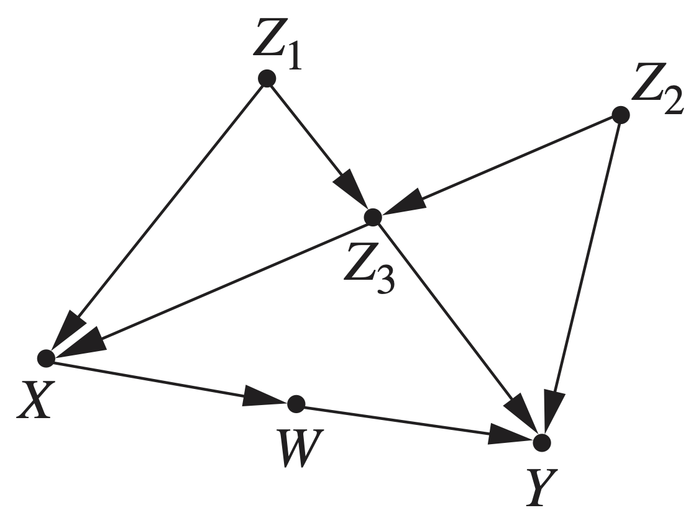
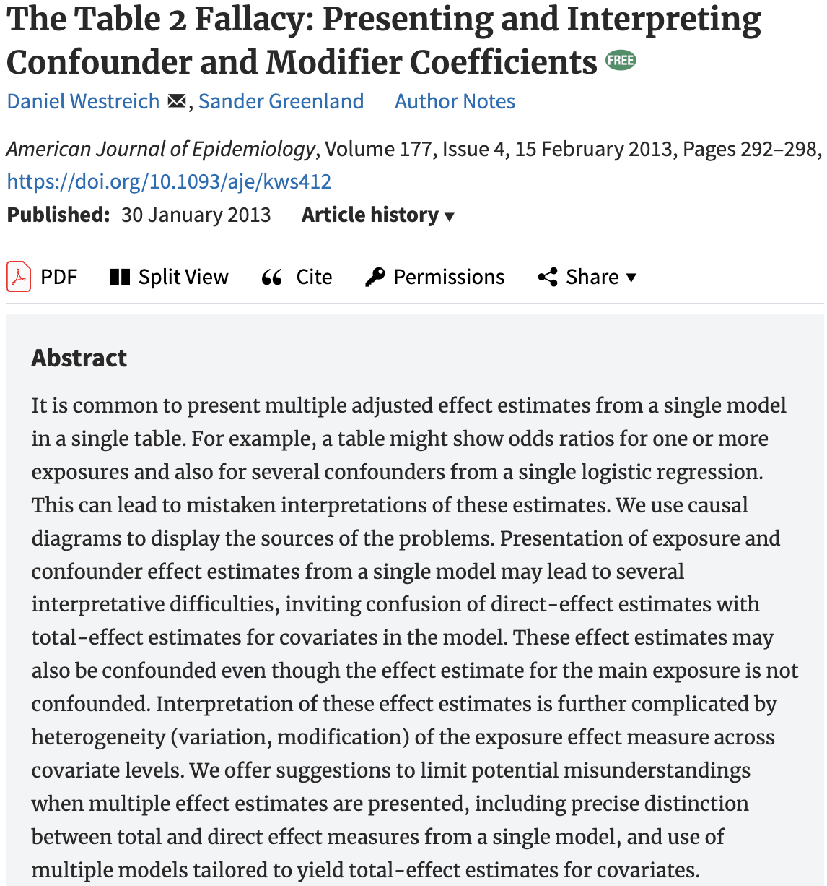
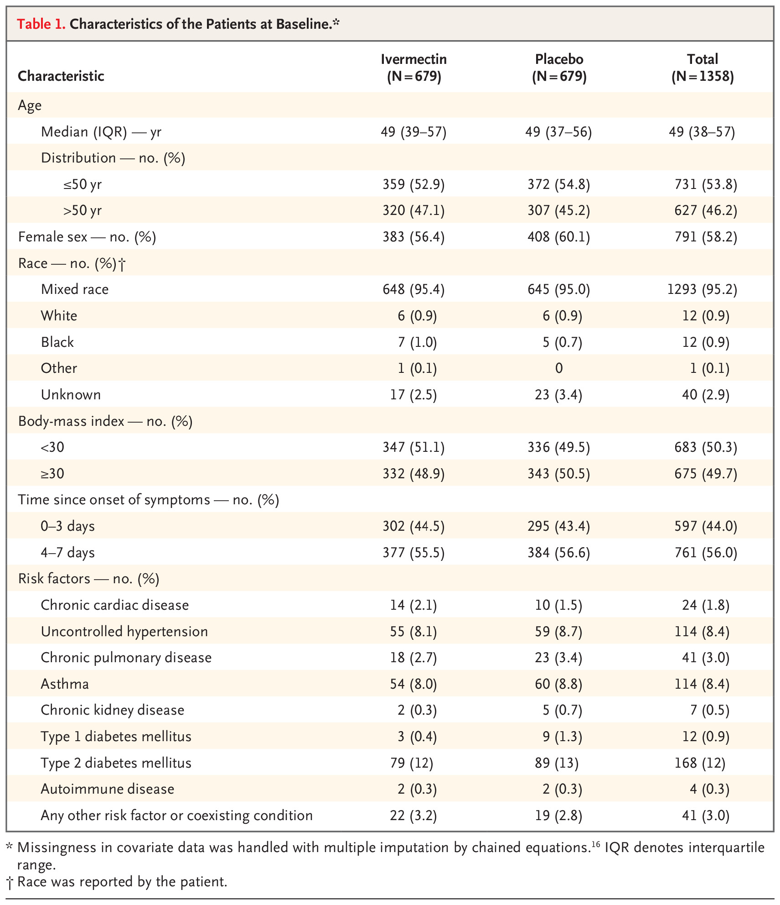
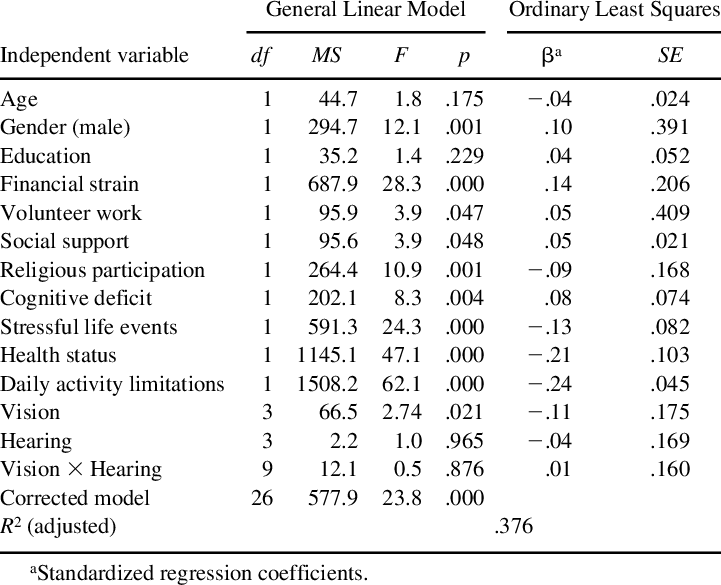

```{r setup, include=FALSE, warning=FALSE}
options(htmltools.dir.version = FALSE)
options(servr.daemon = TRUE)
knitr::opts_chunk$set(
  prompt = FALSE, comment = "", eval = FALSE, echo = TRUE,
  warning = FALSE, message = FALSE, out.width = "85%"
)
library(xaringanthemer)
library(rethinking)
```

```{r xaringan-themer, include=FALSE, eval=TRUE}
style_solarized_light(
  title_slide_background_color = "#586e75",
  header_color = "#586e75",
  text_bold_color = "#cb4b16",
  background_color = "#fdf6e3",
  header_font_google = google_font("DM Sans"),
  text_font_google = google_font("Roboto Condensed", "300", "300i"),
  code_font_google = google_font("Fira Mono"),
  text_font_size = "24px",
  code_font_size = "1rem"
)
xaringanExtra::use_share_again()
xaringanExtra::use_fit_screen()
xaringanExtra::use_tachyons()
xaringanExtra::use_tile_view()
```

```{css, echo=FALSE, eval=TRUE}
.pull-left-70  { float: left;  width: 64%; }
.pull-right-30 { float: right; width: 32%; }
.pull-left-70 > :first-child, .pull-right-30 > :first-child { margin-top: 0; }
```

```{r funcao-plot-dag, include=FALSE, eval=TRUE}
## Desenha um DAG do dagitty com ggplot2, usando as coordenadas definidas em
## `pos` (se ausentes, usa dagitty::graphLayout). Fundo transparente.
## `labels`: vetor nomeado opcional para trocar os rótulos dos nós; rótulos entre
## $...$ são interpretados como LaTeX, ex.: labels = c(x = "$\\beta_x$").
## `side_labels`: vetor nomeado com textos longos escritos ao lado do nó (fora do
## círculo), no lado oposto ao centro do grafo; `side_size` define a fonte e
## `side_padding` o espaço extra reservado nas laterais. O nó mantém o seu rótulo.
## `latent`: nós não observados, desenhados com círculo pontilhado e sem preenchimento.
## Por padrão usa os nós marcados com [latent] no dagitty, ex.: `u [latent]`;
## também pode ser um vetor de nomes, ex.: latent = c("u", "z").
## Os nomes dos nós no DAG devem ser simples (ex.: ux), sem `$` nem `\`.
## `node_radius` (unidades de coordenadas) é calculado automaticamente a partir de
## `node_size` e de fig.width/fig.height do chunk, para as setas começarem e
## terminarem na borda dos nós; pode ser fornecido manualmente.
library(ggplot2)
library(rethinking)
library(bayesplot)
plot_dag <- function(dag, labels = NULL, node_size = 26, label_size = 11,
                     node_radius = NULL, padding = 0.7, arrow_mm = 4,
                     latent = NULL, side_labels = NULL, side_size = 9, side_padding = 1.6,
                     fig_width = knitr::opts_current$get("fig.width"),
                     fig_height = knitr::opts_current$get("fig.height"),
                     node_fill = "#eee8d5", node_color = "#586e75",
                     edge_color = "#657b83", text_color = "#073642") {
  if (is.character(dag)) dag <- dagitty::dagitty(dag)
  coords <- dagitty::coordinates(dag)
  if (anyNA(coords$x) || anyNA(coords$y)) {
    coords <- dagitty::coordinates(dagitty::graphLayout(dag))
    # Reescala para que a maior dimensão ocupe 2 unidades (mesma escala do uso manual)
    escala <- 2 / max(diff(range(coords$x)), diff(range(coords$y)))
    coords$x <- (coords$x - min(coords$x)) * escala
    coords$y <- (coords$y - min(coords$y)) * escala
    dagitty::coordinates(dag) <- coords
  }
  nodes <- data.frame(node = names(coords$x), x = unname(coords$x),
                      y = unname(coords$y))
  if (is.null(latent)) latent <- dagitty::latents(dag)
  nodes$latent <- nodes$node %in% latent
  nodes$label <- nodes$node
  if (!is.null(labels)) {
    i <- match(names(labels), nodes$node)
    nodes$label[i] <- labels
  }
  # Rótulos entre $...$ são interpretados como LaTeX (latex2exp); os demais, como texto
  nodes$label_expr <- vapply(nodes$label, function(l) {
    expr <- if (grepl("\\$", l)) latex2exp::TeX(l, output = "character") else deparse(l)
    paste0("bold(", expr, ")")
  }, character(1))

  # raio do círculo (shape 21) em polegadas
  raio_pol <- 0.375 * (node_size * ggplot2::.pt + 1.2 * ggplot2::.stroke / 2) / 72
  circle_radius <- NULL
  pad_x <- if (is.null(side_labels)) padding else padding + side_padding
  if (is.null(node_radius)) {
    if (is.null(fig_width)) fig_width <- 7
    if (is.null(fig_height)) fig_height <- 5
    # polegadas por unidade de coordenada (coord_equal usa a menor escala)
    pol_por_unid <- min(
      fig_width / (diff(range(nodes$x)) + 2 * pad_x),
      fig_height / (diff(range(nodes$y)) + 2 * padding)
    )
    # raio do círculo mais uma pequena folga para as setas
    node_radius <- (raio_pol + 0.08) / pol_por_unid
    circle_radius <- raio_pol / pol_por_unid
  }
  if (is.null(circle_radius)) circle_radius <- node_radius * 0.85

  edges <- dagitty::edges(dag)
  edges <- edges[edges$e %in% c("->", "<->"), ]
  from <- match(edges$v, nodes$node)
  to <- match(edges$w, nodes$node)
  dx <- nodes$x[to] - nodes$x[from]
  dy <- nodes$y[to] - nodes$y[from]
  len <- sqrt(dx^2 + dy^2)
  edges <- data.frame(
    x = nodes$x[from] + node_radius * dx / len,
    y = nodes$y[from] + node_radius * dy / len,
    xend = nodes$x[to] - node_radius * dx / len,
    yend = nodes$y[to] - node_radius * dy / len,
    bidirected = edges$e == "<->"
  )

  seta <- function(ends) {
    grid::arrow(type = "closed", ends = ends, length = grid::unit(arrow_mm, "mm"))
  }
  p <- ggplot2::ggplot()
  for (bi in c(FALSE, TRUE)) {
    e <- edges[edges$bidirected == bi, ]
    if (nrow(e) == 0) next
    p <- p + ggplot2::geom_segment(
      data = e, ggplot2::aes(x = x, y = y, xend = xend, yend = yend),
      linewidth = 1.1, color = edge_color,
      arrow = seta(if (bi) "both" else "last")
    )
  }
  if (!is.null(side_labels)) {
    i <- match(names(side_labels), nodes$node)
    lateral <- nodes[i, ]
    lateral$texto <- unname(side_labels)
    direita <- lateral$x >= mean(nodes$x)
    deslocamento <- node_radius * 1.15
    lateral$x <- lateral$x + ifelse(direita, deslocamento, -deslocamento)
    lateral$hjust <- ifelse(direita, 0, 1)
    p <- p + ggplot2::geom_text(
      data = lateral, ggplot2::aes(x = x, y = y, label = texto, hjust = hjust),
      color = text_color, size = side_size
    )
  }
  obs <- nodes[!nodes$latent, ]
  lat <- nodes[nodes$latent, ]
  p <- p + ggplot2::geom_point(
    data = obs, ggplot2::aes(x = x, y = y), shape = 21, size = node_size,
    stroke = 1.2, fill = node_fill, color = node_color
  )
  if (nrow(lat) > 0) {
    lat$r <- circle_radius
    p <- p + ggforce::geom_circle(
      data = lat, ggplot2::aes(x0 = x, y0 = y, r = r), fill = NA,
      color = node_color, linetype = "dotted", linewidth = 1.1
    )
  }
  p +
    ggplot2::geom_text(
      data = nodes, ggplot2::aes(x = x, y = y, label = label_expr), parse = TRUE,
      color = text_color, fontface = "bold", size = label_size
    ) +
    ggplot2::coord_equal(
      xlim = range(nodes$x) + c(-pad_x, pad_x),
      ylim = range(nodes$y) + c(-padding, padding), expand = FALSE
    ) +
    ggplot2::theme_void() +
    ggplot2::theme(
      plot.background = ggplot2::element_rect(fill = "transparent", color = NA),
      panel.background = ggplot2::element_rect(fill = "transparent", color = NA),
      plot.margin = ggplot2::margin(8, 12, 8, 12)
    )
}
```

## Recaptitulando

.pull-left[
- O uso de modelos estatísticos para estimativas de efeitos causais depende de um modelo causal subjacente.
- O modelo causal pode ser representado por um DAG, que representa um conjunto de hipótese sobre as independências condicionais entre as variáveis.
- Todas as relações contidas nos DAGs podem ser decompostas em 3 tipos de estruturas: **pipes**, **forks** e **colliders**.
- Cada tipo de relação tem implicações diferentes para o efeito estimado por um modelo estatístico.
]
.pull-right[
**Pipe**

```{r figura-caminho, echo=FALSE, eval=TRUE, out.width="90%", fig.align="center"}

```

**Fork**

```{r figura-bifurcacao, echo=FALSE, eval=TRUE, out.width="90%", fig.align="center"}

```

**Collider**

```{r figura-colisor, echo=FALSE, eval=TRUE, out.width="90%", fig.align="center"}

```
]

---

## Usando DAGs para construir modelos

.pull-left[
- Se representarmos nossas relações causais propostas por meio de DAGs, teremos um conjunto de regras que nos informa quais variáveis incluir no modelo para estimar determinado efeito.

- **do-calculus**: Existem regras matemáticas que permitem derivar o efeito causal de uma variável sobre outra a partir de um DAG.


$$
\begin{aligned}
x_1 &= \mathcal{f}(u_1) \\
x_2 &= \mathcal{f}(x_1, u_2) \\
x_3 &= \mathcal{f}(x_1, u_3) \\
x_4 &= \mathcal{f}(x_2, x_3, u_4) \\
x_5 &= \mathcal{f}(x_4, u_5)
\end{aligned}
$$

]
.pull-right[
```{r figura-dag-xy-condicionado-nou, echo=FALSE, eval=TRUE, out.width="100%", fig.align="center", dpi=300, dev="png", dev.args=list(bg="transparent")}
plot_dag("dag {
  x5 [pos=\"0,0\"]
  x4 [pos=\"0,1\"]
  x3 [pos=\"-1,2\"]
  x2 [pos=\"1,2\"]
  x1 [pos=\"0,3\"]
  x1 -> x2
  x1 -> x3
  x3 -> x4
  x2 -> x4
  x4 -> x5
}", labels = c(x1 = "$x_1$", x2 = "$x_2$", x3 = "$x_3$", x4 = "$x_4$", x5 = "$x_5$" ))
```
] 

---

## Representando intervenções

.pull-left[

- Vamos imaginar uma intervenção na variável "regador" ($x_2$), que é uma variável que podemos manipular. A intervenção é representada por um nó de ação $do(x_2)$, que remove todas as setas que entram em $x_2$.

$$
\begin{aligned}
x_1 &= \mathcal{f}(u_1) \\
x_2 &= \mathcal{f}(x_1, u_2) \\
x_3 &= \mathcal{f}(x_1, u_3) \\
x_4 &= \mathcal{f}(x_2, x_3, u_4) \\
x_5 &= \mathcal{f}(x_4, u_5)
\end{aligned}
$$

]
.pull-right[
```{r figura-dag-xy-condicionado-chuva, echo=FALSE, eval=TRUE, fig.height = 7, fig.width=10, out.width="100%", fig.align="center", dpi=300, dev="png", dev.args=list(bg="transparent")}
plot_dag("dag {
  x5 [pos=\"0,0\"]
  x4 [pos=\"0,1\"]
  x3 [pos=\"-1,2\"]
  x2 [pos=\"1,2\"]
  x1 [pos=\"0,3\"]
  x1 -> x2
  x1 -> x3
  x3 -> x4
  x2 -> x4
  x4 -> x5
}", labels = c(x1 = "$x_1$", x2 = "$x_2$", x3 = "$x_3$", x4 = "$x_4$", x5 = "$x_5$"),
side_labels = c(x1 = "Estação", x2 = "Regador", x3 = "Chuva", x4 = "Umidade do solo", x5 = "Crescimento da planta"))
```
] 

---

## Representando intervenções

.pull-left[

- Vamos imaginar uma intervenção na variável "regador" ($x_2$), que é uma variável que podemos manipular. A intervenção é representada por um nó de ação $do(x_2)$, que remove todas as setas que entram em $x_2$.

$$
\begin{aligned}
x_1 &= \mathcal{f}(u_1) \\
x_2^* &= \mathrm{do}(x_2 = \text{ligado}) \\
x_3 &= \mathcal{f}(x_1, u_3) \\
x_4 &= \mathcal{f}(x_2, x_3, u_4) \\
x_5 &= \mathcal{f}(x_4, u_5)
\end{aligned}
$$

]
.pull-right[
```{r figura-dag-xy-condicionado-chuva-x2, echo=FALSE, eval=TRUE, fig.height = 7, fig.width=10, out.width="100%", fig.align="center", dpi=300, dev="png", dev.args=list(bg="transparent")}
plot_dag("dag {
  x5 [pos=\"0,0\"]
  x4 [pos=\"0,1\"]
  x3 [pos=\"-1,2\"]
  x2 [pos=\"1,2\"]
  x1 [pos=\"0,3\"]
  x1 -> x3
  x3 -> x4
  x2 -> x4
  x4 -> x5
}", labels = c(x1 = "$x_1$", x2 = "$x_2^*$", x3 = "$x_3$", x4 = "$x_4$", x5 = "$x_5$"),
side_labels = c(x1 = "Estação", x2 = "Regador Ligado", x3 = "Chuva", x4 = "Umidade do solo", x5 = "Crescimento da planta"))
```
] 

---

## Em que condições podemos estimar o efeito causal de $X$ sobre $Y$?

- Quando: $p(y | do(x)) = p(y | x, z)$

- Em quais condições existe um conjunto de variáveis $Z$ que podemos controlar para estimar o efeito causal de $X$ sobre $Y$?

---

## Caminhos 


- Caminhos que contêm caminhos ou bifurcações não controlados ficam abertos.
- Caminhos que contêm colisores ficam fechados por padrão, mas se abrem quando condicionamos no colisor.


- Ferramenta automatizada: [dagitty.net](http://www.dagitty.net/dags.html)

---

## Identifique todos os caminhos abertos de $X$ a $Y$

```{r figura-caminhos-dag, echo=FALSE, eval=TRUE, out.width="55%", fig.align="center"}

```

---

## Critério da porta dos fundos

Para estimar o efeito causal de $X$ sobre $Y$, identifique um conjunto de variáveis de controle que não contenha descendentes de $X$ e bloqueie todos os caminhos entre $X$ e $Y$ que incluam uma seta apontando para $X$.

---

## Nem todas as estimativas são causais

```{r figura-tabela-2, echo=FALSE, eval=TRUE, out.width="60%", fig.align="center"}

```

- Westreich et al. (2013).

---

## Falácia da tabela 2

.pull-left[
Tabela 1: resumo da amostra
```{r figura-tabela_1, echo=FALSE, eval=TRUE, out.width="100%", fig.align="center"}

```
]
.pull-right[
Tabela 2: ajuste do modelo
```{r figura-tabela_2, echo=FALSE, eval=TRUE, out.width="100%", fig.align="center"}

```
Nem todos os coeficientes são estimativas de efeitos causais. 
]

---

## HIV e acidente vascular cerebral

```{r figura-dag-hiv-avc, echo=FALSE, eval=TRUE, out.width="40%", fig.align="center"}

```

---

## Bons controles

- Bloqueiam caminhos não causais.
- Melhoram a precisão.
- Permitem inferências causais.

---

## Maus controles

- Bloqueiam caminhos causais (bloqueando caminhos).
- Abrem caminhos não causais (abrindo colisores).
- Reduzem a precisão.
- Impedem inferências causais.

---

## Referências

- Cinelli e Hazlett (2020).
- Montgomery et al. (2018).
- Ripple, W. J. e Beschta, R. L. (2004). “Wolves and the ecology of fear: Can predation risk structure ecosystems?” *BioScience*, 54(8), 755–766.
- Westreich et al. (2013).
